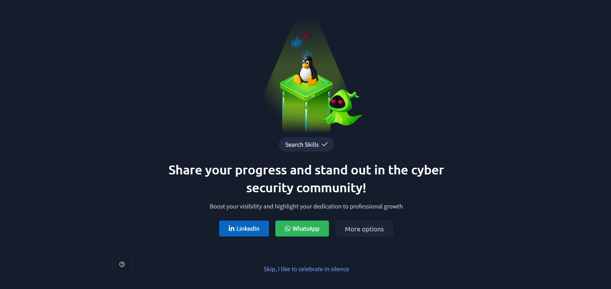

# TryHackMe – Search Skills

## Lab Completion Proof



*Screenshot showing the successful completion of the Search Skills room on TryHackMe.*

## Overview

In this room, I learned about different platforms and resources that can be used to search for cybersecurity-related information.

I explored tools and websites such as Shodan, VirusTotal, CVE databases, Linux manual pages, and GitHub. These resources help security professionals gather information about systems, investigate suspicious files or IP addresses, understand vulnerabilities, and research cybersecurity topics.

## What I Learned

### 1. Shodan

Shodan is a search engine that helps users discover internet-connected devices and services.

It collects information about devices that are connected to the internet and makes it searchable.

Security professionals can use Shodan to:

- Discover internet-connected devices.
- Identify exposed services and open ports.
- Gather information about publicly accessible systems.
- Research the exposure of systems on the internet.

Shodan can help security professionals understand what information about an organisation's systems is publicly visible.

### 2. VirusTotal

VirusTotal is an online platform used to analyse suspicious files, URLs, domains, and IP addresses.

It uses multiple security engines and other analysis tools to check whether something may be malicious.

Security professionals can use VirusTotal to:

- Check suspicious files.
- Analyse suspicious URLs and domains.
- Check IP addresses for possible malicious activity.
- Review detection results from different security engines.
- Gather information during threat investigation.

It is useful for getting additional information when investigating a suspicious file or indicator.

### 3. CVE – Common Vulnerabilities and Exposures

CVE stands for **Common Vulnerabilities and Exposures**.

It is a system used to identify and reference publicly known cybersecurity vulnerabilities.

Each CVE has a unique identifier that helps security professionals find information about a particular vulnerability.

For example:

`CVE-2026-1337`

A CVE identifier can be used to search for information about a vulnerability.

Security professionals can use CVE information to:

- Identify known vulnerabilities.
- Understand affected products and software.
- Research security weaknesses.
- Find information about vulnerabilities.
- Understand which systems may need security updates.

### 4. Product and Tool Documentation (MAN) in Linux

Linux provides manual pages, commonly known as `man` pages, that explain how commands and tools work.

The `man` command is used to open the manual page for a particular command.

**Example:**

```bash
man ls
```

This command displays the manual page for the `ls` command.

Manual pages can provide information such as:

- Command descriptions.
- Available options and arguments.
- How to use a command.
- Examples and other useful details.

Learning how to use `man` pages is helpful because they provide documentation directly within the Linux terminal.

### 5. GitHub for Cybersecurity Research

GitHub is a platform where developers and security researchers share code, tools, and projects.

It is also a useful resource for cybersecurity research.

Security researchers may publish:

- Proof-of-Concept (PoC) code.
- Security tools and scripts.
- Vulnerability analysis.
- Technical reports.
- Security-related projects.

For example, searching for a CVE identifier on GitHub can help find repositories containing PoC code, scanner scripts, or technical analysis related to that vulnerability.

However, not all information or PoC code available on GitHub is reliable or safe. It is important to review repositories and understand the code before using it.

## Practical Experience

During this room, I explored different cybersecurity research resources and learned how they can be used to gather information.

I learned about:

- **Shodan:** Searching for internet-connected devices and exposed services.
- **VirusTotal:** Checking suspicious files, URLs, domains, and IP addresses.
- **CVE:** Searching for information about known vulnerabilities using their unique identifiers.
- **Linux MAN pages:** Reading documentation and learning how to use Linux commands.
- **GitHub:** Researching cybersecurity tools, PoC code, and vulnerability information.

## SOC Analyst Relevance

These resources are useful for a SOC Analyst during security monitoring and investigation.

- **Shodan:** Helps understand publicly exposed systems and services.
- **VirusTotal:** Helps investigate suspicious files, URLs, domains, and IP addresses.
- **CVE:** Helps identify and understand known vulnerabilities that may affect an organisation.
- **Linux MAN pages:** Help SOC Analysts understand and use Linux commands during investigations.
- **GitHub:** Helps researchers and security professionals find technical information, security tools, and vulnerability research.

Knowing how to search for reliable cybersecurity information can help SOC Analysts investigate alerts and understand potential threats more effectively.

## Key Takeaways

- Shodan is a search engine for internet-connected devices and services.
- VirusTotal helps analyse suspicious files, URLs, domains, and IP addresses.
- CVE provides unique identifiers for publicly known vulnerabilities.
- Linux `man` pages provide documentation about commands and tools.
- GitHub is useful for cybersecurity research and finding security-related projects.
- Searching for CVE identifiers on GitHub can help find PoC code and vulnerability analysis.
- Security information and tools should always be reviewed before using them.

## Lab Details

- **Platform:** TryHackMe
- **Learning Path:** Cyber Security 101
- **Room:** Search Skills
- **Status:** Completed

## Disclaimer

These notes document my learning from an authorized TryHackMe lab environment and are intended for educational purposes.