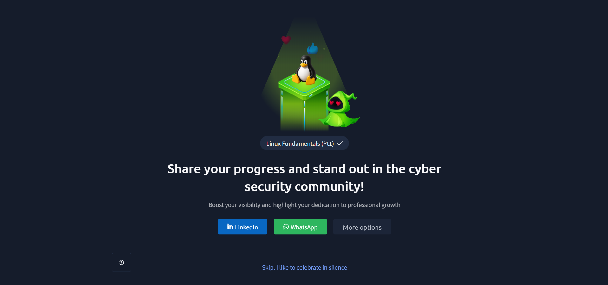

# TryHackMe – Linux Fundamentals Part 1

## Lab Completion Proof



*Screenshot showing the successful completion of the Linux Fundamentals Part 1 room on TryHackMe.*

## Overview

In this room, I learned the basics of Linux and how to work with the Linux terminal. I explored where Linux is used, how to identify the current user, and how to execute basic commands.

I also learned how to navigate through directories, view file contents, search for files and specific text, and use different Linux operators.

This room helped me understand the basic Linux commands that are useful when working with Linux systems.

## What I Learned

### 1. Introduction to Linux

Linux is an open-source operating system. It is widely used because it is flexible, reliable, and can be used for different purposes.

Linux allows users to interact with the system through a graphical user interface (GUI) or a command-line interface (CLI).

In this room, I focused on learning how to use Linux through the terminal.

### 2. Where Is Linux Used?

Linux is used in many different environments, including:

- **Servers:** Many web servers and other server systems run on Linux.
- **Cloud Computing:** Linux is widely used in cloud infrastructure.
- **Cybersecurity:** Security professionals use Linux for security testing, monitoring, and investigation.
- **Networking:** Linux is used in different networking devices and environments.
- **Embedded Systems:** Linux is used in devices such as smart TVs and other embedded systems.

### 3. Who Are You on This Machine?

When working with a Linux machine, it is important to know which user account you are currently using.

Different users may have different permissions and levels of access.

Linux provides commands that help identify the current user.

### 4. Introduction to Linux Terminal

The Linux terminal is a command-line interface (CLI) that allows users to interact with the operating system by entering commands.

Instead of using a mouse to perform every action, we can type commands to:

- Navigate through directories.
- Create and manage files.
- View file contents.
- Search for information.
- Execute programs and tools.

### 5. The `whoami` Command

The `whoami` command displays the username of the current user.

**Example:**

```bash
whoami
```

**Purpose:** It helps identify which user account is currently being used on the Linux machine.

### 6. The `echo` Command

The `echo` command is used to display text or the value of a variable in the terminal.

**Example:**

```bash
echo "Hello World"
```

**Output:**

```text
Hello World
```

It can also be used to display the value of an environment variable.

**Example:**

```bash
echo $USER
```

### 7. Introduction to Linux Navigation

Linux provides different commands to navigate through directories and view files.

#### `pwd` – Print Working Directory

The `pwd` command displays the current working directory.

```bash
pwd
```

#### `ls` – List Directory Contents

The `ls` command displays the files and directories available in the current location.

```bash
ls
```

#### `cd` – Change Directory

The `cd` command is used to move from one directory to another.

```bash
cd Documents
```

To move one directory back:

```bash
cd ..
```

#### `cat` – Display File Contents

The `cat` command is used to display the contents of a file.

```bash
cat file.txt
```

These commands help users move around the Linux file system and access files.

### 8. Introduction to Searching in Linux

Linux provides commands that help search for files and specific text.

#### `find` Command

The `find` command is used to search for files and directories.

**Example:**

```bash
find /home -name file.txt
```

This command searches for a file named `file.txt` inside the `/home` directory and its subdirectories.

#### `grep` Command

The `grep` command is used to search for specific text or patterns inside files.

**Example:**

```bash
grep "error" file.txt
```

This command searches for the word `error` inside `file.txt` and displays matching lines.

### 9. Introduction to Linux Operators

Linux provides operators that allow users to control how commands are executed and how their output is handled.

#### `&` – Run in the Background

The `&` operator is used to run a command in the background.

**Example:**

```bash
sleep 60 &
```

This starts the `sleep` command in the background instead of keeping the terminal occupied while it runs.

#### `&&` – Execute Commands Together

The `&&` operator runs the second command only if the first command completes successfully.

**Example:**

```bash
whoami && pwd
```

Here, `pwd` runs only if `whoami` executes successfully.

#### `>` – Redirect Output

The `>` operator redirects the output of a command into a file.

**Example:**

```bash
echo "Hello World" > file.txt
```

This writes the text into `file.txt`. If the file already contains information, its previous content is overwritten.

#### `>>` – Append Output

The `>>` operator adds output to the end of a file without removing its existing content.

**Example:**

```bash
echo "New Line" >> file.txt
```

This adds `New Line` at the end of `file.txt`.

## Practical Experience

During this room, I got hands-on experience using the Linux terminal in the TryHackMe environment.

I practised:

- Identifying the current user using `whoami`.
- Displaying text using `echo`.
- Navigating directories using `cd` and `pwd`.
- Listing files using `ls`.
- Viewing file contents using `cat`.
- Searching for files using `find`.
- Searching for text using `grep`.
- Using Linux operators such as `&`, `&&`, `>`, and `>>`.

## SOC Analyst Relevance

Linux knowledge is useful for a SOC Analyst because many security tools, servers, and systems use Linux.

Understanding basic Linux commands helps SOC Analysts:

- Navigate through directories and access files.
- Search for suspicious files and specific text.
- Read logs and other file contents.
- Execute commands through the terminal.
- Understand how commands can be combined and how their output can be redirected.

These basic commands provide a foundation for performing security investigations in Linux environments.

## Key Takeaways

- Linux is an open-source operating system used in servers, cloud computing, networking, and cybersecurity.
- The terminal allows users to interact with Linux using commands.
- `whoami` displays the current username.
- `echo` displays text or variable values.
- `pwd` displays the current working directory.
- `ls` lists files and directories.
- `cd` changes the current directory.
- `cat` displays file contents.
- `find` searches for files and directories.
- `grep` searches for specific text inside files.
- `&` runs a command in the background.
- `&&` executes the second command only if the first succeeds.
- `>` redirects output and overwrites existing file content.
- `>>` appends output to the end of a file.

## Lab Details

- **Platform:** TryHackMe
- **Learning Path:** Cyber Security 101
- **Room:** Linux Fundamentals Part 1
- **Status:** Completed

## Disclaimer

These notes document my learning from an authorized TryHackMe lab environment and are intended for educational purposes.