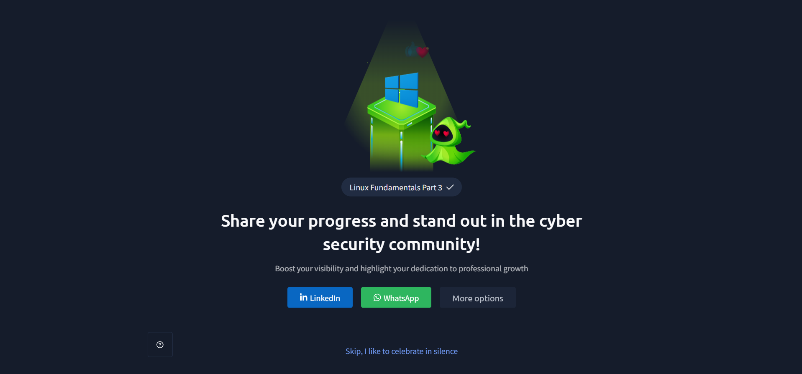

# TryHackMe – Linux Fundamentals Part 3

## Lab Completion Proof



*Screenshot showing the successful completion of the Linux Fundamentals Part 3 room on TryHackMe.*

## Overview

In this room, I continued learning about Linux and explored some more advanced concepts related to the Linux terminal and system management.

I learned about terminal text editors such as Nano and Vim, how to download and transfer files, and how to serve files using a web server.

I also explored processes and process management, task scheduling using Cron, packages and software repositories, and Linux log files.

These topics helped me understand how Linux systems work and how to manage and monitor different activities.

## What I Learned

### 1. Linux Fundamentals – Terminal Text Editors (Nano and Vim)

Terminal text editors allow users to create, edit, and modify files directly from the Linux terminal.

Two commonly used terminal text editors are Nano and Vim.

#### Introduction to Terminal Text Editors

Terminal text editors are useful when working on Linux systems, especially when accessing remote machines through SSH.

They allow users to edit configuration files, scripts, and other text files without needing a graphical interface.

#### Nano Editor

Nano is a simple and beginner-friendly terminal text editor.

To open or create a file using Nano:

```bash
nano file.txt
```

This opens the file in the Nano editor. If the file does not exist, Nano allows us to create it.

Some useful Nano shortcuts:

| Shortcut | Purpose |
|---|---|
| `CTRL + O` | Save the file |
| `CTRL + X` | Exit Nano |
| `CTRL + W` | Search for text |
| `CTRL + K` | Cut a line |
| `CTRL + U` | Paste a line |

#### Vim Editor

Vim is another terminal text editor that provides different modes for editing text.

To open a file using Vim:

```bash
vim file.txt
```

Some important Vim modes include:

- **Normal Mode:** Used for navigation and executing commands.
- **Insert Mode:** Used to insert or edit text.
- **Command Mode:** Used to execute commands such as saving and quitting.

Some useful Vim commands:

| Command | Purpose |
|---|---|
| `i` | Enter Insert Mode |
| `Esc` | Return to Normal Mode |
| `:w` | Save the file |
| `:q` | Quit Vim |
| `:wq` | Save and quit |
| `:q!` | Quit without saving changes |

### 2. Linux Fundamentals – Downloading, Transferring, and Serving Files

Linux provides different methods for downloading files, transferring files between computers, and sharing files through a web server.

#### Introduction to File Transfer

File transfer means moving or copying files from one system to another.

This is useful when working with remote Linux machines, downloading tools, or sharing files between computers.

#### Downloading Files Using Wget

`wget` is a command-line tool used to download files from the internet using a URL.

**Example:**

```bash
wget https://example.com/file.txt
```

This command downloads the specified file into the current working directory.

#### Transferring Files Using SCP (SSH)

SCP stands for **Secure Copy Protocol**. It is used to securely transfer files between local and remote computers through SSH.

**Example:**

```bash
scp file.txt username@ip_address:/home/username/
```

This command copies a local file to a remote computer.

#### Copying a File From Local Computer to Remote Computer

To copy a file from the local computer to a remote computer, use:

```bash
scp local_file.txt username@ip_address:/remote/path/
```

Here:
- `local_file.txt` is the file on the local computer.
- `username` is the remote user's account.
- `ip_address` is the remote machine's IP address.
- `/remote/path/` is the destination directory.

#### Copying a File From Remote Computer to Local Computer

To copy a file from a remote computer to the local computer, use:

```bash
scp username@ip_address:/remote/path/file.txt .
```

The dot (`.`) represents the current local directory.

#### Serving Files From Your Computer Using a Web Server

A computer can also share files with other devices by running a web server.

For example, Python provides a simple way to start a basic HTTP server.

```bash
python3 -m http.server 8000
```

This starts a web server on port `8000` and serves files from the current directory.

Other devices that can reach the server may access the shared files through a browser using the computer's IP address and port.

### 3. Processes and Process Management

#### What Are Processes?

A process is a running instance of a program or application.

Whenever we execute a command or start an application, the operating system creates a process to handle its execution.

Each process has a unique Process ID (PID), which helps the operating system identify and manage it.

#### Viewing Processes

Linux provides commands to view running processes and their information.

**`ps` command:**

```bash
ps
```

Displays information about processes running in the current terminal session.

To view processes running across the system:

```bash
ps aux
```

**`top` command:**

```bash
top
```

Displays real-time information about running processes, including CPU and memory usage.

These commands help us understand which processes are running on a Linux system.

### 4. Task Scheduling with Cron

Cron is a Linux utility used to schedule commands or scripts to run automatically at specific times or intervals.

The scheduled tasks are called Cron jobs.

For example, Cron can be used to:

- Run a script at a particular time.
- Schedule regular system tasks.
- Execute commands automatically at repeated intervals.

Cron jobs are configured using a Cron schedule.

A Cron schedule contains five time fields:

| Field | Purpose |
|---|---|
| Minute | Minute of the hour |
| Hour | Hour of the day |
| Day of Month | Day of the month |
| Month | Month of the year |
| Day of Week | Day of the week |

**Example:**

```bash
0 5 * * * /path/to/script.sh
```

This schedule runs the specified script every day at 5:00 AM.

### 5. Packages and Software Repositories

Linux uses packages to install and manage software.

A package contains the files and information required to install a particular application or tool.

Software repositories are locations where software packages are stored and made available for installation.

On Debian-based Linux systems, `apt` is commonly used to manage packages.

Some useful commands:

**Update package information:**

```bash
sudo apt update
```

**Upgrade installed packages:**

```bash
sudo apt upgrade
```

**Install a package:**

```bash
sudo apt install package_name
```

**Remove a package:**

```bash
sudo apt remove package_name
```

These commands help users install, update, and manage software on Linux systems.

### 6. Log Files

#### What Are Log Files?

Log files contain records of activities and events that happen on a system.

They help administrators and security professionals understand what is happening on a machine.

Log files can contain information about:

- System activities.
- Application events.
- User activities.
- Errors and warnings.
- Services running on the system.

Logs are important because they provide information that can be used to troubleshoot problems and investigate suspicious activities.

#### Where Are Log Files Stored in Linux?

In Linux, log files are commonly stored inside the following directory:

```bash
/var/log
```

To view the contents of this directory:

```bash
ls /var/log
```

This directory contains log files and folders related to different system services and applications.

#### What Is Log Rotation?

Log rotation is the process of managing log files over time.

As applications and services continue running, log files can become very large.

Linux systems use log rotation to manage these files by:

- Rotating old log files.
- Creating new log files.
- Compressing older logs.
- Removing old logs according to configured retention settings.

This helps prevent log files from consuming too much disk space.

#### Important Service Logs

Different services maintain their own log files.

For example, some common service logs include:

- **Apache2:** Stores information related to the Apache web server.
- **Authentication logs:** Contain information about authentication-related activities.
- **System logs:** Store general system events and activities.

These logs help administrators understand the activities and behaviour of different services.

## Practical Experience

During this room, I got hands-on experience with different Linux tools and system management commands.

I practised:

- Opening and editing files using Nano and Vim.
- Downloading files using `wget`.
- Transferring files using SCP.
- Copying files from a local computer to a remote computer.
- Copying files from a remote computer to a local computer.
- Serving files using Python's HTTP server.
- Viewing running processes using `ps` and `top`.
- Understanding task scheduling with Cron.
- Managing packages using `apt`.
- Exploring Linux log files inside `/var/log`.
- Understanding how log rotation manages log files.
- Learning about important service logs.

## SOC Analyst Relevance

These topics are useful for a SOC Analyst because Linux systems are commonly used in servers and security environments.

Understanding processes, scheduled tasks, file transfers, and log files helps during security monitoring and investigation.

- **Nano and Vim:** Help read and edit configuration files and scripts.
- **Wget and SCP:** Help understand how files are downloaded and transferred between systems.
- **Processes:** Help identify running programs and investigate unusual process activity.
- **Cron:** Helps understand scheduled tasks that may run automatically on a system.
- **Packages and repositories:** Help understand how software is installed and updated.
- **Log files:** Help investigate system activities, authentication events, application events, and possible suspicious behaviour.
- **Log rotation:** Helps understand how historical logs are managed and stored.

Log analysis is especially important for SOC Analysts because logs provide valuable information during security investigations.

## Key Takeaways

- Nano and Vim are terminal text editors used to create and edit files.
- `wget` is used to download files from the internet.
- SCP securely transfers files between local and remote systems using SSH.
- A Python HTTP server can be used to share files over a network.
- A process is a running instance of a program.
- `ps` and `top` are used to view running processes.
- Cron is used to schedule tasks automatically.
- Linux uses packages and software repositories to manage applications.
- `apt` is commonly used for package management on Debian-based systems.
- Log files record system and application activities.
- Linux log files are commonly stored in `/var/log`.
- Log rotation helps manage log file size and storage.
- Service logs help understand the activities of individual services.

## Lab Details

- **Platform:** TryHackMe
- **Learning Path:** Cyber Security 101
- **Room:** Linux Fundamentals Part 3
- **Status:** Completed

## Disclaimer

These notes document my learning from an authorized TryHackMe lab environment and are intended for educational purposes.