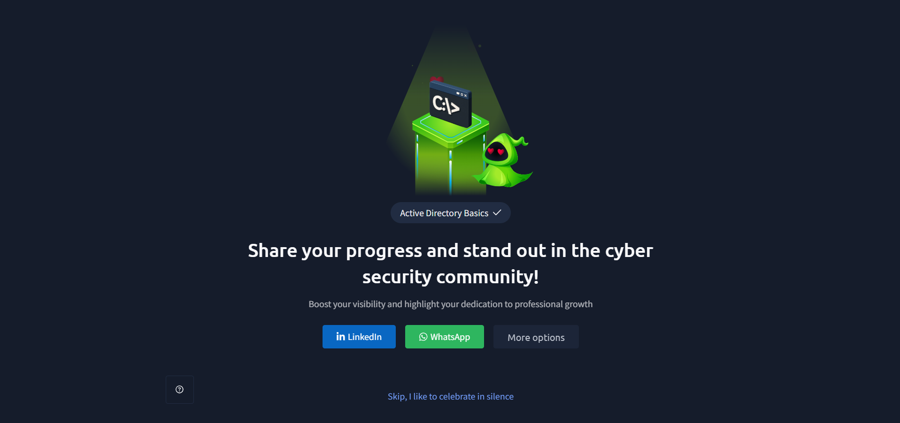

# TryHackMe – Active Directory Basics

## Lab Completion Proof

*Screenshot showing successful completion of the Active Directory Basics room on TryHackMe.*

## Overview

In this room, I learned the basics of Active Directory (AD) and how it is used to manage users, computers, and resources in a Windows domain environment.

I explored Windows domains, Active Directory, user and computer management, Group Policies, authentication models, and the relationship between trees, forests, and trusts.

## What I Learned

### 1. Introduction

Active Directory is a directory service developed by Microsoft. It is mainly used in Windows domain environments to manage users, computers, and other network resources from a central location.

It helps administrators manage access, apply security settings, and organize resources across an organization's network.

### 2. Windows Domain

A Windows domain is a group of users, computers, and other resources managed under a central administration system.

- A domain allows administrators to manage multiple computers from one place.
- Users can sign in to domain-joined computers using their domain accounts.
- Domain resources and permissions can be managed centrally.
- A **Domain Controller (DC)** is a Windows server that manages domain authentication and directory services.

Domains are useful in organizations where many users and computers need to be managed.

### 3. Active Directory

Active Directory (AD) is Microsoft's directory service used to store information about objects in a Windows domain.

Some important Active Directory components include:

- **Domain Controller:** A server that runs Active Directory Domain Services (AD DS) and handles domain authentication and management.
- **Objects:** Items stored in Active Directory, such as users, computers, and groups.
- **Organizational Units (OUs):** Containers used to organize objects into manageable groups.
- **Domain:** A logical structure that contains users, computers, and other resources.

Active Directory makes it easier for administrators to manage an organization's network.

### 4. Managing Users in Active Directory

Active Directory allows administrators to create and manage user accounts centrally.

Administrators can:

- Create new user accounts.
- Update user information.
- Reset user passwords.
- Enable or disable user accounts.
- Add users to security groups.
- Manage user permissions and access.

User accounts allow employees to access domain resources based on their assigned permissions.

### 5. Managing Computers in Active Directory

Active Directory also manages computers that are joined to a domain.

When a computer joins a domain, a computer account is created in Active Directory.

Administrators can:

- View domain-joined computers.
- Organize computer accounts into Organizational Units.
- Manage computer accounts.
- Disable or enable computer accounts.
- Apply Group Policies to computers.

This helps administrators manage and secure multiple computers across an organization.

### 6. Group Policies

Group Policy is a Windows feature used to manage and configure settings for users and computers in a domain.

Administrators use Group Policy Objects (GPOs) to apply settings centrally.

Examples include:

- Enforcing password policies.
- Controlling access to certain Windows features.
- Configuring security settings.
- Managing desktop and system settings.
- Restricting the use of certain applications.

Group Policies help maintain consistent security settings across an organization's computers and users.

### 7. Authentication Models

Authentication is the process of verifying the identity of a user or computer before allowing access to resources.

I learned about two common Windows authentication models:

- **Local Authentication:** User accounts are stored and managed on an individual computer. Authentication is handled by that computer.
- **Domain Authentication:** User accounts are managed centrally through Active Directory. A Domain Controller verifies the user's credentials.

Domain authentication makes it easier to manage user access across multiple computers in an organization.

### 8. Trees, Forests, and Trusts

Active Directory uses domains, trees, and forests to organize large network environments.

**Trees**

- A tree is a collection of one or more domains arranged in a hierarchical structure.
- Domains in a tree share a continuous DNS namespace.
- Child domains are connected to their parent domain.

**Forests**

- A forest is a collection of one or more Active Directory trees.
- Trees in a forest can have different DNS namespaces.
- Domains within a forest share a common schema and configuration.
- A forest is the highest-level logical structure in Active Directory.

**Trusts**

- Trusts allow users in one domain to access resources in another domain when the required permissions are granted.
- They establish a relationship between domains for authentication and resource access.
- Trust relationships can exist between domains within a forest and between separate forests.

These structures help organizations manage multiple domains and resources efficiently.

## Practical Experience

During this lab, I explored the basic structure and management of Active Directory.

I learned how domains and Domain Controllers work, how administrators manage users and computers, and how Group Policies help apply security settings. I also studied authentication models and how domains are organized using trees, forests, and trusts.

## SOC Analyst Relevance

Understanding Active Directory is important for a SOC Analyst because many organizations use it to manage their Windows environments.

- **Windows Domains:** Helps understand how users and computers are connected in an organization.
- **Active Directory:** Helps understand where user accounts, computer accounts, and groups are managed.
- **User Management:** Helps investigate suspicious user accounts, account changes, and unauthorized access.
- **Computer Management:** Helps identify domain computers and understand their role in the network.
- **Group Policies:** Helps understand security configurations and detect unexpected policy changes.
- **Authentication Models:** Helps investigate login activity and authentication-related attacks.
- **Trees, Forests, and Trusts:** Helps understand relationships between domains and how access can move across domain boundaries.

These concepts are useful when investigating suspicious logins, compromised accounts, privilege misuse, and other Active Directory-related security incidents.

## Key Takeaways

- Active Directory is used to centrally manage users, computers, and resources.
- A Windows domain provides centralized administration.
- A Domain Controller handles domain authentication and directory services.
- Administrators can manage user and computer accounts through Active Directory.
- Group Policies help apply security settings across a domain.
- Local and domain authentication work in different ways.
- Trees organize related domains, while forests contain one or more trees.
- Trusts allow authentication and resource access between domains when permissions are granted.

## Lab Details

- **Platform:** TryHackMe
- **Learning Path:** Cyber Security 101
- **Room:** Active Directory Basics
- **Status:** Completed

## Disclaimer

These notes document my learning from an authorized TryHackMe lab environment and are intended for educational purposes.