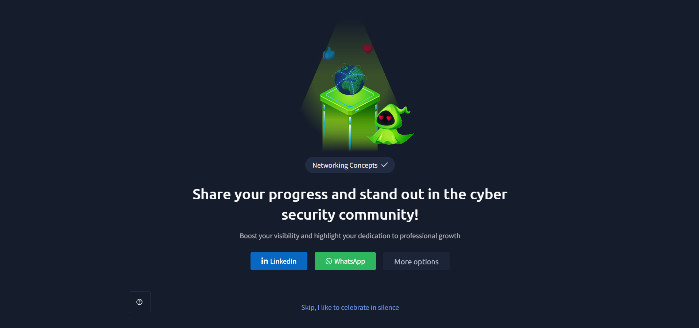

# TryHackMe – Networking Concepts

## Lab Completion Proof



*Screenshot showing successful completion of the Networking Concepts room on TryHackMe.*

## Overview

In this room, I learned the fundamentals of computer networking and how devices communicate with each other over a network.

I explored the OSI Model, TCP/IP Model, IP addresses and subnets, TCP and UDP protocols, encapsulation, and Telnet. These concepts helped me understand how data travels between devices and how different networking protocols work.

## What I Learned

### 1. OSI Model

The OSI (Open Systems Interconnection) Model is a conceptual model that explains how network communication works. It divides the communication process into seven different layers.

Each layer has a specific responsibility in sending and receiving data.

The seven layers of the OSI Model are:

| Layer | Name | Purpose |
|---|---|---|
| 7 | Application | Provides network services to applications. |
| 6 | Presentation | Handles data formatting, encryption, and compression. |
| 5 | Session | Establishes, manages, and terminates communication sessions. |
| 4 | Transport | Handles end-to-end communication and data delivery. |
| 3 | Network | Handles logical addressing and routing using IP addresses. |
| 2 | Data Link | Handles communication between devices on the same network. |
| 1 | Physical | Transmits raw bits through physical media. |

**Important points:**

- The OSI Model has seven layers.
- Each layer performs a different networking function.
- It helps understand and troubleshoot network communication.
- It provides a common framework for understanding networking protocols.

### 2. TCP/IP Model

The TCP/IP Model is a networking model used to explain how devices communicate over the internet and other networks.

Unlike the OSI Model, which has seven layers, the TCP/IP Model commonly uses four layers.

| Layer | Purpose | Examples |
|---|---|---|
| Application | Provides network services to applications. | HTTP, HTTPS, DNS, FTP |
| Transport | Handles communication between devices and applications. | TCP, UDP |
| Internet | Handles IP addressing and routing. | IPv4, IPv6, ICMP |
| Network Access | Handles communication over the local network and physical transmission. | Ethernet, Wi-Fi |

**Important points:**

- The TCP/IP Model has four layers.
- It is the foundation of communication over the internet.
- It explains how data moves between applications and network devices.
- It combines some responsibilities that are separated in the OSI Model.

### 3. IP Addresses and Subnets

An IP (Internet Protocol) address is a unique logical address assigned to a device on a network. It helps identify devices and allows data to reach the correct destination.

There are two main versions of IP addresses:

**IPv4**

- Uses a 32-bit address.
- Written in four decimal numbers separated by dots.
- Each number ranges from 0 to 255.

Example:

```text
192.168.1.10
```

**IPv6**

- Uses a 128-bit address.
- Written using hexadecimal values separated by colons.
- Provides a much larger address space than IPv4.

Example:

```text
2001:db8::1
```

**Public and Private IP Addresses**

- **Public IP:** Used to identify a network or device on the internet.
- **Private IP:** Used for communication within private networks, such as home or office networks.

**Subnets**

Subnetting is the process of dividing a larger network into smaller networks called subnets.

A subnet helps organize network devices and manage IP addresses efficiently.

A subnet mask is used to identify which part of an IP address represents the network and which part represents the host.

Example:

```text
IP Address:  192.168.1.10
Subnet Mask: 255.255.255.0
CIDR:        /24
```

In this example, `/24` means that the first 24 bits represent the network portion of the address.

### 4. UDP and TCP

TCP and UDP are two important transport layer protocols used for communication between applications running on networked devices.

**TCP (Transmission Control Protocol)**

TCP is a connection-oriented protocol that provides reliable data delivery.

Its main features include:

- Establishes a connection before sending data.
- Ensures data is delivered reliably.
- Maintains the correct order of data.
- Retransmits lost data.
- Uses acknowledgements to confirm successful delivery.

TCP is commonly used by applications where reliable data delivery is important.

Examples:
- HTTP and HTTPS
- SSH
- FTP

**UDP (User Datagram Protocol)**

UDP is a connectionless protocol that sends data without establishing a connection first.

Its main features include:

- Does not establish a connection before sending data.
- Has lower overhead than TCP.
- Does not guarantee delivery.
- Does not guarantee that data arrives in the correct order.
- Does not retransmit lost packets automatically.

UDP is commonly used where speed and low latency are important.

Examples:
- DNS
- DHCP
- Online gaming
- Voice and video streaming

**Difference Between TCP and UDP**

| TCP | UDP |
|---|---|
| Connection-oriented | Connectionless |
| Reliable data delivery | No delivery guarantee |
| Uses acknowledgements | Does not use acknowledgements |
| Maintains data order | Does not guarantee data order |
| Higher overhead | Lower overhead |
| Used when reliability is important | Used when speed and low latency are important |

### 5. Encapsulation

Encapsulation is the process of adding protocol-related information to data as it moves down the networking layers before being transmitted over a network.

Each layer adds its own header, and sometimes a trailer, to the data.

The general process is:

1. **Application Layer:** Creates the data that needs to be transmitted.
2. **Transport Layer:** Adds a TCP or UDP header. The data becomes a segment (TCP) or datagram (UDP).
3. **Internet Layer:** Adds an IP header. The result is called a packet.
4. **Network Access Layer:** Adds the necessary frame information. The result is called a frame.
5. **Physical Transmission:** The frame is transmitted as bits over the network medium.

When data reaches the destination, the receiving device performs the reverse process, called decapsulation. Each layer removes and processes its corresponding information.

**Data Units:**

| Layer | Data Unit |
|---|---|
| Application | Data |
| Transport | Segment (TCP) / Datagram (UDP) |
| Internet | Packet |
| Network Access | Frame |
| Physical | Bits |

Encapsulation helps different networking layers work together to deliver data to the correct destination.

### 6. Telnet

Telnet is a network protocol used to establish a remote command-line connection to another device over a network.

It commonly uses TCP port `23`.

Telnet allows users to interact with a remote system through a terminal.

**Important points:**

- Telnet is used for remote access.
- It uses TCP for communication.
- It sends data, including usernames and passwords, in plain text.
- It does not provide encryption.
- It is considered insecure for remote administration.

**Example:**

```bash
telnet MACHINE_IP 23
```

Here:
- `telnet` starts the Telnet client.
- `MACHINE_IP` represents the target machine's IP address.
- `23` is the default Telnet port.

**Security Importance:**

Because Telnet does not encrypt communication, attackers who can capture network traffic may be able to read the transmitted information.

For secure remote administration, SSH is generally preferred because it encrypts communication.

## Practical Experience

During this lab, I explored the basic concepts of computer networking and learned how different networking models and protocols work.

I studied the seven layers of the OSI Model and the four layers of the TCP/IP Model. I also learned about IPv4, IPv6, subnetting, and the differences between TCP and UDP.

Finally, I understood how encapsulation works when data travels through network layers and explored how Telnet provides remote access to another system.

## SOC Analyst Relevance

Networking knowledge is important for a SOC Analyst because security monitoring involves analysing network traffic, connections, and communication between devices.

- **OSI Model:** Helps understand different layers where network-related attacks can occur.
- **TCP/IP Model:** Helps understand how network communication works in real-world environments.
- **IP Addresses and Subnets:** Helps identify source and destination IP addresses and understand network ranges.
- **TCP and UDP:** Helps analyse network traffic and identify which transport protocols are being used.
- **Encapsulation:** Helps understand how network packets and frames are structured during communication.
- **Telnet:** Helps identify insecure remote access protocols and understand the risks of unencrypted communication.

These concepts are useful when analysing network logs, investigating suspicious connections, monitoring traffic, and understanding network-based attacks.

## Key Takeaways

- The OSI Model explains network communication using seven layers.
- The TCP/IP Model uses four layers to explain internet communication.
- IP addresses help identify devices on a network.
- Subnetting divides a larger network into smaller networks.
- TCP provides reliable and ordered data delivery.
- UDP provides connectionless communication with lower overhead.
- Encapsulation adds protocol information as data moves through network layers.
- Decapsulation happens when the receiving device processes the data.
- Telnet provides remote access but does not encrypt communication.
- SSH is a more secure alternative for remote administration.

## Lab Details

- **Platform:** TryHackMe
- **Learning Path:** Cyber Security 101
- **Room:** Networking Concepts
- **Status:** Completed

## Disclaimer

These notes document my learning from an authorized TryHackMe lab environment and are intended for educational purposes.