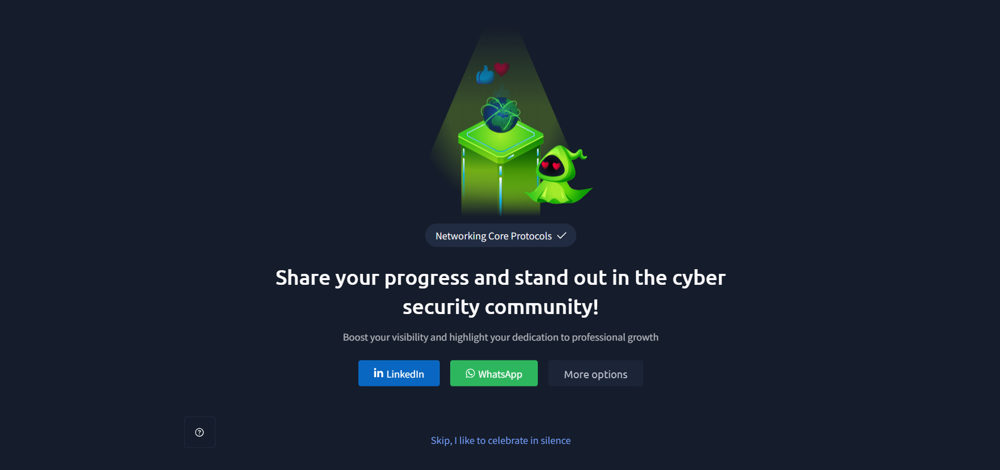

# TryHackMe – Networking Core Protocols

## Lab Completion Proof



*Screenshot showing successful completion of the Networking Core Protocols room.*

## Overview

In this room, I learned about important networking protocols used for different types of communication over the internet.

I explored how DNS translates domain names into IP addresses, how WHOIS provides information about domain registrations, how web browsers communicate with web servers, and how email and file transfer protocols work.

I also learned the differences between HTTP and HTTPS, FTP, SMTP, POP3, and IMAP.

## What I Learned

### 1. DNS (Domain Name System)

DNS is a system that translates human-readable domain names into IP addresses.

For example, when we enter `google.com` in a web browser, the computer uses DNS to find the IP address of the server hosting that website.

Without DNS, we would need to remember the IP addresses of websites instead of their domain names.

**How DNS works:**

1. A user enters a domain name in a browser.
2. The computer checks its local DNS cache.
3. If the record is not available, it sends a query to a DNS resolver.
4. The resolver finds the required DNS record.
5. The IP address is returned to the client.
6. The browser uses that IP address to connect to the website.

**Common DNS record types:**

| Record | Purpose |
|---|---|
| A | Maps a domain name to an IPv4 address. |
| AAAA | Maps a domain name to an IPv6 address. |
| CNAME | Creates an alias for another domain name. |
| MX | Identifies mail servers for a domain. |
| NS | Identifies authoritative name servers. |
| TXT | Stores text information, often used for domain verification and email security. |

**Important point:**

DNS commonly uses UDP port 53 for queries, but it can also use TCP port 53, such as for zone transfers and certain larger responses.

### 2. WHOIS

WHOIS is a protocol and lookup service used to find information about registered domain names and IP address resources.

It helps users investigate who registered a domain and obtain publicly available registration details.

**WHOIS can provide information such as:**

- Domain registrar
- Domain registration date
- Domain expiration date
- Name servers
- Domain status
- Registrant information, when publicly available

**Example:**

```bash
whois example.com
```

This command performs a WHOIS lookup for the domain `example.com`.

**Why WHOIS is useful:**

- Helps investigate suspicious domains.
- Provides information about domain registration.
- Helps identify domain registrars and name servers.
- Supports cybersecurity research and threat intelligence.

WHOIS commonly uses TCP port 43. Some registration information may be hidden or protected by privacy services.

### 3. HTTP and HTTPS

HTTP stands for Hypertext Transfer Protocol. It is used for communication between web browsers and web servers.

When we open a website, the browser sends HTTP requests to the web server, and the server responds with the requested information.

#### HTTP

HTTP is used to transfer web content such as HTML pages, images, and other resources.

**Common HTTP methods:**

| Method | Purpose |
|---|---|
| GET | Retrieves data from a server. |
| POST | Sends data to a server. |
| PUT | Creates or replaces a resource. |
| DELETE | Deletes a resource. |

HTTP commonly uses TCP port 80.

#### HTTPS

HTTPS stands for Hypertext Transfer Protocol Secure.

It is the secure version of HTTP. HTTPS uses TLS to encrypt communication between the browser and the web server.

**Why HTTPS is important:**

- Protects data during transmission.
- Helps prevent attackers from reading or modifying communication.
- Provides authentication of the server through digital certificates.

HTTPS commonly uses TCP port 443.

**Main difference:**

| HTTP | HTTPS |
|---|---|
| Communication is not encrypted by HTTP itself. | Communication is protected using TLS. |
| Commonly uses port 80. | Commonly uses port 443. |
| Less secure for sensitive information. | Provides confidentiality and integrity protections. |

### 4. FTP (File Transfer Protocol)

FTP is a protocol used to transfer files between a client and a server over a network.

It allows users to upload, download, and manage files on a remote server.

**Common FTP operations:**

- Uploading files to a server.
- Downloading files from a server.
- Listing files and directories.
- Renaming and deleting files.

FTP commonly uses:

- **TCP port 21:** Control connection.
- **TCP port 20:** Traditional active-mode data connection. In passive mode, the server uses a negotiated port for data transfer.

**Important security point:**

Traditional FTP does not encrypt usernames, passwords, or file contents. This means attackers may be able to capture sensitive information if the traffic is intercepted.

Secure alternatives include SFTP and FTPS.

### 5. SMTP (Simple Mail Transfer Protocol)

SMTP is a protocol used to send emails from email clients to mail servers and between mail servers.

When we send an email, SMTP helps transfer the message towards the recipient's mail server.

**How SMTP works:**

1. A user writes and sends an email.
2. The email client submits the message to an SMTP server.
3. The sending mail server identifies the recipient's mail server using DNS MX records.
4. The message is transferred to the recipient's mail server.
5. The recipient retrieves the email using POP3 or IMAP.

**Common SMTP ports:**

| Port | Purpose |
|---|---|
| 25 | Server-to-server email transfer. |
| 587 | Email submission, commonly with STARTTLS. |
| 465 | Email submission using implicit TLS. |

**Important point:**

SMTP is mainly used for sending emails, not retrieving them.

### 6. POP3 (Post Office Protocol Version 3)

POP3 is an email protocol used to retrieve emails from a mail server to a local device.

It is commonly used when users want to download their emails and access them through an email client.

**How POP3 works:**

1. The email client connects to the mail server.
2. The user authenticates with their credentials.
3. The client downloads available emails.
4. Depending on the client settings, downloaded messages may be deleted from the server or kept there.

**Common POP3 ports:**

- **TCP port 110:** Standard POP3.
- **TCP port 995:** POP3 over implicit TLS.

**Important points:**

- POP3 is mainly used for receiving emails.
- It is suitable for simple email access, especially from one device.
- It does not provide the same synchronization features as IMAP.

### 7. IMAP (Internet Message Access Protocol)

IMAP is an email protocol that allows users to access and synchronize their emails directly with a mail server.

Unlike the traditional POP3 download-and-delete approach, IMAP keeps messages on the server and synchronizes changes across multiple devices.

For example, if we read, move, or delete an email on our desktop, the changes can also appear on our smartphone.

**Common IMAP ports:**

- **TCP port 143:** Standard IMAP.
- **TCP port 993:** IMAP over implicit TLS.

**Important features:**

- Synchronizes emails across multiple devices.
- Keeps messages stored on the mail server.
- Synchronizes read, unread, moved, and deleted email status.
- Allows users to manage folders on the server.

**POP3 vs IMAP:**

| POP3 | IMAP |
|---|---|
| Mainly downloads emails to a device. | Keeps emails on the server and synchronizes them. |
| Better suited to simple access from one device. | Useful when accessing emails from multiple devices. |
| Changes may not synchronize across devices. | Synchronizes email changes across devices. |

## Practical Experience

During this room, I learned how different networking protocols support everyday internet services.

I understood how DNS resolves domain names, how WHOIS helps investigate domain registration details, and how HTTP and HTTPS allow browsers to communicate with web servers.

I also learned how FTP transfers files and how SMTP, POP3, and IMAP work together to support email communication.

## SOC Analyst Relevance

Understanding these protocols is important for a SOC Analyst because they are commonly involved in network traffic and security investigations.

- **DNS:** Helps investigate suspicious domain lookups, malicious domains, and possible DNS tunnelling.
- **WHOIS:** Helps gather domain registration information during threat intelligence investigations.
- **HTTP and HTTPS:** Helps investigate suspicious web requests, downloads, and communication with malicious websites.
- **FTP:** Helps identify insecure file transfers and suspicious file uploads or downloads.
- **SMTP:** Helps investigate phishing emails, spam, and suspicious email delivery.
- **POP3:** Helps understand email retrieval traffic and identify unusual email access.
- **IMAP:** Helps investigate email synchronization and suspicious mailbox access.

## Key Takeaways

- DNS translates domain names into IP addresses.
- WHOIS provides domain registration information.
- HTTP is used for web communication, while HTTPS protects communication using TLS.
- FTP is used to transfer files between clients and servers.
- SMTP is used to send emails.
- POP3 retrieves emails, commonly by downloading them to a local device.
- IMAP synchronizes emails across multiple devices.
- Understanding protocol ports and their purpose helps in network monitoring and security investigations.

## Lab Details

- **Platform:** TryHackMe
- **Learning Path:** Cyber Security 101
- **Room:** Networking Core Protocols
- **Status:** Completed

## Disclaimer

These notes document my learning from an authorized TryHackMe lab environment and are intended for educational purposes.