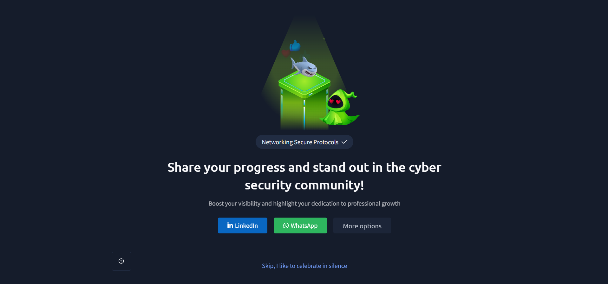

# TryHackMe – Networking Secure Protocols

## Lab Completion Proof



*Screenshot showing successful completion of the Networking Secure Protocols room.*

## Overview

In this room, I learned about secure networking protocols that help protect communication between devices, web browsers, servers, and networks.

I explored how TLS and SSL provide encryption, how HTTPS secures web communication, and how secure versions of email and file transfer protocols protect data.

I also learned about SSH for secure remote access and VPNs for creating secure connections over public networks.

## What I Learned

### 1. TLS and SSL (Transport Layer Security and Secure Sockets Layer)

TLS and SSL are cryptographic protocols used to protect data transmitted over a network.

They help provide:

- **Confidentiality:** Encrypts data so unauthorized people cannot easily read it.
- **Integrity:** Helps detect whether data has been modified during transmission.
- **Authentication:** Helps verify the identity of the communicating server using digital certificates.

**SSL vs TLS:**

- SSL is an older security protocol.
- TLS is the modern successor to SSL.
- SSL versions are outdated and insecure.
- Modern secure connections should use TLS.

**How TLS works:**

1. The client connects to a server and starts a TLS handshake.
2. The client and server negotiate the security settings.
3. The server presents its digital certificate.
4. The client verifies the certificate.
5. Both sides establish shared session keys.
6. Encrypted communication begins.

**Important point:**

TLS protects data while it travels between communicating systems. It does not automatically protect data stored on the devices or servers.

### 2. HTTPS (Hypertext Transfer Protocol Secure)

HTTPS is the secure version of HTTP. It uses TLS to protect communication between a web browser and a web server.

When we visit a website using HTTPS, the communication is encrypted, making it harder for attackers to read or modify the exchanged data.

**Benefits of HTTPS:**

- Encrypts communication between the browser and server.
- Protects sensitive information such as login credentials.
- Helps maintain data integrity.
- Authenticates the server using digital certificates.

**Common port:**

- TCP port 443

**HTTP vs HTTPS:**

| HTTP | HTTPS |
|---|---|
| Does not provide encryption by itself. | Uses TLS to protect communication. |
| Commonly uses port 80. | Commonly uses port 443. |
| Data can be exposed if intercepted. | Data is encrypted during transmission. |

### 3. SMTPS, POP3S and IMAPS

Email communication uses protocols such as SMTP, POP3, and IMAP. Their secure versions use TLS to protect email communication.

#### SMTPS (Secure SMTP)

SMTPS is used to send emails securely by protecting communication between an email client and a mail server.

- Commonly uses TCP port 465 for implicit TLS.
- TCP port 587 is also commonly used for email submission with STARTTLS.

#### POP3S (Secure POP3)

POP3S is the secure version of POP3. It allows users to retrieve emails from a mail server through an encrypted connection.

- Commonly uses TCP port 995.
- Uses TLS to protect email retrieval.

#### IMAPS (Secure IMAP)

IMAPS is the secure version of IMAP. It allows users to access and synchronize emails with a mail server over an encrypted connection.

- Commonly uses TCP port 993.
- Uses TLS to protect email communication.

**Comparison:**

| Protocol | Purpose | Common secure port |
|---|---|---|
| SMTPS | Secure email sending | 465 |
| POP3S | Secure email retrieval | 995 |
| IMAPS | Secure email access and synchronization | 993 |

**Important point:**

These secure protocols help protect email credentials and message data while they are being transmitted.

### 4. SSH (Secure Shell)

SSH is a network protocol used to securely access and manage remote computers over an unsecured network.

It provides encrypted communication between a client and a remote server.

**Uses of SSH:**

- Secure remote login.
- Managing Linux servers.
- Executing commands on remote systems.
- Transferring files securely.
- Managing network devices.

**Example:**

```bash
ssh username@192.168.1.10
```

This command attempts to connect to a remote machine using the specified username and IP address.

**Common port:**

- TCP port 22

**Important security features:**

- Encrypts communication.
- Supports password authentication.
- Supports public-key authentication.
- Helps protect login credentials and commands from being exposed during transmission.

### 5. SFTP and FTPS

SFTP and FTPS are secure protocols used for transferring files over a network.

Although their names are similar, they work differently.

#### SFTP (SSH File Transfer Protocol)

SFTP is a secure file transfer protocol that operates over SSH.

It provides encrypted communication for transferring and managing files between a client and a server.

**Features:**

- Secure file uploads and downloads.
- Encrypted file transfer.
- Remote file management.
- Uses SSH for secure communication.

**Common port:**

- TCP port 22 by default.

#### FTPS (FTP Secure)

FTPS is an extension of FTP that uses TLS to secure file transfers and authentication.

It protects communication between an FTP client and server using encryption.

**Features:**

- Encrypts file transfer communication.
- Protects login credentials.
- Supports secure file uploads and downloads.

**Common ports:**

- TCP port 21 for explicit FTPS control connections.
- TCP port 990 for implicit FTPS control connections.

**SFTP vs FTPS:**

| SFTP | FTPS |
|---|---|
| Works over SSH. | Uses TLS to secure FTP. |
| Commonly uses TCP port 22. | Commonly uses TCP port 21 or 990. |
| Does not require the FTP protocol. | Is based on the FTP protocol. |

### 6. VPN (Virtual Private Network)

A VPN creates a secure connection over an existing network, such as the internet.

It allows users or organizations to connect to private networks securely, even when they are located in different geographical locations.

For example, an employee working from home can use a VPN to securely access company resources.

**How VPN works:**

1. The user connects to a VPN server or gateway.
2. The VPN establishes a secure connection.
3. Network traffic is protected through encryption.
4. The user can access permitted resources through the VPN connection.

**Types of VPN:**

- **Remote Access VPN:** Allows individual users to connect securely to an organization's private network.
- **Site-to-Site VPN:** Connects two or more networks, such as offices in different geographical locations.

**Benefits of VPN:**

- Protects data during transmission.
- Provides secure remote access.
- Connects geographically separated networks.
- Helps protect communication over public networks.

**Common VPN technologies and protocols:**

- IPsec
- OpenVPN
- WireGuard
- IKEv2

**Important point:**

A VPN protects traffic between the VPN endpoints, but it does not guarantee complete security or make a user anonymous in every situation.

## Practical Experience

During this room, I learned how secure protocols protect communication over networks.

I understood how TLS provides encryption, how HTTPS protects web traffic, and how SMTPS, POP3S, and IMAPS secure email communication.

I also learned how SSH provides secure remote access, how SFTP and FTPS protect file transfers, and how VPNs create secure connections over public networks.

## SOC Analyst Relevance

Understanding secure networking protocols is important for a SOC Analyst because these protocols are commonly seen in network traffic, security logs, and incident investigations.

- **TLS and SSL:** Helps understand encrypted network traffic and identify outdated or insecure protocol usage.
- **HTTPS:** Helps investigate suspicious web connections and communication with potentially malicious websites.
- **SMTPS, POP3S and IMAPS:** Helps analyze secure email communication and investigate suspicious email access.
- **SSH:** Helps monitor remote access activity and investigate unauthorized login attempts.
- **SFTP and FTPS:** Helps investigate suspicious file transfers and identify possible data exfiltration.
- **VPN:** Helps investigate remote access connections, unusual login locations, and suspicious VPN activity.

## Key Takeaways

- TLS is the modern protocol used to secure network communication; SSL is outdated.
- HTTPS uses TLS to protect communication between browsers and web servers.
- SMTPS, POP3S, and IMAPS provide secure email communication.
- SSH provides encrypted remote access to systems.
- SFTP uses SSH, while FTPS uses TLS to secure file transfers.
- VPNs create secure connections over public networks.
- Understanding secure protocols and their ports helps in network monitoring and SOC investigations.

## Lab Details

- **Platform:** TryHackMe
- **Learning Path:** Cyber Security 101
- **Room:** Networking Secure Protocols
- **Status:** Completed

## Disclaimer

These notes document my learning from an authorized TryHackMe lab environment and are intended for educational purposes.