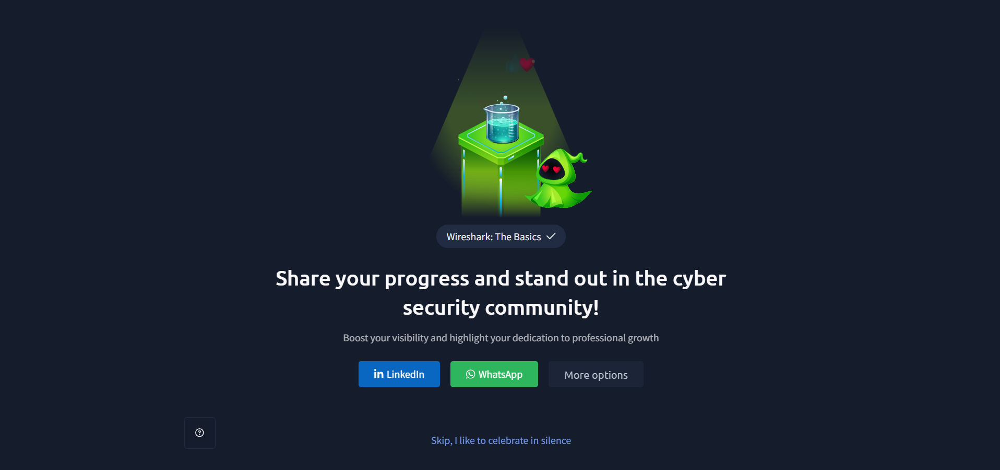

# TryHackMe – Wireshark: The Basics

## Lab Completion Proof



*Screenshot showing successful completion of the Wireshark: The Basics room.*

## Overview

In this room, I learned the fundamentals of Wireshark, a popular network protocol analyzer used to capture and inspect network traffic.

I explored the Wireshark interface, learned how to capture and analyze packets, and understood how packet information is organized across different OSI layers.

I also practiced navigating, searching, marking, exporting, and filtering packets. During the hands-on activities, I analyzed two PCAP files and retrieved information from them to complete the room.

## What I Learned

### 1. Wireshark Fundamentals – Introduction, GUI, Packet Analysis and Traffic Capture

Wireshark is an open-source network protocol analyzer that allows us to capture and inspect network traffic.

It helps us understand what is happening inside a network by examining individual packets and their details.

**Important Wireshark interface components:**

#### Toolbar

The toolbar provides quick access to commonly used features, such as opening files, saving captures, starting and stopping packet capture, and navigating packets.

#### Display Filter Bar

The display filter bar allows us to filter captured packets and show only the traffic we are interested in.

For example:

```text
http
```

This displays packets related to HTTP traffic.

#### Recent Files

This section helps us quickly access previously opened capture files.

#### Capture Filter and Interface

Before starting a capture, we can select a network interface such as Wi-Fi or Ethernet.

Capture filters can be used to limit which packets are collected.

For example:

```text
port 80
```

This captures traffic using port 80.

**Important difference:**

- Capture filters control which packets are collected.
- Display filters control which already captured packets are shown.

#### Status Bar

The status bar displays useful information about the current capture file, including packet counts and the number of displayed packets.

#### Packet List Panel

This panel displays captured packets in rows.

It provides information such as:

- Packet number
- Time
- Source
- Destination
- Protocol
- Length
- Info

#### Packet Detail Panel

This panel displays detailed information about the selected packet.

It organizes packet information into expandable sections, making it easier to understand different protocol layers.

#### Packet Bytes Panel

This panel displays the raw packet data in hexadecimal and ASCII formats.

It helps analysts inspect the actual bytes contained in a packet.

#### Packet Colouring

Wireshark uses different colours to make packet types and traffic patterns easier to identify.

Colouring rules help analysts quickly recognize different protocols and unusual traffic.

#### Traffic Sniffing

Traffic sniffing means capturing and inspecting network packets as they travel across a network.

Wireshark can help us examine communication between devices and investigate network activity.

#### Merge PCAP

Wireshark allows us to combine multiple capture files into a single capture file.

This is useful when analyzing traffic collected from different sources or time periods.

#### Capture File Properties

Capture file properties provide information about a PCAP file, such as:

- Capture file name and format
- Capture time information
- Packet statistics
- File details

### 2. Wireshark Fundamentals – Packet Dissection and Packet Details

Packet dissection means breaking down a captured packet into different protocol layers so that we can understand its structure and contents.

Wireshark organizes packet details based on the protocols and layers involved in communication.

**Important packet sections:**

| Packet information | Related OSI layer | Description |
|---|---|---|
| Frame | Layer 1 – Physical | Contains information about the captured frame, such as its length and arrival time. |
| Source MAC | Layer 2 – Data Link | Identifies the source network interface. |
| Source IP | Layer 3 – Network | Identifies the source IP address. |
| Protocol | Depends on the protocol | Shows the protocol identified in the packet, such as TCP or UDP. |
| Protocol Errors | Depends on the protocol | Shows errors or unusual conditions detected during dissection. |
| Application Protocol | Layer 7 – Application | Identifies application protocols such as HTTP, DNS, or FTP. |
| Application Data | Layer 7 – Application | Contains application-level data carried by the packet. |

**Important point:**

Wireshark displays packet information according to the protocols it identifies. A packet can contain information from multiple OSI layers.

For example, when analyzing an HTTP packet, we may see Ethernet, IP, TCP, and HTTP details.

### 3. Wireshark Fundamentals – Packet Navigation, Searching, Marking, Exporting and Expert Info

Wireshark provides several features that help analysts navigate and investigate large packet captures.

#### Packet Number

Every packet in a capture is assigned a packet number.

This helps us identify and refer to a particular packet during analysis.

#### Go to Packet

The Go to Packet feature allows us to jump directly to a specific packet number.

This is useful when working with large PCAP files.

#### Find Packet

The Find Packet feature helps search for specific information inside a capture.

We can search using strings, hexadecimal values, or packet-related details depending on the selected search options.

#### Mark Packet

Marking a packet helps us highlight important packets during an investigation.

Marked packets are easier to identify when reviewing the capture again.

#### Packet Comments

Packet comments allow us to add notes to individual packets.

This is useful for documenting observations and explaining why a particular packet is important.

#### Export Packet

Wireshark allows us to export selected packets or packet data for further analysis.

This can help when we need to share or investigate specific traffic separately.

#### Export Objects

The Export Objects feature allows us to extract supported application objects from captured traffic.

For example, if a PCAP contains HTTP file transfers, we may be able to extract transferred files from the capture.

#### Time Display Format

Wireshark allows us to change how packet timestamps are displayed.

Different time formats can help us understand when packets were captured and analyze the sequence of network events.

#### Expert Info

Expert Information provides warnings, notes, and errors detected by Wireshark during packet analysis.

It can help identify issues such as:

- Retransmissions
- Duplicate acknowledgements
- Connection resets
- Malformed packets
- Other unusual network conditions

**Important point:**

Expert Info is useful during troubleshooting and security investigations, but every warning does not necessarily indicate a security attack.

### 4. Wireshark Fundamentals – Packet Filtering

Packet filtering helps analysts focus on specific network traffic instead of examining every packet in a capture.

Wireshark provides different filtering and conversation features to make packet analysis easier.

#### Apply as Filter

This feature allows us to select a packet field or value and quickly create a display filter based on it.

For example, selecting a source IP address and applying it as a filter helps display traffic matching that address.

#### Conversation Filter

A conversation filter displays packets belonging to a particular communication between network endpoints.

It is useful for examining communication between two devices.

#### Colourise Conversation

This feature applies colours to packets belonging to a selected conversation.

It helps distinguish traffic flows when multiple conversations are present in a capture.

#### Prepare as Filter

This feature prepares a filter using the selected packet field or value without immediately applying it.

We can then modify the filter before using it.

#### Apply as Column

This feature adds a selected packet field as a column in the Packet List panel.

For example, we can add a useful field such as TCP port or IP address to make packet information easier to compare.

#### Follow Stream

Follow Stream helps reconstruct the data exchanged during a communication session.

Depending on the protocol, Wireshark can display the conversation between endpoints in a readable format.

For example, Follow TCP Stream can show the TCP conversation between a client and server.

#### Display Filter Bar

The display filter bar allows us to write filters manually and narrow down the packets displayed in Wireshark.

**Some useful display filter examples:**

| Filter | Purpose |
|---|---|
| `ip.addr == 192.168.1.10` | Shows packets involving the specified IP address. |
| `ip.src == 192.168.1.10` | Shows packets from the specified source IP. |
| `ip.dst == 192.168.1.10` | Shows packets going to the specified destination IP. |
| `tcp` | Shows TCP packets. |
| `udp` | Shows UDP packets. |
| `dns` | Shows DNS traffic. |
| `http` | Shows HTTP traffic. |
| `icmp` | Shows ICMP traffic. |
| `tcp.port == 80` | Shows TCP packets using port 80. |

**Important point:**

Capture filters and display filters use different syntax. For example, `port 80` is a capture filter, while `tcp.port == 80` is a display filter.

## Practical Experience

During this room, I got hands-on experience with Wireshark and practiced the different features used in packet analysis.

I worked with two PCAP files provided in the lab and analyzed the captured network traffic to retrieve the required information.

My practical activities included:

- Exploring the Wireshark graphical interface.
- Understanding packet list, packet details, and packet bytes.
- Inspecting packet information across different protocol layers.
- Navigating and searching for specific packets.
- Marking packets and adding packet comments.
- Exporting packets and supported objects.
- Using Expert Info to inspect packet-related warnings and errors.
- Applying display filters to identify specific traffic.
- Following network streams to understand communication between endpoints.
- Using conversation filters and packet colouring to make traffic analysis easier.

By completing these activities, I gained practical experience in examining network traffic and extracting useful information from PCAP files.

## SOC Analyst Relevance

Wireshark is an important tool for SOC Analysts because it helps investigate network activity and understand suspicious communication.

- **Traffic Capture:** Helps collect network packets for investigation.
- **Packet Analysis:** Helps understand communication between systems.
- **Protocol Analysis:** Helps identify protocols used by devices and applications.
- **Display Filters:** Helps narrow down traffic and investigate specific IP addresses, ports, and protocols.
- **Follow Stream:** Helps reconstruct communication between network endpoints.
- **Export Objects:** Helps extract files transferred through supported protocols for further investigation.
- **Expert Info:** Helps identify network errors and unusual packet behaviour.
- **PCAP Analysis:** Helps investigate suspicious connections, possible data transfers, and network-based attacks.

## Key Takeaways

- Wireshark is a network protocol analyzer used to capture and inspect network traffic.
- The GUI contains different panels that help us understand packet information.
- Packet dissection helps us examine data across different protocol layers.
- Packet navigation and search features make investigations easier.
- Marking, commenting, and exporting help document important findings.
- Expert Info helps identify network-related warnings and errors.
- Capture filters control which packets are collected, while display filters control which captured packets are displayed.
- Follow Stream helps reconstruct communication between network endpoints.
- Analyzing PCAP files is an important practical skill for SOC Analysts.

## Lab Details

- **Platform:** TryHackMe
- **Learning Path:** Cyber Security 101
- **Room:** Wireshark: The Basics
- **Status:** Completed

## Disclaimer

These notes document my learning from an authorized TryHackMe lab environment and are intended for educational purposes.