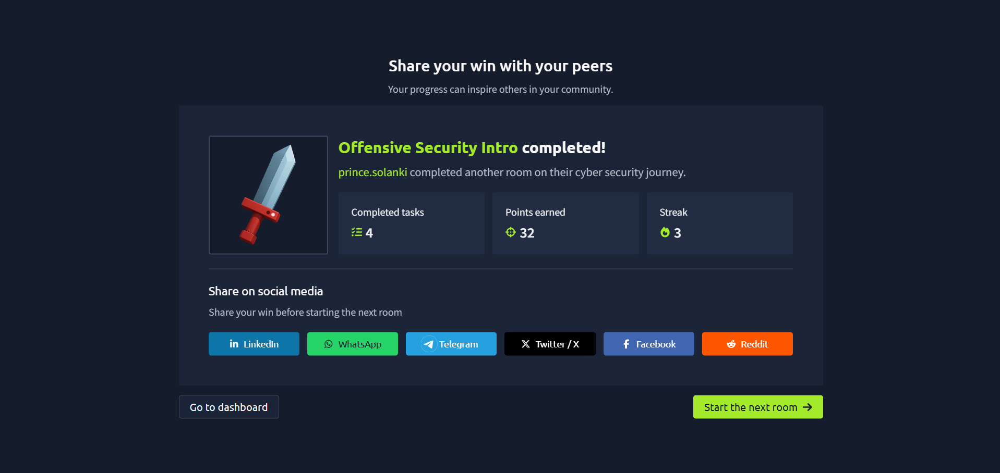

# TryHackMe – Offensive Security Intro

## Lab Completion Proof

*Screenshot showing completion of the Offensive Security Intro room on TryHackMe.*

## Overview

I completed the **Offensive Security Intro** room in the Pre Security learning path on TryHackMe.

This room introduced me to the basics of offensive security and how security professionals use practical testing to identify weaknesses in systems.

## What I Learned

- Understood the basic concept of offensive security.
- Learned why security professionals test systems for weaknesses.
- Gained introductory practical experience with offensive security concepts.
- Understood the importance of identifying security weaknesses to help improve defenses.

## Practical Experience

I worked through the exercises provided in the TryHackMe lab and explored the basic concepts of offensive security.

## SOC Analyst Relevance

Understanding offensive security helps me learn how attacks may happen and why systems need to be protected. This knowledge provides a foundation for recognizing suspicious activities and understanding potential attack techniques as I prepare for a SOC Analyst Level 1 role.

## Key Takeaways

This lab helped me understand the purpose of offensive security and its role in identifying security weaknesses. I will continue building my cybersecurity knowledge through hands-on labs.

## Lab Details

- **Platform:** TryHackMe
- **Learning Path:** Pre Security
- **Room:** Offensive Security Intro
- **Status:** Completed

## Disclaimer

These notes document my learning from an authorized TryHackMe lab environment. All explanations are intended for educational purposes.