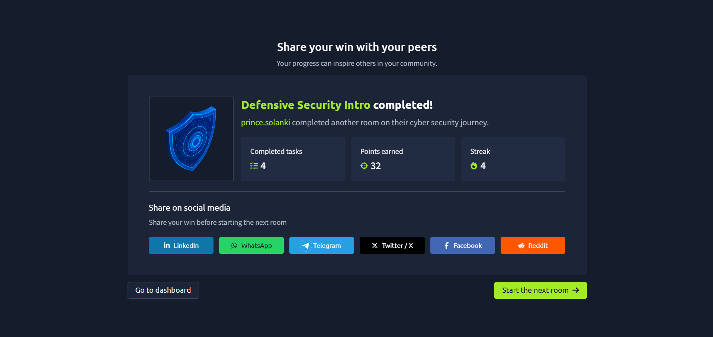

# TryHackMe – Defensive Security Intro

## Lab Completion Proof

*Screenshot showing completion of the Defensive Security Intro room on TryHackMe.*

## Overview

I completed the **Defensive Security Intro** room in the Pre Security learning path on TryHackMe.

This room introduces the basics of defensive security and how security professionals protect systems, monitor activities, and identify potential threats.

## What I Learned

- Understood the basic concept of defensive security.
- Learned how security teams help protect systems and networks.
- Understood the importance of monitoring system activity and identifying suspicious behavior.
- Learned about the role of defenders in preventing and responding to cyber threats.

## Practical Experience

I worked through the exercises provided in the TryHackMe lab and explored the fundamentals of defensive security.

## SOC Analyst Relevance

Defensive security is closely related to the work of a SOC Analyst. SOC Analysts monitor security alerts, investigate suspicious activities, analyze logs, and help identify potential threats.

Understanding defensive security provides a foundation for developing the skills needed for a SOC Analyst Level 1 role.

## Key Takeaways

This lab helped me understand how defensive security supports the protection of systems and networks. I will continue developing my cybersecurity knowledge through hands-on labs and practical exercises.

## Lab Details

- **Platform:** TryHackMe
- **Learning Path:** Pre Security
- **Room:** Defensive Security Intro
- **Status:** Completed

## Disclaimer

These notes document my learning from an authorized TryHackMe lab environment. All explanations are intended for educational purposes.