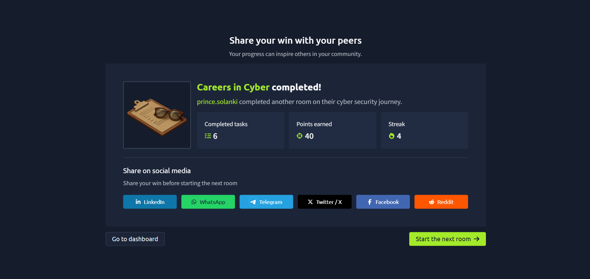

# TryHackMe – Careers in Cyber

## Lab Completion Proof

*Screenshot showing completion of the Careers in Cyber room on TryHackMe.*

## Overview

I completed the **Careers in Cyber** room in the Pre Security learning path on TryHackMe.

This room introduces different career opportunities in cybersecurity and helps learners understand the roles and responsibilities of professionals working in this field.

## What I Learned

- Learned about different career paths in cybersecurity.
- Understood that cybersecurity includes both offensive and defensive security roles.
- Gained an introduction to different responsibilities within the cybersecurity industry.
- Understood the importance of developing technical knowledge and practical skills for a cybersecurity career.

## Practical Experience

I explored the career-related concepts and activities presented in the TryHackMe lab to understand the different opportunities available in cybersecurity.

## SOC Analyst Relevance

This room helped me understand the cybersecurity career landscape and the role of defensive security professionals.

As I prepare for a **SOC Analyst Level 1** role, I am focusing on developing my knowledge of security monitoring, log analysis, threat detection, and incident investigation through structured learning and hands-on practice.

## Key Takeaways

This lab helped me explore cybersecurity career options and understand the importance of continuous learning and practical experience. I will continue progressing through the TryHackMe learning paths to strengthen my cybersecurity skills.

## Lab Details

- **Platform:** TryHackMe
- **Learning Path:** Pre Security
- **Room:** Careers in Cyber
- **Status:** Completed

## Disclaimer

These notes summarize my learning from an authorized TryHackMe lab environment. They are intended for educational purposes.