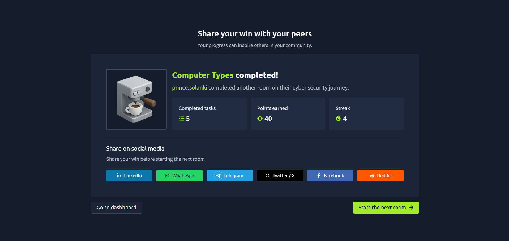

# TryHackMe – Computer Types

## Lab Completion Proof

*Screenshot showing completion of the Computer Types room on TryHackMe.*

## Overview

I completed the **Computer Types** room in the Pre Security learning path on TryHackMe.

This room introduces different types of computers and helps build an understanding of the systems and devices used in modern computing.

## What I Learned

- Learned about different types of computers and their purposes.
- Understood that computers can differ in size, processing power, and use cases.
- Gained a basic understanding of how different computing devices are used in everyday life and in organizations.
- Built foundational knowledge of computer systems.

## Practical Experience

I worked through the exercises provided in the TryHackMe lab to understand the computer types and concepts covered in the room.

## Cybersecurity Relevance

Understanding computer systems is an important first step in cybersecurity. Security professionals need to understand the devices and systems they protect before they can effectively monitor activity, identify weaknesses, and investigate potential security issues.

This knowledge provides a foundation for my goal of becoming a SOC Analyst Level 1.

## Key Takeaways

This lab helped me strengthen my understanding of computer types and their uses. I will continue building my technical knowledge through the TryHackMe Pre Security learning path.

## Lab Details

- **Platform:** TryHackMe
- **Learning Path:** Pre Security
- **Room:** Computer Types
- **Status:** Completed

## Disclaimer

These notes document my learning from an authorized TryHackMe lab environment and are intended for educational purposes.