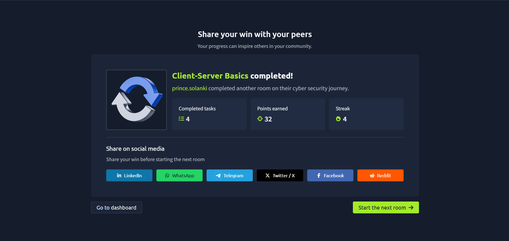

# TryHackMe – Client-Server Basics

## Lab Completion Proof

*Screenshot showing completion of the Client-Server Basics room on TryHackMe.*

## Overview

I completed the **Client-Server Basics** room in the Pre Security learning path on TryHackMe.

This room introduces the client-server model, which explains how devices and applications communicate to request and provide services over a network.

## What I Learned

- Understood the basic concepts of clients and servers.
- Learned how a client sends a request and a server responds.
- Understood how websites and other network services use client-server communication.
- Learned the basic idea of requests and responses in network communication.

## Practical Experience

I worked through the exercises provided in the TryHackMe lab to understand the client-server model and how clients communicate with servers.

## SOC Analyst Relevance

Understanding client-server communication is useful for a SOC Analyst because many security events involve network connections between clients and servers.

This knowledge provides a foundation for understanding network traffic, investigating suspicious connections, and recognizing potentially malicious communication during security monitoring.

## Key Takeaways

This lab helped me understand how clients and servers communicate over a network. These concepts will support my further learning in networking, cybersecurity, and SOC operations.

## Lab Details

- **Platform:** TryHackMe
- **Learning Path:** Pre Security
- **Room:** Client-Server Basics
- **Status:** Completed

## Disclaimer

These notes document my learning from an authorized TryHackMe lab environment and are intended for educational purposes.