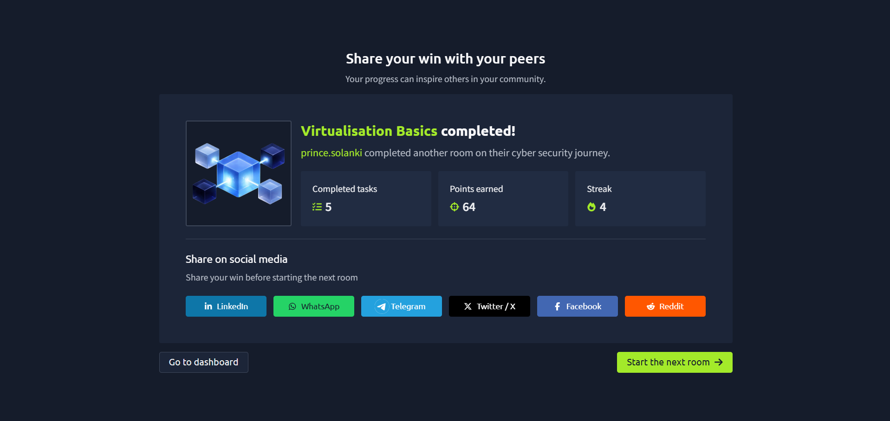

# TryHackMe – Virtualization Basics

## Lab Completion Proof

*Screenshot showing completion of the Virtualization Basics room on TryHackMe.*

## Overview

I completed the **Virtualization Basics** lab in the Pre Security learning path on TryHackMe.

This lab introduced me to virtualization, containers, hypervisors, and Docker. These technologies help run and manage computing environments efficiently and are widely used in modern IT infrastructure.

## What I Learned

### 1. Virtualization

- Learned how virtualization allows multiple virtual machines to run on a single physical computer.
- Understood that each virtual machine can run its own operating system and applications.
- Learned how virtualization helps use hardware resources efficiently.

### 2. Hypervisor

- Understood that a hypervisor is software or firmware that creates and manages virtual machines.
- Learned that it allocates physical resources such as CPU, memory, and storage to virtual machines.
- Understood that hypervisors help isolate virtual machines from one another.

### 3. Containers

- Learned that containers package applications and their dependencies into isolated environments.
- Understood that containers generally share the host operating system's kernel.
- Learned that containers are usually more lightweight than full virtual machines.

### 4. Docker

- Learned that Docker is a platform used to build, distribute, and run containerized applications.
- Understood the basic concepts of Docker images and containers.
- Learned how Docker can make application deployment more consistent across environments.

## Practical Experience

I studied the concepts of virtualization, hypervisors, containers, and Docker through the exercises provided in the TryHackMe lab.

These concepts helped me understand the differences between virtual machines and containers and how they are used in modern computing environments.

## Cybersecurity Relevance

Understanding virtualization and containers is useful in cybersecurity because organizations use them to run applications, services, and lab environments.

For a SOC Analyst, this knowledge provides a foundation for understanding virtualized infrastructure, recognizing the environments where applications run, and investigating security events involving virtual machines or containers.

## Key Takeaways

- Virtualization allows multiple virtual machines to run on physical hardware.
- A hypervisor creates and manages virtual machines.
- Containers provide lightweight application isolation while generally sharing the host kernel.
- Docker helps build and manage containerized applications.

This lab strengthened my understanding of modern computing environments and their role in IT infrastructure and cybersecurity.

## Lab Details

- **Platform:** TryHackMe
- **Learning Path:** Pre Security
- **Room:** Virtualization Basics
- **Status:** Completed

## Disclaimer

These notes document my learning from an authorized TryHackMe lab environment and are intended for educational purposes.