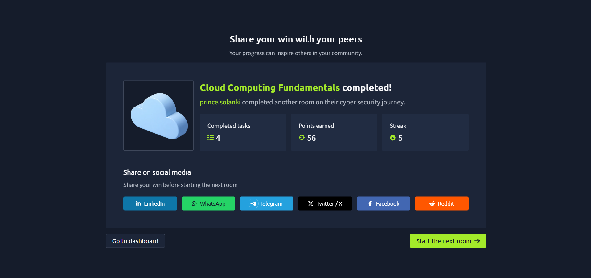

# TryHackMe – Cloud Computing

## Lab Completion Proof

*Screenshot showing completion of the Cloud Computing room on TryHackMe.*

## Overview

I completed the **Cloud Computing** room in the Pre Security learning path on TryHackMe.

This lab introduced me to cloud computing, how cloud infrastructure has evolved, the benefits and types of cloud computing, cloud service models, major cloud providers, and basic Amazon EC2 concepts.

## What I Learned

### 1. What Is Cloud Computing?

- Learned that cloud computing provides computing resources such as servers, storage, databases, and networking over the internet.
- Understood that organizations can use cloud resources without owning and maintaining all the physical hardware themselves.

### 2. Evolution of Servers to Cloud

- Learned how organizations moved from managing physical servers to using virtualized infrastructure and cloud services.
- Understood how cloud computing makes it easier to provision and scale computing resources when needed.

### 3. Benefits of Cloud Computing

- **Scalability:** Resources can be increased or decreased according to demand.
- **Cost efficiency:** Organizations can reduce the need to purchase and maintain physical hardware.
- **Flexibility:** Resources can be accessed and configured as required.
- **Availability:** Cloud platforms provide options for building reliable services across locations.
- **Speed:** Computing resources can be deployed quickly.

### 4. Types of Cloud Computing

- **Public Cloud:** Cloud resources are provided by a third-party provider and shared across customers through logically separated environments.
- **Private Cloud:** Cloud infrastructure is dedicated to a single organization.
- **Hybrid Cloud:** Combines private infrastructure with public cloud services.

### 5. Cloud Service Models

- **IaaS (Infrastructure as a Service):** Provides resources such as virtual machines, storage, and networking.
- **PaaS (Platform as a Service):** Provides a platform for developing and running applications without managing all the underlying infrastructure.
- **SaaS (Software as a Service):** Provides ready-to-use software over the internet.

### 6. Major Cloud Vendors

Learned about major cloud service providers:

- **Amazon Web Services (AWS)**
- **Microsoft Azure**
- **Google Cloud**

These providers offer computing, storage, networking, security, and other cloud services.

### 7. How Companies Use Cloud Computing

- Hosting websites and applications.
- Storing and processing data.
- Running business applications and databases.
- Creating backup and disaster recovery solutions.
- Scaling infrastructure to support changing workloads.
- Deploying development and testing environments.

### 8. Basic Cloud Terminology: EC2 and Instance Types

- **Amazon EC2:** A service from AWS that provides resizable virtual servers for running applications.
- **EC2 Instance:** A virtual server running in AWS.
- **Instance Type:** Defines the combination of CPU, memory, storage, and networking capacity available to an instance.
- **AMI (Amazon Machine Image):** A template used to launch an EC2 instance with a configured operating system and other software.
- **Instance Family:** A category of instance types designed for particular workloads.

Common EC2 instance family categories include:

- **General purpose:** Balanced CPU, memory, and networking resources.
- **Compute optimized:** Designed for workloads that require more processing power.
- **Memory optimized:** Designed for workloads that need substantial memory.
- **Storage optimized:** Designed for workloads that require high storage performance.
- **Accelerated computing:** Uses specialized hardware such as GPUs for suitable workloads.

## Practical Experience

I studied the concepts of cloud computing, deployment models, cloud service models, major providers, and basic AWS EC2 terminology through the TryHackMe lab.

These topics helped me understand how organizations use cloud infrastructure to host applications and manage computing resources.

## SOC Analyst Relevance

Understanding cloud computing is important for a SOC Analyst because many organizations host their applications, servers, and data in cloud environments.

This knowledge provides a foundation for:

- Understanding cloud-hosted infrastructure.
- Learning how cloud resources are configured and managed.
- Recognizing the importance of cloud access controls and permissions.
- Understanding cloud logs and security monitoring.
- Investigating suspicious activity involving cloud accounts and resources.

As I progress toward a SOC Analyst Level 1 role, I will continue building my knowledge of cloud security and monitoring.

## Key Takeaways

- Cloud computing provides computing resources over the internet.
- Cloud environments can use public, private, or hybrid deployment models.
- IaaS, PaaS, and SaaS describe different levels of cloud services.
- AWS, Azure, and Google Cloud are major cloud providers.
- Amazon EC2 provides virtual servers, and instance types define their resource capabilities.
- Cloud security knowledge is useful for monitoring and investigating modern IT environments.

## Lab Details

- **Platform:** TryHackMe
- **Learning Path:** Pre Security
- **Room:** Cloud Computing
- **Status:** Completed

## Disclaimer

These notes document my learning from an authorized TryHackMe lab environment and are intended for educational purposes.