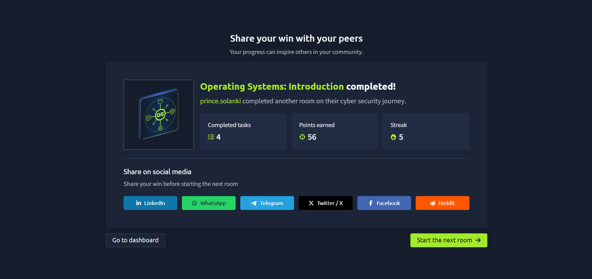

# TryHackMe – Operating Systems

## Lab Completion Proof



*Screenshot showing completion of the Operating Systems room on TryHackMe.*

## Overview

I completed the **Operating Systems** lab in the Pre Security learning path on TryHackMe.

This lab introduced me to operating systems, their responsibilities, privilege levels, security, interfaces, and different types of operating systems used in real-world environments.

## What I Learned

### 1. What Is an Operating System?

- Learned that an operating system (OS) manages computer hardware and software resources.
- Understood how it provides an environment for applications to run.
- Examples include Windows, Linux, macOS, Android, and iOS.

### 2. System Privilege Layers

- Learned that computer systems use different privilege levels to control access to resources.
- Understood that the operating system kernel operates with high privileges, while ordinary applications generally run with restricted privileges.
- Learned that privilege separation helps protect the system from unauthorized access and errors.

### 3. Main Duties of an Operating System

- **Process management:** Manages running programs and processes.
- **Memory management:** Allocates and manages RAM.
- **File management:** Organizes files and directories.
- **Device management:** Coordinates hardware devices.
- **User management:** Supports user accounts and access permissions.
- **Resource management:** Allocates system resources to programs.

### 4. Operating System Security

- Learned that OS security helps protect system resources and user data.
- Understood the importance of user permissions and access controls.
- Learned that updates and security patches help address vulnerabilities.
- Recognized the importance of restricting unnecessary privileges.

### 5. Operating System Interfaces: GUI and CLI

- **GUI (Graphical User Interface):** Allows users to interact with a computer using windows, icons, menus, and buttons.
- **CLI (Command-Line Interface):** Allows users to interact with a computer by entering commands in a terminal.

A CLI example on Linux:

```bash
whoami
```

This command displays the username of the current user.

### 6. Types of Operating Systems

- **Desktop OS:** Designed for personal computers and workstations.
- **Server OS:** Designed to provide services and resources to other systems.
- **Mobile OS:** Designed for smartphones and tablets.
- **Embedded OS:** Used in dedicated devices such as appliances and industrial equipment.
- **Real-time OS:** Designed to meet specific timing requirements.

### 7. Real-World Operating Systems

- **Windows:** Commonly used on personal computers and business systems.
- **Linux:** Widely used on servers, cloud infrastructure, and security systems.
- **macOS:** Apple's operating system for Mac computers.
- **Android:** A widely used mobile operating system.
- **iOS:** Apple's mobile operating system for iPhones.

### 8. Why Are There Different Operating Systems?

- Different devices have different hardware and software requirements.
- Some operating systems focus on ease of use, while others are designed for servers or specialized devices.
- Operating systems differ in their security features, performance, compatibility, and resource requirements.
- Organizations choose operating systems according to their needs and workloads.

## Practical Experience

I studied the concepts of operating systems, privilege levels, system responsibilities, security, interfaces, and OS types through the TryHackMe lab.

This helped me understand how operating systems manage computer resources and provide a foundation for learning system administration and cybersecurity.

## SOC Analyst Relevance

Operating system knowledge is important for a SOC Analyst because security events often involve Windows or Linux systems.

This knowledge provides a foundation for:

- Understanding user accounts and permissions.
- Learning how processes and services operate.
- Investigating system logs and suspicious activity.
- Recognizing potential privilege misuse.
- Understanding the importance of patches and system security.

As I prepare for a SOC Analyst Level 1 role, I will continue developing my knowledge of Windows, Linux, system logs, and security monitoring.

## Key Takeaways

- An operating system manages hardware, software, and system resources.
- Privilege levels help control access to sensitive system operations.
- OS security relies on access controls, updates, and appropriate permissions.
- GUI and CLI are two common ways to interact with an operating system.
- Different operating systems are designed for different devices and purposes.
- Understanding Windows and Linux is useful for future SOC investigations.

## Lab Details

- **Platform:** TryHackMe
- **Learning Path:** Pre Security
- **Room:** Operating Systems
- **Status:** Completed

## Disclaimer

These notes document my learning from an authorized TryHackMe lab environment and are intended for educational purposes.