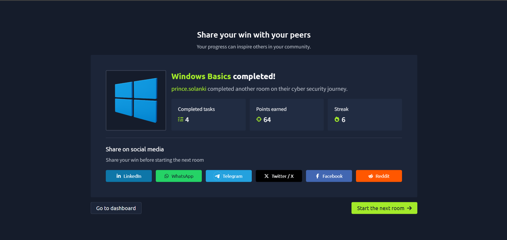

# TryHackMe – Windows Basics

## Lab Completion Proof

*Screenshot showing completion of the Windows Basics room on TryHackMe.*

## Overview

I completed the **Windows Basics** room in the Pre Security learning path on TryHackMe.

This lab introduced me to Microsoft Windows, its interface, system management, application management, updates, authentication, and built-in security features.

## What I Learned

### 1. Microsoft Windows

- Learned that Windows is an operating system developed by Microsoft.
- Understood how it manages hardware, applications, files, and system resources.
- Learned why Windows is widely used on personal computers and in business environments.

### 2. Evolution of Windows

- Explored how Windows evolved from early graphical interfaces to modern operating systems.
- Understood how newer versions introduced improvements in usability, performance, compatibility, and security.

### 3. Login and Authentication

- Learned how users sign in to Windows using supported authentication methods.
- Understood that authentication verifies a user's identity.
- Recognized the importance of strong passwords and protecting user accounts.

### 4. Windows Desktop Components

- Explored common desktop components, including the Start menu, taskbar, desktop icons, notification area, and search.
- Learned how these components help users access applications and system features.

### 5. Built-in Windows Tools

- Learned that Windows includes built-in tools for managing and troubleshooting the system.
- Explored how system utilities help users inspect settings, manage resources, and perform administrative tasks.

### 6. Getting System Information

- Learned how to view information about the computer and its operating system.
- Understood the importance of identifying the OS version and hardware configuration.

### 7. File Exploration and Management

- Learned how to use File Explorer to navigate files and folders.
- Practiced basic file operations such as creating, copying, moving, renaming, and deleting files.
- Understood the importance of organizing files and managing access permissions.

### 8. Applications in Windows

- Learned how applications provide different functions to users.
- Understood that applications rely on the operating system to access system resources and perform tasks.

### 9. Updating Applications

- Learned why keeping applications updated is important.
- Understood that updates can fix bugs, improve performance, and address security vulnerabilities.

### 10. Windows Update

- Learned that Windows Update delivers operating system updates and security patches.
- Understood how regular updates help protect systems against known vulnerabilities.

### 11. Installing Applications

- Learned how applications can be installed using supported installation methods.
- Understood the importance of obtaining software from trusted sources.

### 12. Uninstalling Applications

- Learned how to remove applications that are no longer needed.
- Understood that removing unnecessary software can help reduce system clutter and potential attack surface.

### 13. Windows Settings and Control Panel

- Explored Windows Settings and Control Panel.
- Learned how these interfaces help manage system configuration, accounts, devices, applications, and other settings.

### 14. Task Manager

- Learned how Task Manager displays running applications, processes, and system resource usage.
- Understood how it can help identify applications consuming excessive CPU, memory, or other resources.

### 15. Native Windows Security

- Learned that Windows includes built-in security features to help protect the operating system.
- Understood the importance of account protection, security updates, access controls, and antivirus protection.

### 16. Windows Defender Firewall

- Learned that Microsoft Defender Firewall helps control incoming and outgoing network traffic according to configured rules.
- Understood how firewall rules can help block unauthorized network connections.
- Recognized the importance of configuring firewall rules appropriately.

## Practical Experience

I worked through the TryHackMe Windows Basics lab using a Windows Server 2019 environment.

I explored Windows features, examined system information, managed files and applications, and learned about built-in security settings and firewall protection.

## SOC Analyst Relevance

Windows knowledge is important for a SOC Analyst because many organizations use Windows workstations and servers.

This knowledge provides a foundation for:

- Understanding user accounts and authentication events.
- Identifying suspicious processes and application activity.
- Investigating Windows system information and logs.
- Understanding the role of security updates and patches.
- Learning how firewalls control network traffic.
- Recognizing the importance of built-in endpoint security features.

As I prepare for a SOC Analyst Level 1 role, I will continue learning Windows administration, Event Viewer, authentication logs, and endpoint security monitoring.

## Key Takeaways

- Windows provides an environment for running applications and managing system resources.
- Authentication helps verify user identities.
- File Explorer, Task Manager, Settings, and Control Panel support system management.
- Regular application and operating system updates help address security vulnerabilities.
- Microsoft Defender Firewall controls network traffic according to configured rules.
- Understanding Windows administration and security is a useful foundation for SOC investigations.

## Lab Details

- **Platform:** TryHackMe
- **Learning Path:** Pre Security
- **Room:** Windows Basics
- **Environment:** Windows Server 2019
- **Status:** Completed

## Disclaimer

These notes document my learning from an authorized TryHackMe lab environment and are intended for educational purposes.