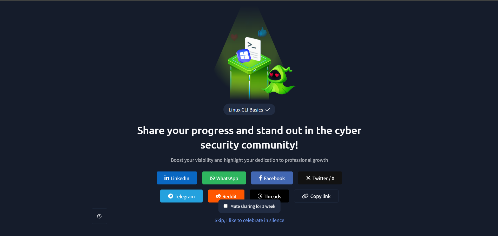

# TryHackMe – Linux CLI

## Lab Completion Proof

*Screenshot showing completion of the Linux CLI room on TryHackMe.*

## Overview

I completed the **Linux CLI** room in the Pre Security learning path on TryHackMe.

This lab introduced me to the Linux command-line interface (CLI), the terminal, basic Linux commands, system information commands, and how to identify a Linux distribution using files in the `/etc` directory.

## What I Learned

### 1. Introduction to Linux CLI
- Learned what the Linux command-line interface (CLI) is.
- Understood how to interact with a Linux system by entering commands instead of using a graphical interface.
- Learned that commands can be used to navigate directories, view files, and retrieve system information.

### 2. What Is a Terminal?
- Learned that a terminal provides an interface for entering commands and viewing their output.
- Understood how the terminal allows users to interact with the command-line shell.
- Gained experience executing commands directly in the live terminal.

### 3. Basic Linux Commands

Learned and practiced the following commands:

| Command | Purpose |
|---|---|
| `pwd` | Displays the current working directory. |
| `ls` | Lists files and directories in the current directory. |
| `ls -l` | Displays files and directories in a detailed, long-listing format. |
| `ls -al` | Lists all files, including hidden files, in a detailed format. |
| `cd` | Changes the current directory. |
| `cd ..` | Moves to the parent directory. |
| `find` | Searches for files and directories based on specified criteria. |
| `cat` | Displays the contents of a file in the terminal. |

### 4. System Information Commands

Learned how to use Linux commands to identify the current user, inspect system information, and check available disk space.

| Command | Purpose |
|---|---|
| `whoami` | Displays the username of the current user. |
| `uname -a` | Displays system and kernel information. |
| `df -h` | Displays filesystem disk space usage in a human-readable format. |

### 5. Checking the Linux Distribution

- Learned how to check Linux distribution information using files in the `/etc` directory.
- Explored the `/etc/os-release` file, which contains information identifying the Linux distribution.
- Understood how distribution information can help identify the operating system environment.

## Practical Experience

During the lab, I gained hands-on experience using a **live Linux terminal** and running commands directly.

I practiced navigating directories, listing files, viewing file contents, searching for files and directories, checking system information, and identifying the Linux distribution through the `/etc/os-release` file.

## SOC Analyst Relevance

Linux command-line knowledge is useful for a SOC Analyst because Linux systems may be used as servers, security tools, and investigation environments.

This knowledge provides a foundation for:
- Navigating Linux systems during investigations.
- Identifying the current user and understanding the system environment.
- Locating and viewing files that may be relevant to an investigation.
- Checking operating system and kernel information.
- Understanding disk space usage.
- Building the command-line skills needed to investigate Linux logs and suspicious activity.

As I continue preparing for a SOC Analyst Level 1 role, I will build on these fundamentals by learning Linux log analysis, process inspection, and security-related commands.

## Key Takeaways

- The Linux CLI allows users to interact with a system by entering commands.
- The terminal provides an interface for running commands.
- Commands such as `pwd`, `ls`, `cd`, `find`, and `cat` help with navigation and file operations.
- Commands such as `whoami`, `uname -a`, and `df -h` provide useful system information.
- The `/etc/os-release` file helps identify the Linux distribution.
- Hands-on terminal practice builds a foundation for Linux system administration and security investigations.

## Lab Details

- **Platform:** TryHackMe
- **Learning Path:** Pre Security
- **Room:** Linux CLI
- **Practical Work:** Live terminal and Linux command execution
- **Status:** Completed

## Disclaimer

These notes document my learning from an authorized TryHackMe lab environment and are intended for educational purposes.
