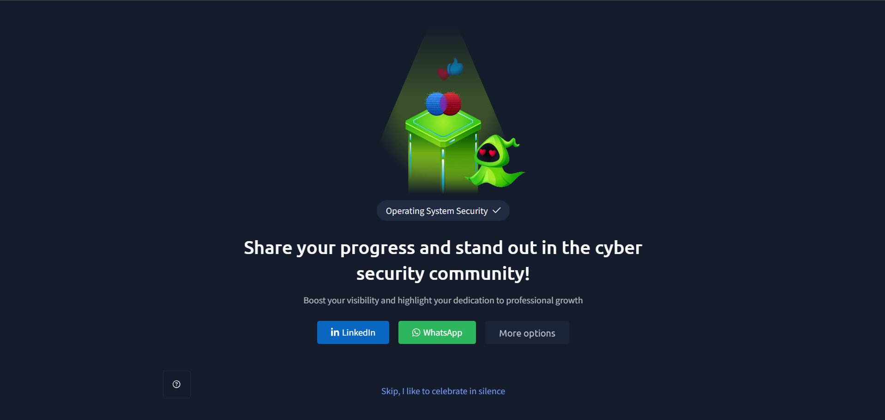

# TryHackMe – Operating System Security

## Lab Completion Proof

*Screenshot showing completion of the Operating System Security room on TryHackMe.*

## Overview

I completed the **Operating System Security** room in the Pre Security learning path on TryHackMe.

This lab introduced me to operating systems, computer hardware, the relationship between hardware, operating systems, and applications, and the importance of operating system security. I also learned about the three pillars of security, authentication, weak passwords, weak file permissions, and malicious programs.

In the practical lab, I gained hands-on experience connecting to and interacting with a remote system using SSH and Linux commands.

## What I Learned

### 1. What Is an Operating System?
- Learned what an operating system (OS) is and why computers need one.
- Understood that an OS manages hardware resources and provides an environment for applications to run.

### 2. Computer Hardware
- Learned about computer hardware and its role in a computer system.
- Understood that hardware includes physical components such as the CPU, memory, storage, and input/output devices.

### 3. Relationship Between Hardware, OS, and Applications
- Learned how hardware, the operating system, and applications work together.
- Understood that applications rely on the operating system to access hardware resources and perform tasks.

### 4. Types of Operating Systems
- Learned that different types of operating systems are designed for different devices and purposes.
- Understood that operating systems are used in personal computers, servers, mobile devices, and other computing environments.

### 5. Why Is Operating System Security Important?
- Learned why protecting an operating system is important for keeping systems and their data secure.
- Understood that security weaknesses can allow unauthorized access, data exposure, or malicious activity.

### 6. Three Pillars of Security
- Learned about the three pillars of information security, known as the **CIA triad**:
  - **Confidentiality:** Protecting information from unauthorized access.
  - **Integrity:** Protecting information from unauthorized modification.
  - **Availability:** Ensuring that systems and information are accessible when needed.

### 7. Authentication and Weak Passwords
- Learned that authentication verifies the identity of a user.
- Understood how weak passwords can make user accounts easier to compromise.
- Recognized the importance of strong passwords and secure authentication practices.

### 8. Weak File Permissions
- Learned that file permissions control who can read, write, or execute files.
- Understood that incorrectly configured permissions may allow unauthorized users to access or modify files.
- Recognized the importance of assigning appropriate permissions to files and directories.

### 9. Malicious Programs
- Learned that malicious programs are designed to perform harmful or unauthorized activities.
- Understood that malicious software can threaten system security, compromise data, or affect system availability.

## Practical Experience

During the lab, I gained hands-on experience accessing and interacting with a remote system.

I practiced the following commands and operations:

| Command / Operation | Purpose |
|---|---|
| `ssh username@remote_host` | Connects to a remote system using SSH. |
| `whoami` | Displays the username of the current user. |
| `ls` | Lists files and directories in the current directory. |
| `cat filename` | Displays the contents of a file. |
| `history` | Displays previously entered commands in the shell history. |
| `su username` | Switches to another user account, subject to authentication and permissions. |

I also practiced switching users during the remote session using SSH and `su`, and checking the active user with `whoami`.

These exercises helped me understand how remote access works and how user identity and permissions affect access to a Linux system.

## SOC Analyst Relevance

Operating system security is important for a SOC Analyst because security incidents can involve compromised accounts, misconfigured permissions, malicious programs, or unauthorized remote access.

This knowledge provides a foundation for:
- Understanding how operating systems support applications and manage hardware resources.
- Recognizing weak passwords and authentication-related risks.
- Understanding how incorrect file permissions can create security weaknesses.
- Identifying the security impact of malicious programs.
- Understanding remote access through SSH.
- Checking user identity and reviewing command activity during basic investigations.
- Applying the CIA triad when thinking about the impact of a security incident.

As I continue preparing for a SOC Analyst Level 1 role, I will build on these fundamentals by learning authentication log analysis, Linux log investigation, and techniques for identifying suspicious remote access.

## Key Takeaways

- An operating system connects applications with computer hardware and manages system resources.
- Operating system security helps protect systems, users, and data.
- The CIA triad consists of Confidentiality, Integrity, and Availability.
- Weak passwords and incorrect file permissions can create security risks.
- Malicious programs can compromise system security.
- SSH provides a way to access remote systems securely.
- Commands such as `whoami`, `ls`, `cat`, and `history` help users inspect their current environment and activity.
- Understanding user switching and permissions is useful for Linux security investigations.

## Lab Details

- **Platform:** TryHackMe
- **Learning Path:** Pre Security
- **Room:** Operating System Security
- **Practical Work:** Remote system access, SSH, Linux commands, and user switching
- **Status:** Completed

## Disclaimer

These notes document my learning from an authorized TryHackMe lab environment and are intended for educational purposes.
