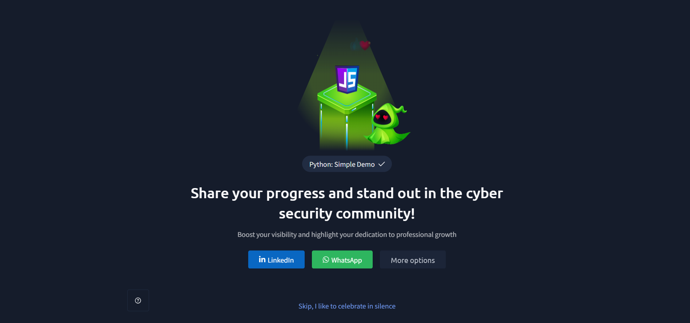

# TryHackMe – Python: Simple Demo

## Lab Completion Proof

*Screenshot showing completion of the Python: Simple Demo room on TryHackMe.*

## Overview

I completed the **Python: Simple Demo** room in the Pre Security learning path on TryHackMe.

This lab introduced me to Python programming through a practical project: the **Guess the Number game**. While building the game, I learned about variables, random number generation, user input, conditional statements, and loops.

## What I Learned

### 1. What Is Python?
- Learned that Python is a high-level programming language.
- Understood that Python can be used to develop applications, automate tasks, and work with data.
- Learned basic programming concepts by building a simple interactive game.

### 2. Guess the Number Game
- Learned how a simple number-guessing game works.
- Understood how the program generates a secret number and asks the user to guess it.
- Learned how the program checks the user's guess and provides feedback until the correct number is guessed.

### 3. Variables Used in the Game
Learned how variables store information needed by the program.

| Variable | Purpose |
|---|---|
| `secret` | Stores the randomly generated number that the user needs to guess. |
| `guess` | Stores the number entered by the user. |
| `tries` | Keeps track of the number of guessing attempts. |

### 4. Generating a Random Number
- Learned how to use Python's built-in `random` module.
- Understood how `random` can generate a number for the game.
- Learned that the generated number is stored in the `secret` variable.

### 5. Taking User Input
- Learned how to use the `input()` function to accept input from the user.
- Understood how user input allows the program to interact with the player.
- Learned that `input()` returns text, so numeric input may need to be converted into an integer before comparison.

### 6. Comparing the Guess With the Secret Number
- Learned how the program compares the user's guess with the secret number.
- Understood how comparisons determine whether the guess is correct, too high, or too low, depending on the game's logic.
- Learned how the program can provide feedback based on the comparison.

### 7. Conditional Statements: `if`, `elif`, and `else`
- Learned how conditional statements allow a program to make decisions.
- Understood the purpose of each statement:
  - `if` checks the first condition.
  - `elif` checks another condition if the earlier condition is false.
  - `else` executes when none of the preceding conditions are true.
- Learned how these statements control the game's responses to different guesses.

### 8. What Are Loops?
- Learned that loops repeat a block of code.
- Understood how loops reduce the need to write the same instructions repeatedly.
- Learned why loops are useful when a program needs to continue accepting guesses.

### 9. The `while` Loop
- Learned how a `while` loop repeats code as long as its condition remains true.
- Understood how the game can continue asking for guesses until the correct number is entered.
- Learned that the loop condition determines when the program continues or stops.

### 10. How Loops Work
- Learned how a loop checks its condition before repeating the code.
- Understood how user input, comparisons, and loop conditions work together.
- Learned how updating variables and changing conditions help prevent a loop from running indefinitely.

## Practical Experience

During this lab, I built the **Guess the Number game** using Python.

While implementing the game, I gained hands-on experience with:
- Creating and using variables.
- Generating a random number with the `random` module.
- Accepting user input.
- Comparing the user's guess with the secret number.
- Using `if`, `elif`, and `else` conditional statements.
- Repeating instructions with a `while` loop.
- Understanding how different programming concepts work together in a single program.

This practical exercise helped me understand Python fundamentals by applying them in a working project.

## SOC Analyst Relevance

Python is useful for a SOC Analyst because it can help automate repetitive tasks, process data, and analyze security-related information.

The concepts learned in this lab provide a foundation for:
- Using variables to store information extracted from logs.
- Applying conditional statements to check security-related conditions.
- Using loops to process multiple log entries or indicators.
- Accepting input for simple security tools.
- Building more advanced Python scripts for cybersecurity tasks.

As I continue preparing for a SOC Analyst Level 1 role, I will build on these Python fundamentals by creating practical scripts that support security analysis and automation.

## Key Takeaways

- Python is a programming language that can be used to build applications and automate tasks.
- Variables store values that a program uses.
- The `random` module can generate random numbers.
- The `input()` function accepts input from the user.
- Conditional statements help a program make decisions.
- A `while` loop repeats code while its condition is true.
- Building the Guess the Number game helped me understand how these concepts work together in practice.

## Lab Details

- **Platform:** TryHackMe
- **Learning Path:** Pre Security
- **Room:** Python: Simple Demo
- **Practical Project:** Guess the Number game
- **Status:** Completed

## Disclaimer

These notes document my learning from an authorized TryHackMe lab environment and are intended for educational purposes.
