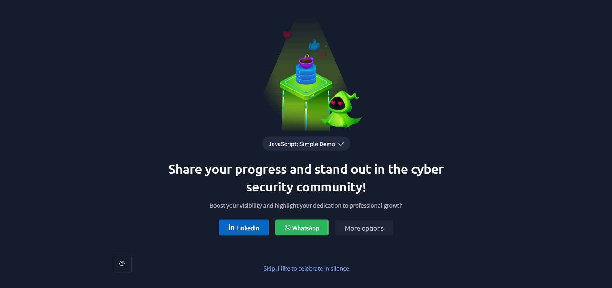

# TryHackMe – JavaScript: Simple Demo

## Lab Completion Proof

*Screenshot showing completion of the JavaScript: Simple Demo room on TryHackMe.*

## Overview

I completed the **JavaScript: Simple Demo** room in the Pre Security learning path on TryHackMe.

This lab introduced me to JavaScript programming through a practical project: the **Guess the Number game**. While building the game, I learned about variables, displaying output, accepting user input, asynchronous programming with `await`, conditional statements, and loops.

## What I Learned

### 1. What Is JavaScript?
- Learned that JavaScript is a programming language used to create interactive applications and websites.
- Understood that JavaScript can also run outside a web browser using environments such as Node.js.
- Learned basic programming concepts by creating a command-line game.

### 2. Guess the Number Game
- Learned how to build a number-guessing game in JavaScript.
- Understood how the program generates a secret number and asks the user to guess it.
- Learned how the program provides feedback when a guess is too low, too high, outside the allowed range, or correct.

### 3. Creating Variables: `const` and `let`
- Learned how variables store values used by a program.
- Understood that `const` is used when a variable binding should not be reassigned.
- Learned that `let` is used when a variable needs to be reassigned during program execution.

In my game:
- `const secret` stores the randomly generated secret number.
- `let tries` tracks the number of attempts.
- `let guess` stores the user's latest guess.

### 4. Displaying Output With `console.log()`
- Learned how to use `console.log()` to display messages in the terminal.
- Understood how output helps communicate instructions and results to the player.
- Used it to display the game's starting message, feedback for guesses, and the final result.

### 5. Taking User Input
- Learned how to collect input from the user in a command-line JavaScript program.
- Understood how user input allows the program to respond to the player's guesses.
- Learned that input received as text must be converted into a number before numerical comparisons can be performed.

### 6. Setting Up the Readline Interface
- Learned how to use Node.js modules to handle terminal input and output.
- Used `node:readline/promises` to create a readline interface.
- Used `stdin` and `stdout` from `node:process` to connect the interface to standard input and output.

### 7. Using `await`
- Learned that `await` can be used to wait for a Promise to settle.
- Used `await rl.question()` to wait for the user to enter a guess before continuing the game.
- Understood how asynchronous input can be handled in a readable, step-by-step way.

### 8. Closing the Readline Interface
- Learned why an input interface should be closed when it is no longer needed.
- Used `rl.close()` to close the readline interface.
- Understood how a `try...finally` structure helps ensure that the interface is closed when execution leaves the `try` block, including when an error occurs.

### 9. Evaluating User Input With Conditional Statements
- Learned how conditional statements allow a program to make decisions based on user input.
- Used `if`, `else if`, and `else` to compare the guess with the secret number.
- Implemented checks for guesses outside the range of 1 to 20, guesses that were too low, guesses that were too high, and the correct guess.

### 10. What Is a `while` Loop?
- Learned that a `while` loop repeatedly executes a block of code while its condition is true.
- Understood how loops avoid repeating the same instructions manually.
- Learned how the loop condition controls when a program continues or stops.

### 11. The `while` Loop in JavaScript
- Used `while (guess !== secret)` to keep the game running until the user guesses the secret number.
- Understood how each new guess updates the `guess` variable.
- Learned how the loop stops when `guess` becomes equal to `secret`.

## Practical Experience

During this lab, I built the **complete Guess the Number game** using JavaScript and Node.js.

My implementation included:

- Generating a random secret number between 1 and 20 using `Math.random()` and `Math.floor()`.
- Creating variables with `const` and `let`.
- Displaying messages using `console.log()`.
- Accepting terminal input using the readline interface.
- Using `await` to wait for the user's input.
- Converting the input into a number with `parseInt()`.
- Counting attempts using the `tries` variable.
- Validating whether the guess was within the allowed range.
- Using `if`, `else if`, and `else` to evaluate guesses.
- Using a `while` loop to continue until the correct number was guessed.
- Closing the readline interface using `try...finally`.

This practical exercise helped me understand how variables, input/output, asynchronous operations, conditions, and loops work together in a complete program.

## SOC Analyst Relevance

JavaScript knowledge can be useful for understanding web applications and writing small automation tools. The programming fundamentals from this lab are also transferable to cybersecurity scripting.

This knowledge provides a foundation for:
- Using variables to store information during program execution.
- Applying conditional statements to evaluate security-related conditions.
- Using loops to process multiple items or records.
- Accepting and validating user input.
- Understanding Node.js and command-line JavaScript programs.
- Building a stronger programming foundation for future cybersecurity projects.

As I continue preparing for a SOC Analyst Level 1 role, I will build on these programming fundamentals while learning more about web technologies, security analysis, and automation.

## Key Takeaways

- JavaScript can run in a terminal using Node.js.
- `const` and `let` are used to declare variables.
- `console.log()` displays output.
- The readline interface can collect terminal input.
- `await` allows the program to wait for asynchronous input.
- `if`, `else if`, and `else` control decisions.
- A `while` loop repeats code while its condition remains true.
- `try...finally` helps ensure that resources such as the readline interface are closed.
- Building the Guess the Number game helped me apply these concepts in a working program.

## Lab Details

- **Platform:** TryHackMe
- **Learning Path:** Pre Security
- **Room:** JavaScript: Simple Demo
- **Practical Project:** Guess the Number game
- **Environment:** JavaScript with Node.js
- **Status:** Completed

## Disclaimer

These notes document my learning from an authorized TryHackMe lab environment and are intended for educational purposes.
