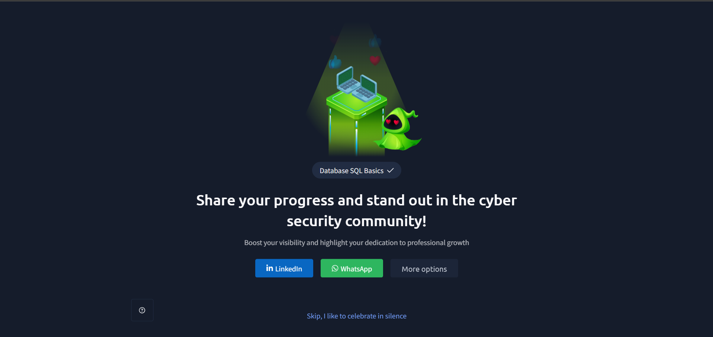

# TryHackMe – Database: SQL Basics

## Lab Completion Proof



*Screenshot showing completion of the Database: SQL Basics room on TryHackMe.*

## Overview

I completed the **Database: SQL Basics** room in the Pre Security learning path on TryHackMe.

This lab introduced me to SQL, data, databases, tables, rows, and columns. I learned how to retrieve data using `SELECT` and `FROM`, filter results with `WHERE`, sort results using `ORDER BY`, and combine filtering and sorting in SQL queries.

## What I Learned

### 1. What Is SQL?
- Learned that SQL stands for **Structured Query Language**.
- Understood that SQL is used to communicate with relational databases.
- Learned how SQL queries can retrieve, filter, sort, and manipulate data.

### 2. What Is Data?
- Learned that data consists of facts or information that can be stored and processed.
- Understood that data can include names, numbers, dates, prices, and other values.
- Learned how organized data can be stored in database tables.

### 3. What Is a Database?
- Learned that a database is an organized collection of data.
- Understood that databases help store, manage, and retrieve information efficiently.
- Learned that SQL can be used to interact with data in relational databases.

### 4. What Does One Row Represent?
- Learned that a row represents one record in a database table.
- Understood that each row contains values for the columns defined in that table.
- Recognized that each record represents one item or entry, depending on the table's purpose.

### 5. Tables, Rows, and Columns
- Learned how relational databases organize data into tables.
- Understood the difference between rows and columns:
  - **Table:** Organizes related data.
  - **Row:** Represents a record.
  - **Column:** Represents a particular attribute or field, such as a name or price.

### 6. Database Tables
- Learned how database tables store related information in a structured format.
- Understood that a table contains columns defining the data fields and rows containing individual records.
- Learned that tables make information easier to query and organize.

### 7. `SELECT` and `FROM` — View All Data
- Learned how `SELECT` specifies which columns to retrieve.
- Understood how `FROM` specifies the table from which the data is retrieved.
- Learned how `SELECT *` retrieves all columns from a table.

Example:

```sql
SELECT *
FROM Orders;
```

### 8. Selecting Specific Columns
- Learned how to retrieve only the columns needed from a table.
- Understood that selecting specific columns makes query results more focused and readable.

Example:

```sql
SELECT drink, price
FROM Menu;
```

### 9. Filtering Results With `WHERE`
- Learned how `WHERE` filters records based on a condition.
- Understood that filtering helps retrieve only the records that match a particular requirement.

Example:

```sql
SELECT *
FROM Menu
WHERE price > 50;
```

### 10. Sorting Results With `ORDER BY`
- Learned how `ORDER BY` sorts query results using a selected column.
- Understood that `ASC` sorts in ascending order and `DESC` sorts in descending order.

Example:

```sql
SELECT *
FROM Menu
ORDER BY price ASC;
```

### 11. Combining Filtering and Sorting
- Learned how to combine `WHERE` and `ORDER BY` in a single SQL query.
- Understood that filtering is performed before the final results are sorted.
- Practiced retrieving records that match a condition and arranging them in a useful order.

Example:

```sql
SELECT *
FROM Menu
WHERE price > 50
ORDER BY price DESC;
```

## Practical Experience

During this lab, I gained hands-on experience writing and executing SQL queries in the practice database environment.

I practiced:
- Retrieving data from database tables.
- Fetching all columns or selecting specific columns.
- Filtering records using `WHERE`.
- Sorting query results using `ORDER BY`.
- Combining filtering and sorting in a single query.
- Understanding how query results reflect the structure and contents of a database table.

I also explored how SQL is used to interact with stored data and perform database operations.

## SOC Analyst Relevance

SQL knowledge is useful for a SOC Analyst because security-related information may be stored in databases, and SQL is commonly used to retrieve and analyze records.

This knowledge provides a foundation for:
- Querying structured security-related data.
- Filtering records to focus on specific events or conditions.
- Sorting results to make investigation data easier to review.
- Understanding how applications store and retrieve information.
- Building foundational knowledge for investigating database-related security issues.

As I continue preparing for a SOC Analyst Level 1 role, I will build on these fundamentals while learning more about log analysis, data investigation, and database security.

## Key Takeaways

- SQL is used to communicate with relational databases.
- Databases organize and store information.
- Tables contain rows and columns.
- `SELECT` and `FROM` retrieve data from tables.
- `WHERE` filters records based on conditions.
- `ORDER BY` sorts query results.
- Combining filtering and sorting helps produce more useful results.
- Hands-on SQL practice builds a foundation for data analysis and cybersecurity investigations.

## Lab Details

- **Platform:** TryHackMe
- **Learning Path:** Pre Security
- **Room:** Database: SQL Basics
- **Practical Work:** Writing SQL queries and retrieving database records
- **Status:** Completed

## Disclaimer

These notes document my learning from an authorized TryHackMe lab environment and are intended for educational purposes.
