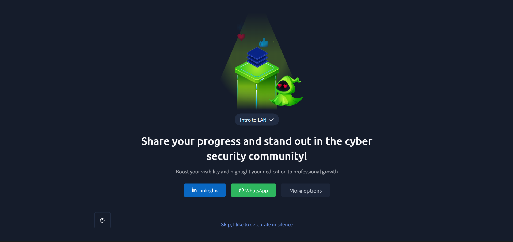

# TryHackMe — Intro to LAN

## Lab Completion Proof



This section displays the TryHackMe room completion screenshot as proof that the lab has been completed.

## Overview

In this lab, I learned about Local Area Networks (LANs), different network topologies, and networking devices such as switches and routers. I also explored routing, subnetting, subnet masks, ARP, and DHCP. These concepts help explain how devices communicate and exchange data within a network.

## What I Learned

### 1. What Is Network Topology?

- Network topology describes how devices are arranged and connected within a network.
- It explains how devices communicate and how network connections are organized.

### 2. Star Topology

- In star topology, all devices are connected to a central device, usually a switch or hub.
- Devices communicate through this central device.

**Advantages:**
- Easy to manage and troubleshoot.
- Failure of one connected device usually does not affect other devices.
- Devices can be added or removed easily.

**Disadvantages:**
- If the central device fails, the network can stop functioning.
- Requires more cables because every device connects separately to the central device.
- Requires a central networking device, which adds cost.

### 3. Bus Topology

- In bus topology, all devices connect to a single main cable called the backbone.
- Data travels along this shared cable to reach the intended device.

**Advantages:**
- Requires less cabling than some other topologies.
- Simple and relatively inexpensive to set up for small networks.

**Disadvantages:**
- If the main backbone cable fails, the entire network can stop working.
- Network performance can decrease when many devices communicate.
- Troubleshooting cable problems can be difficult.

### 4. Ring Topology

- In ring topology, each device connects to two neighboring devices, forming a circular connection.
- Data travels around the ring to reach its destination.

**Advantages:**
- Data can travel in an organized manner around the ring.
- Each device gets an opportunity to transmit data in an orderly arrangement.

**Disadvantages:**
- A failure in one device or connection can disrupt the network in a basic single-ring setup.
- Adding or removing devices can interrupt network communication.
- Troubleshooting can be more difficult.

### 5. What Is a Switch?

- A switch is a networking device used to connect multiple devices within a LAN.
- It forwards data to the appropriate device using MAC addresses.

### 6. How Does a Switch Work?

- A switch learns the MAC addresses of connected devices.
- It stores these addresses in a MAC address table.
- When a frame arrives, the switch checks its destination MAC address.
- It forwards the frame through the port connected to the destination device, when the destination is known.

### 7. Switch vs Hub

- **Hub:** Sends incoming data to all connected ports, except the port from which it received the data.
- **Switch:** Uses MAC addresses to forward data to the appropriate destination port when the destination is known.
- Switches are more efficient than hubs because they reduce unnecessary traffic sent to other devices.

### 8. Switches, Routers, and Redundancy

- Switches connect devices within a local network.
- Routers connect different networks and forward traffic between them.
- Redundancy means having backup connections or devices to help maintain network availability if a component fails.

### 9. What Is a Router?

- A router is a networking device that connects different networks.
- It forwards data packets between networks using IP addresses.
- A router helps devices on a local network communicate with external networks, including the internet.

### 10. What Is Routing?

- Routing is the process of selecting a path for data packets to travel from a source network to a destination network.
- Routers use routing tables to determine where packets should be forwarded.

### 11. What Is Subnetting?

- Subnetting is the process of dividing a larger IP network into smaller networks called subnets.
- It helps organize devices and manage IP addresses more efficiently.

### 12. What Is a Subnet Mask?

- A subnet mask identifies which part of an IP address represents the network portion and which part represents the host portion.
- It helps devices determine whether another IP address belongs to the same local network or a different network.

Example:

```text
IP Address:  192.168.1.10
Subnet Mask: 255.255.255.0
```

In this example:
- Network portion: `192.168.1`
- Host portion: `10`

### 13. Three Important Network Addresses

**Network Address**
- Identifies a particular network or subnet.
- It is used to represent the network itself rather than an individual host.

**Host Address**
- Identifies an individual device or interface within a network.
- Each device needs an appropriate host IP address to communicate.

**Default Gateway**
- The IP address of the router or other Layer 3 device that a host uses to send traffic outside its local network.
- It acts as the device's route to other networks.

### 14. Where Is Subnetting Used?

- Subnetting is used in home, office, and enterprise networks.
- It helps divide large networks into smaller network segments.
- It is used to organize devices and manage IP address allocation.

### 15. Benefits of Subnetting

- **Better organization:** Divides a large network into smaller sections.
- **Efficient IP management:** Helps use available IP addresses more effectively.
- **Reduced broadcast traffic:** Limits broadcast traffic to individual subnets.
- **Improved network management:** Makes networks easier to manage and troubleshoot.
- **Network separation:** Helps separate different groups of devices.

### 16. What Is ARP?

- ARP stands for Address Resolution Protocol.
- It is used to find the MAC address associated with an IPv4 address on a local network.
- It helps devices deliver Ethernet frames to the correct destination.

### 17. How Does ARP Work?

- A device knows the destination's IPv4 address but needs its MAC address to send a frame on the local network.
- ARP helps the device discover the MAC address associated with that IP address.

### 18. Step-by-Step Process of How ARP Works

1. A device checks its ARP cache to see whether it already knows the MAC address for the destination IP.
2. If the entry is not available, it sends an ARP Request as a broadcast to the local network.
3. The ARP Request asks which device owns the requested IP address.
4. The device with that IP address responds with an ARP Reply containing its MAC address.
5. The sender stores the IP-to-MAC mapping in its ARP cache.
6. The sender can now use that MAC address to send the Ethernet frame.

### 19. What Is DHCP?

- DHCP stands for Dynamic Host Configuration Protocol.
- It automatically assigns network configuration information to devices.
- This information commonly includes an IP address, subnet mask, default gateway, and DNS server addresses.

### 20. How Does DHCP Work?

DHCP commonly follows a four-step process known as DORA:

1. **Discover:** The client broadcasts a DHCP Discover message to find available DHCP servers.
2. **Offer:** A DHCP server responds with a DHCP Offer containing an available IP address and network configuration.
3. **Request:** The client sends a DHCP Request to indicate that it wants to use the offered configuration.
4. **Acknowledge:** The DHCP server sends a DHCP Acknowledgment confirming the address assignment.

## Practical Experience

During this lab, I learned how devices communicate within a LAN and how switches and routers help transfer data. I also explored subnetting, subnet masks, network addresses, host addresses, and default gateways. Additionally, I learned how ARP resolves IP addresses to MAC addresses and how DHCP automatically provides network configuration to devices.

## SOC Analyst Relevance

Understanding LAN concepts is important for a SOC Analyst because:

- **Network traffic analysis:** Helps understand how data moves between devices.
- **IP and MAC address analysis:** Helps identify devices involved in network communication.
- **Subnetting:** Helps understand network segments and identify where devices belong.
- **ARP monitoring:** Helps recognize unusual ARP activity, including possible ARP spoofing.
- **DHCP monitoring:** Helps understand how devices receive IP addresses and network configurations.
- **Network troubleshooting:** Helps investigate communication issues and suspicious network activity.

## Key Takeaways

- Network topology describes how devices are connected.
- Star, bus, and ring are different network topologies.
- Switches connect devices within a LAN using MAC addresses.
- Routers connect different networks using IP addresses.
- Routing determines the path taken by network packets.
- Subnetting divides a large network into smaller networks.
- A subnet mask separates the network and host portions of an IP address.
- ARP resolves IPv4 addresses to MAC addresses on a local network.
- DHCP automatically assigns IP addresses and other network configuration details using the DORA process.

## Lab Details

- **Platform:** TryHackMe
- **Learning Path:** Pre-Security
- **Room:** Intro to LAN
- **Status:** Completed

## Disclaimer

These notes summarize the concepts learned during the TryHackMe Pre-Security lab. They are intended for educational purposes and personal revision.