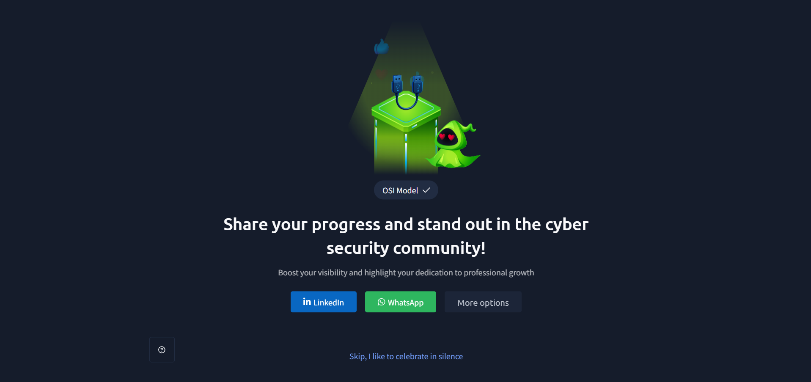

# TryHackMe — OSI Model

## Lab Completion Proof

This section displays the TryHackMe room completion screenshot as proof that the lab has been completed.

## Overview

In this lab, I learned about the OSI (Open Systems Interconnection) model and its seven layers. The OSI model explains how data travels from one device to another over a network. I also learned the different operations performed by each layer, from physical data transmission to user-facing network services.

## What I Learned

### 1. What Is the OSI Model?

- OSI stands for **Open Systems Interconnection**.
- It is a conceptual model used to understand how network communication works.
- It divides network communication into seven different layers.
- Each layer performs a specific function and works with the layers above and below it.
- It helps understand, troubleshoot, and investigate network communication problems.

### 2. The Seven Layers of the OSI Model

The OSI model has seven layers. Each layer performs a different operation during network communication.

| Layer | Name | Main Operation |
|---|---|---|
| 7 | Application | Provides network services to applications |
| 6 | Presentation | Handles data format, encryption, and compression |
| 5 | Session | Establishes and manages communication sessions |
| 4 | Transport | Handles end-to-end data delivery |
| 3 | Network | Handles logical addressing and routing |
| 2 | Data Link | Handles frames and MAC addressing |
| 1 | Physical | Transmits raw bits through physical media |

### 3. Layer 7 — Application Layer

- The application layer is the closest layer to the end user.
- It provides network services that applications use to communicate.
- It allows applications to interact with network resources.

**Main operations:**
- Provides network services to applications.
- Supports protocols such as HTTP, HTTPS, DNS, and SMTP.
- Helps applications request and exchange data over a network.

**Example:** When you open a website in a browser, the browser uses application-layer protocols such as HTTP or HTTPS to communicate with the web server.

### 4. Layer 6 — Presentation Layer

- The presentation layer handles how data is represented and understood by different systems.
- It makes sure that data is in a suitable format for the receiving system.

**Main operations:**
- Data translation and formatting.
- Data encryption and decryption.
- Data compression and decompression.

**Example:** Encryption helps protect data so that unauthorized people cannot easily read it.

### 5. Layer 5 — Session Layer

- The session layer manages communication sessions between devices or applications.
- It helps establish, maintain, and terminate communication sessions.

**Main operations:**
- Establishes communication sessions.
- Maintains active sessions.
- Terminates sessions when communication is complete.
- Helps coordinate communication between systems.

**Example:** Managing an ongoing communication session between two systems.

### 6. Layer 4 — Transport Layer

- The transport layer is responsible for end-to-end data delivery between devices.
- It handles how data is divided and delivered to the receiving application.

**Main operations:**
- Segmentation and reassembly.
- Port addressing.
- Flow control.
- Error recovery and reliable delivery when using TCP.

**Important protocols:**
- **TCP:** Provides reliable, connection-oriented communication.
- **UDP:** Provides connectionless communication with lower overhead.

**Example:** When downloading a file using TCP, data is delivered reliably and missing data can be retransmitted.

### 7. Layer 3 — Network Layer

- The network layer handles communication between different networks.
- It uses logical addresses, such as IP addresses, to identify source and destination devices.
- Routers operate at this layer.

**Main operations:**
- Logical addressing using IP addresses.
- Routing packets between networks.
- Selecting paths for data packets.

**Important protocol:** IP (Internet Protocol).

**Example:** When data travels from your home network to a server on the internet, routers forward packets toward their destination.

### 8. Layer 2 — Data Link Layer

- The data link layer handles communication between devices on the same local network link.
- It uses MAC addresses for local delivery.
- Switches commonly operate at this layer.

**Main operations:**
- Framing: Organizes data into frames.
- Physical addressing: Uses MAC addresses.
- Error detection: Helps detect transmission errors in frames.
- Media access control: Coordinates access to the shared network medium where applicable.

**Example:** A switch uses MAC addresses to forward Ethernet frames to the appropriate device on a LAN.

### 9. Layer 1 — Physical Layer

- The physical layer is the lowest layer of the OSI model.
- It is responsible for transmitting raw bits over a physical connection.

**Main operations:**
- Transmits binary data (0s and 1s).
- Defines physical connections and transmission media.
- Handles electrical, optical, or radio signals.
- Defines physical characteristics such as cables, connectors, and signaling.

**Examples:** Ethernet cables, fiber-optic cables, and wireless radio signals.

### 10. How the Seven Layers Work Together

When you send data from one device to another:

1. The **Application Layer** provides network services to the application.
2. The **Presentation Layer** handles data formatting and representation.
3. The **Session Layer** manages the communication session.
4. The **Transport Layer** divides data into segments and handles delivery.
5. The **Network Layer** adds logical addressing and handles routing.
6. The **Data Link Layer** organizes data into frames and uses MAC addressing.
7. The **Physical Layer** transmits the data as bits through the network medium.

At the receiving device, the process happens in reverse, from the Physical Layer up to the Application Layer. This is called decapsulation.

## Practical Experience

During this lab, I learned about the OSI model and its seven layers. I understood the different operations performed by each layer and how they work together to make communication between network devices possible.

## SOC Analyst Relevance

Understanding the OSI model is important for a SOC Analyst because:

- **Network traffic analysis:** Helps understand how network communication takes place.
- **Troubleshooting:** Helps identify which layer may be responsible for a network issue.
- **Protocol analysis:** Helps understand protocols such as HTTP, DNS, TCP, UDP, and IP.
- **Security investigation:** Helps classify suspicious network activity according to the layer involved.
- **Packet analysis:** Provides a foundation for understanding packet captures using tools such as Wireshark.

## Key Takeaways

- OSI stands for Open Systems Interconnection.
- The OSI model contains seven layers.
- Each layer performs a specific operation during network communication.
- The Transport Layer handles end-to-end delivery.
- The Network Layer handles IP addressing and routing.
- The Data Link Layer handles frames and MAC addressing.
- The Physical Layer transmits raw bits.
- Understanding the OSI model helps with network troubleshooting and cybersecurity investigations.

## Lab Details

- **Platform:** TryHackMe
- **Learning Path:** Pre-Security
- **Room:** OSI Model
- **Status:** Completed

## Disclaimer

These notes summarize the concepts learned during the TryHackMe Pre-Security lab. They are intended for educational purposes and personal revision.