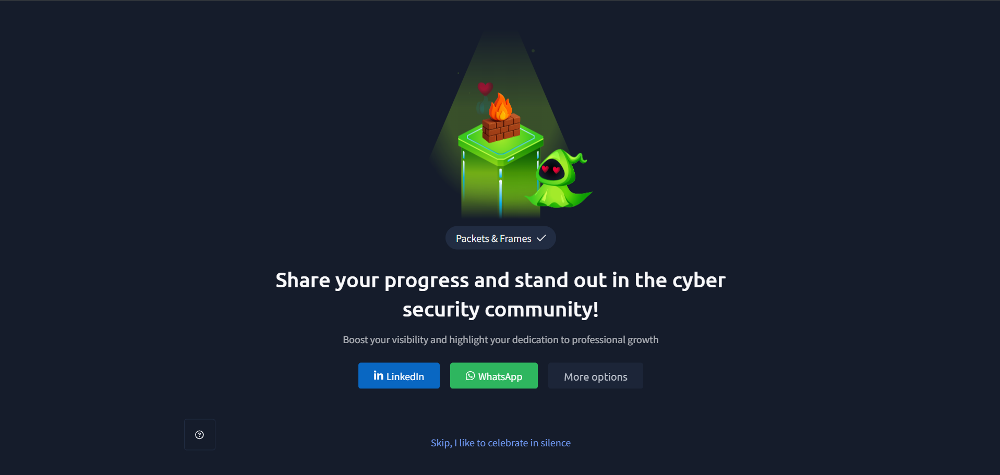

# TryHackMe — Packets & Frames

## Lab Completion Proof

This section displays the TryHackMe room completion screenshot as proof that the lab has been completed.

## Overview

In this lab, I learned about packets and frames, their differences, and how they are used in network communication. I also explored packet headers, TCP and UDP protocols, TCP communication, the three-way handshake, TCP flags, connection termination, and the importance of network ports.

## What I Learned

### 1. What Are Packets and Frames?

- **Packets:** Packets are units of data transmitted at the Network Layer (Layer 3) of the OSI model.
- **Frames:** Frames are units of data transmitted at the Data Link Layer (Layer 2) of the OSI model.
- Both are used to transfer data between devices over a network.

### 2. Difference Between Packets and Frames

| Packets | Frames |
|---|---|
| Operate at the Network Layer (Layer 3). | Operate at the Data Link Layer (Layer 2). |
| Contain source and destination IP addresses. | Contain source and destination MAC addresses. |
| Used for communication between networks. | Used for communication over a local network link. |
| Encapsulate transport-layer data. | Encapsulate network-layer packets. |

### 3. Why Are Packets Used?

- Packets divide large amounts of data into smaller units.
- Smaller units make data transmission more manageable.
- They allow data to travel across different networks.
- They help network devices forward data toward its destination.

### 4. Packet Headers

- A packet header contains important information required for network communication.
- It is added to the data to help devices understand where the data is coming from and where it needs to go.
- Network devices use header information to process and forward data.

### 5. Important Packet Header Fields

Some important IP packet header fields include:

- **Source IP Address:** Identifies the IP address of the sending device.
- **Destination IP Address:** Identifies the IP address of the receiving device.
- **Time to Live (TTL):** Limits how many router hops an IPv4 packet can pass through.
- **Protocol:** Identifies the protocol carried in the IP payload, such as TCP or UDP.
- **Identification:** Helps identify fragments belonging to the same original IPv4 packet.
- **Fragmentation Flags:** Provide information about IPv4 packet fragmentation.

### 6. What Is TCP?

- TCP stands for Transmission Control Protocol.
- It is a connection-oriented transport-layer protocol.
- It provides reliable data transmission between devices.
- TCP ensures data is delivered in the correct order and handles retransmission of missing data.

### 7. The Four Layers of TCP/IP

The TCP/IP model contains four layers:

| Layer | Main Function |
|---|---|
| Application Layer | Provides network services to applications. |
| Transport Layer | Handles communication between applications using TCP or UDP. |
| Internet Layer | Handles IP addressing and routing. |
| Network Access Layer | Handles communication over the local network and physical transmission. |

### 8. How Does TCP Work?

- TCP establishes a connection before transferring data.
- It divides data into smaller segments.
- Each segment contains TCP header information.
- The receiving device acknowledges successfully received data.
- If data is missing, TCP can retransmit it.
- TCP uses sequence numbers to maintain the correct order of data.

### 9. Advantages and Disadvantages of TCP

**Advantages:**
- Provides reliable data delivery.
- Maintains the correct order of data.
- Detects missing data and supports retransmission.
- Uses acknowledgements to confirm received data.
- Provides flow control.

**Disadvantages:**
- Generally slower than UDP because of additional communication and reliability mechanisms.
- Has more overhead due to its larger header and connection management.
- Requires connection establishment before data transfer.

### 10. Important TCP Header Fields

TCP headers contain information that helps manage communication between devices.

Important TCP header fields include:

- **Source Port:** Identifies the sending application's port.
- **Destination Port:** Identifies the receiving application's port.
- **Sequence Number:** Identifies the position of data in the byte stream.
- **Acknowledgment Number:** Indicates the next sequence number expected from the other side.
- **Data Offset:** Indicates the length of the TCP header.
- **Flags:** Control and manage TCP communication.
- **Window Size:** Indicates how much data the receiver is currently willing to accept.
- **Checksum:** Helps detect errors in the TCP header and data.
- **Urgent Pointer:** Indicates the end of urgent data when the URG flag is set.

### 11. TCP Three-Way Handshake

- The TCP three-way handshake is the process used to establish a TCP connection between two devices.
- It uses three main steps: SYN, SYN-ACK, and ACK.

### 12. Three Main Steps of the TCP Handshake

**Step 1: SYN (Synchronize)**

- The client sends a SYN packet to the server.
- It requests to establish a TCP connection.
- It includes the client's initial sequence number.

**Step 2: SYN-ACK (Synchronize-Acknowledge)**

- The server responds with a SYN-ACK packet.
- It acknowledges the client's SYN.
- It also sends its own initial sequence number.

**Step 3: ACK (Acknowledge)**

- The client sends an ACK packet to acknowledge the server's SYN.
- The TCP connection is now established.
- Both devices can begin exchanging application data.

### 13. Understanding TCP Sequence Numbers

- TCP uses sequence numbers to keep track of data sent between devices.
- Each direction of communication maintains its own sequence number.
- The acknowledgment number indicates the next byte expected by the receiving device.
- This helps TCP deliver data in the correct order and identify missing data.

### 14. Important TCP Messages and Flags

TCP uses flags to control different stages of communication.

| TCP Flag | Purpose |
|---|---|
| SYN | Starts a TCP connection. |
| ACK | Acknowledges received data or connection information. |
| FIN | Indicates that a device wants to close its connection. |
| RST | Resets or immediately terminates a TCP connection. |
| PSH | Requests that buffered data be pushed to the receiving application. |
| URG | Indicates that the urgent pointer field is significant. |

### 15. How Does TCP Close a Connection?

- TCP normally closes a connection using a four-step termination process.
- The process uses FIN and ACK flags.

**Step 1: FIN**
- One device sends a FIN packet to indicate that it has finished sending data.

**Step 2: ACK**
- The receiving device acknowledges the FIN packet.

**Step 3: FIN**
- The receiving device sends its own FIN packet when it is ready to close its side of the connection.

**Step 4: ACK**
- The first device acknowledges the second FIN.
- The connection is then closed after the TCP state transitions are completed.

### 16. What Is UDP?

- UDP stands for User Datagram Protocol.
- It is a connectionless transport-layer protocol.
- Unlike TCP, UDP does not establish a connection before sending data.
- It does not guarantee delivery, ordering, or retransmission of lost data.

### 17. How Does UDP Work?

- The sending device divides application data into UDP datagrams.
- UDP adds a header containing source port, destination port, length, and checksum information.
- The datagrams are passed to the IP layer for transmission.
- The receiving device processes the datagrams and delivers the data to the appropriate application.
- UDP does not wait for acknowledgements or retransmit lost datagrams by itself.

### 18. Advantages and Disadvantages of UDP

**Advantages:**
- Faster and has lower overhead than TCP in many situations.
- Does not require a connection establishment process.
- Suitable for real-time communication.
- Supports quick data transmission.

**Disadvantages:**
- Does not guarantee data delivery.
- Does not guarantee the order of received data.
- Does not automatically retransmit lost datagrams.
- Does not provide TCP-style flow control.

### 19. UDP Communication

- UDP allows applications to exchange data without establishing a connection first.
- Each UDP datagram is sent independently.
- It is commonly used in DNS queries, online gaming, voice calls, and video streaming.
- Applications that require reliability must handle it themselves when using UDP.

### 20. What Are Ports?

- A port is a logical number used by transport-layer protocols to identify a particular application or service on a device.
- TCP and UDP use port numbers to deliver data to the appropriate application.
- Port numbers range from `0` to `65535`.

### 21. Why Are Ports Important?

- Ports help multiple applications communicate over the same network connection.
- They identify which service should receive incoming data.
- They help devices manage different network communications.
- They are important for network security monitoring and firewall configuration.

### 22. Common Ports (0–1024)

Some commonly used ports include:

| Port | Protocol | Service |
|---|---|---|
| 20 | TCP | FTP Data |
| 21 | TCP | FTP Control |
| 22 | TCP | SSH |
| 23 | TCP | Telnet |
| 25 | TCP | SMTP |
| 53 | TCP/UDP | DNS |
| 67 | UDP | DHCP Server |
| 68 | UDP | DHCP Client |
| 80 | TCP | HTTP |
| 110 | TCP | POP3 |
| 123 | UDP | NTP |
| 143 | TCP | IMAP |
| 161 | UDP | SNMP |
| 162 | UDP | SNMP Trap |
| 389 | TCP/UDP | LDAP |
| 443 | TCP | HTTPS |
| 445 | TCP | SMB |
| 465 | TCP | SMTP over TLS |
| 514 | UDP | Syslog |
| 587 | TCP | SMTP Submission |
| 993 | TCP | IMAPS |
| 995 | TCP | POP3S |
| 1024 | TCP/UDP | Start of the registered port range |

## Practical Experience

During this lab, I learned how packets and frames are used to transfer data across networks. I explored TCP and UDP communication, TCP header fields, the three-way handshake, sequence numbers, TCP flags, and connection termination. I also learned about network ports and commonly used services associated with different port numbers.

## SOC Analyst Relevance

Understanding packets, frames, TCP, UDP, and ports is important for a SOC Analyst because:

- **Packet analysis:** Helps understand network traffic and communication between devices.
- **TCP handshake monitoring:** Helps identify connection establishment attempts and unusual connection activity.
- **TCP flags analysis:** Helps investigate SYN scans, connection resets, and unusual TCP behavior.
- **UDP traffic analysis:** Helps understand connectionless network communication and investigate suspicious UDP traffic.
- **Port monitoring:** Helps identify services running on systems and detect unexpected network connections.
- **Network investigation:** Helps analyze source and destination IP addresses, ports, and protocols during security incidents.

## Key Takeaways

- Packets operate at the Network Layer, while frames operate at the Data Link Layer.
- Packet headers contain important information such as source and destination IP addresses.
- TCP provides reliable and ordered data delivery.
- TCP establishes connections using the SYN, SYN-ACK, and ACK three-way handshake.
- TCP uses sequence numbers, acknowledgements, and flags to manage communication.
- TCP normally closes connections through a four-step FIN/ACK process.
- UDP is connectionless and does not guarantee delivery or ordering.
- Ports identify applications and services during network communication.
- Understanding common ports is useful for network monitoring and SOC investigations.

## Lab Details

- **Platform:** TryHackMe
- **Learning Path:** Pre-Security
- **Room:** Packets & Frames
- **Status:** Completed

## Disclaimer

These notes summarize the concepts learned during the TryHackMe Pre-Security lab. They are intended for educational purposes and personal revision.