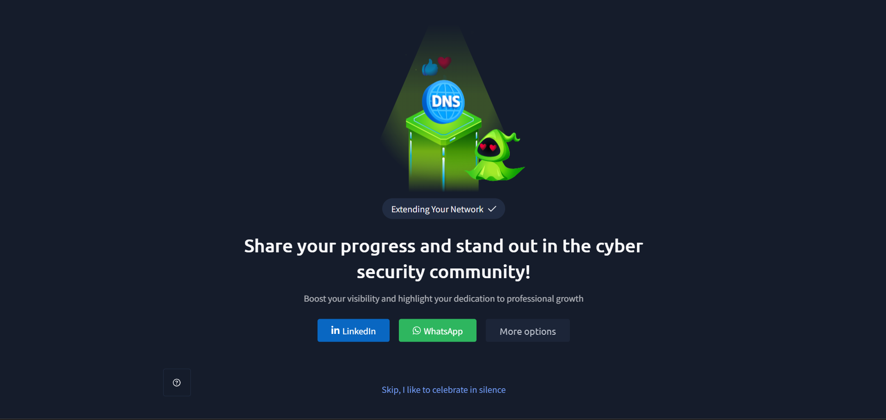

# TryHackMe — Extending Your Network

## Lab Completion Proof

This section displays the TryHackMe room completion screenshot as proof that the lab has been completed.

## Overview

In this lab, I learned about extending networks and how different networking technologies help devices communicate securely. I explored port forwarding, firewalls, packet inspection, VPNs, routers, routing, switches, and VLANs. I also learned how these technologies help control network traffic, connect networks, and improve network security.

## What I Learned

### 1. What Is Port Forwarding?

- Port forwarding is a networking technique that allows external devices to access a specific service running on a device inside a private network.
- It works by forwarding incoming traffic received on a particular port of a router to a specified internal IP address and port.
- It is commonly used to make internal services, such as web servers, accessible from the internet.

### 2. Why Is Port Forwarding Needed?

- Devices inside a private network usually use private IP addresses that cannot be directly accessed from the public internet.
- Port forwarding allows external users to reach selected services running inside the private network.
- It helps make services such as web servers and game servers accessible from outside the local network.

### 3. Difference Between Port Forwarding and Firewall

| Port Forwarding | Firewall |
|---|---|
| Redirects incoming traffic to a specific internal device and port. | Controls which network traffic is allowed or blocked. |
| Makes selected internal services accessible from outside the network. | Protects networks and devices by filtering traffic. |
| Usually configured on a router or NAT device. | Can be implemented on routers, servers, and dedicated security devices. |
| Determines where matching traffic should be forwarded. | Determines whether traffic should be permitted or denied. |

### 4. Where Is Port Forwarding Configured?

- Port forwarding is commonly configured on a router or NAT-enabled firewall.
- An administrator creates a rule that specifies the external port, internal IP address, and internal destination port.
- When matching traffic arrives, the router forwards it to the configured internal device.

### 5. What Is a Firewall?

- A firewall is a network security system that monitors and controls incoming and outgoing network traffic.
- It follows predefined security rules to decide whether traffic should be allowed or blocked.
- It helps protect devices and networks from unauthorized network access.

### 6. How Does a Firewall Decide Which Traffic to Allow or Block?

- A firewall examines network traffic and compares it with its configured rules.
- These rules can check information such as:
  - Source IP address.
  - Destination IP address.
  - Source and destination ports.
  - Network protocol, such as TCP or UDP.
  - Connection state, depending on the firewall type.
- Based on the matching rule, the firewall allows or blocks the traffic.

### 7. Packet Inspection

- Packet inspection is the process of examining network packets to understand their contents and characteristics.
- Firewalls use packet inspection to evaluate network traffic against security rules.
- Depending on the firewall, inspection may examine packet headers, connection information, and application-layer data.

### 8. Types of Firewall

Firewalls can be classified into different types based on how they inspect and filter network traffic.

Some important types include:

- Stateless firewall.
- Stateful firewall.

### 9. Stateful Firewall

- A stateful firewall keeps track of active network connections.
- It maintains information about the state of connections passing through it.
- It uses connection information to decide whether incoming and outgoing traffic should be allowed.
- It can recognize whether a packet belongs to an already established connection.

### 10. Stateless Firewall

- A stateless firewall examines each packet independently.
- It does not maintain information about the state of network connections.
- It checks packet information against predefined rules, such as IP addresses, ports, and protocols.
- Each packet is evaluated separately.

### 11. Difference Between Stateful and Stateless Firewall

| Stateful Firewall | Stateless Firewall |
|---|---|
| Tracks active network connections. | Does not track connection states. |
| Considers the state of a connection when making decisions. | Examines each packet independently. |
| Maintains connection information in a state table. | Uses predefined rules to filter packets. |
| Can recognize packets belonging to established connections. | Does not know whether a packet belongs to an established connection. |
| Requires more resources to maintain connection states. | Generally requires fewer resources. |

### 12. What Is a VPN?

- VPN stands for Virtual Private Network.
- A VPN creates an encrypted connection, commonly called a tunnel, between a device and a VPN endpoint.
- It helps protect network traffic while it travels across an untrusted network, such as the internet.
- It can also allow remote users to access private network resources securely.

### 13. How Does a VPN Work?

- A device connects to a VPN server or endpoint.
- The VPN establishes a secure tunnel between the device and the VPN endpoint.
- Network traffic is encapsulated and encrypted before travelling through the tunnel.
- The VPN endpoint receives the traffic, decrypts it, and forwards it toward its destination.
- Responses travel back through the VPN connection.

### 14. Benefits of VPN

- **Encryption:** Helps protect data from being read by unauthorized parties while travelling through the VPN tunnel.
- **Secure remote access:** Allows users to access private organizational resources remotely.
- **Privacy:** Helps hide the user's original public IP address from destination services when traffic is routed through the VPN provider.
- **Protection on untrusted networks:** Helps secure traffic when using networks such as public Wi-Fi.
- **Secure communication:** Provides a protected communication channel between connected endpoints.

### 15. Types of VPN Technology

Some commonly used VPN technologies and protocols include:

- **IPsec:** A collection of protocols used to secure IP communication through authentication and encryption.
- **OpenVPN:** An open-source VPN technology that uses SSL/TLS for secure communication.
- **WireGuard:** A modern VPN protocol designed to provide secure and efficient communication.
- **SSL/TLS VPN:** Uses SSL/TLS technology to provide secure remote access.
- **L2TP/IPsec:** Combines L2TP tunnelling with IPsec security.

### 16. What Is a Router?

- A router is a networking device that connects different networks.
- It forwards data packets between networks using IP addresses.
- It helps devices on a local network communicate with external networks, including the internet.
- Routers operate at Layer 3 (Network Layer) of the OSI model.

### 17. What Is Routing?

- Routing is the process of selecting a path for data packets to travel from a source network to a destination network.
- Routers use routing tables to determine where packets should be forwarded.
- Routing helps data travel between different networks.

### 18. How Does Routing Work?

1. A device creates a packet containing the destination IP address.
2. The device checks whether the destination belongs to its local network.
3. If the destination is outside the local network, the device sends the packet to its default gateway.
4. The router examines the destination IP address.
5. The router checks its routing table to find the appropriate route.
6. The router forwards the packet toward the next destination.
7. This process continues until the packet reaches the destination network.

### 19. What Is a Switch?

- A switch is a networking device used to connect multiple devices within a Local Area Network (LAN).
- It uses MAC addresses to forward Ethernet frames to the appropriate destination device.
- It learns connected devices' MAC addresses and stores them in a MAC address table.
- Switches commonly operate at Layer 2 (Data Link Layer) of the OSI model.

### 20. What Is VLAN?

- VLAN stands for Virtual Local Area Network.
- It allows a physical network to be divided into multiple logical networks.
- Devices can be placed into different VLANs even when they are connected to the same physical switch.
- Each VLAN creates a separate broadcast domain.
- VLANs help organize network devices and separate network traffic.

## Practical Experience

During this lab, I learned how port forwarding allows external access to selected internal services and how firewalls control network traffic. I also explored packet inspection, stateful and stateless firewalls, VPN technology, routing, and the roles of routers and switches. Finally, I learned how VLANs divide a physical network into separate logical networks.

## SOC Analyst Relevance

Understanding these networking concepts is important for a SOC Analyst because:

- **Port forwarding monitoring:** Helps identify services exposed to external networks.
- **Firewall analysis:** Helps understand why network traffic is allowed or blocked.
- **Packet inspection:** Helps investigate network traffic and identify suspicious communication.
- **VPN monitoring:** Helps understand encrypted remote connections and investigate unusual VPN activity.
- **Routing:** Helps understand how traffic moves between different networks.
- **VLAN awareness:** Helps identify network segmentation and understand communication between different network segments.
- **Network security:** Provides foundational knowledge for investigating unauthorized access and suspicious network connections.

## Key Takeaways

- Port forwarding allows external traffic to reach selected services inside a private network.
- Firewalls monitor and filter network traffic according to security rules.
- Stateful firewalls track active connections, while stateless firewalls inspect packets independently.
- Packet inspection helps examine network traffic.
- VPNs create encrypted tunnels for secure communication.
- Routers connect different networks and forward packets using routing tables.
- Switches connect devices within a LAN using MAC addresses.
- VLANs divide a physical network into multiple logical networks.

## Lab Details

- **Platform:** TryHackMe
- **Learning Path:** Pre-Security
- **Room:** Extending Your Network
- **Status:** Completed

## Disclaimer

These notes summarize the concepts learned during the TryHackMe Pre-Security lab. They are intended for educational purposes and personal revision.