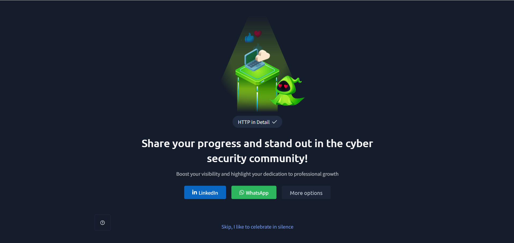

# TryHackMe – HTTP in Detail

## Lab Completion Proof

*Screenshot showing completion of the HTTP in Detail room on TryHackMe.*

## Overview

I completed the **HTTP in Detail** room in the Pre Security learning path on TryHackMe.

This lab introduced me to HTTP and how communication takes place between a web browser and a web server. I learned about HTTP requests and responses, URLs, HTTP methods, status codes, headers, cookies, and tokens.

I also understood the importance of HTTPS and how cookies and tokens help maintain information between requests.

## What I Learned

### 1. What Is HTTP?

- Learned that HTTP stands for Hypertext Transfer Protocol.
- Understood that HTTP is a protocol used for communication between a web browser (client) and a web server.
- Learned how a browser sends requests to a server and receives responses.
- Understood that HTTP is used to transfer information such as web pages and other website resources.

### 2. What Is the Purpose of HTTP?

- Learned that HTTP allows clients and servers to communicate with each other.
- Understood how a browser requests information from a web server.
- Learned how the server processes the request and sends the requested information back to the browser.
- Understood that HTTP makes it possible to access websites and exchange data over the web.

### 3. What Is HTTPS?

- Learned that HTTPS stands for Hypertext Transfer Protocol Secure.
- Understood that HTTPS is the secure version of HTTP.
- Learned that HTTPS uses encryption to protect the communication between a browser and a web server.
- Understood that HTTPS helps protect information transferred between the client and server.

### 4. Why Is HTTPS Important?

- Learned why secure communication is important when accessing websites.
- Understood that HTTP does not encrypt the communication between the browser and server.
- Learned that HTTPS protects transmitted information through encryption.
- Understood why HTTPS is important when sending sensitive information, such as login credentials and personal details.

### 5. What Is a URL?

- Learned that URL stands for Uniform Resource Locator.
- Understood that a URL is the address used to locate a resource on the Internet.
- Learned how a URL tells the browser where to find a particular resource.
- Understood that a URL contains different parts, and each part has its own purpose.

### 6. Different Parts of a URL

Learned about the different components of a URL and what each component represents.

| Component | Purpose |
|---|---|
| Scheme | Specifies the protocol used to access the resource, such as HTTP or HTTPS. |
| User | Contains user information that may be used for authentication. |
| Host | Identifies the server or domain name where the resource is located. |
| Port | Specifies the port used to connect to the server. |
| Path | Identifies the specific resource or location on the server. |
| Query String | Contains additional information sent to the server, usually as key-value pairs. |
| Fragment | Points to a specific section of a webpage or resource. |

### 7. Making an HTTP Request

- Learned how an HTTP request is made when a user accesses a website.
- Understood that the browser acts as a client and sends a request to the web server.
- Learned that the server processes the request and sends an HTTP response.
- Understood that the response contains information that the browser uses to display the requested content.
- Learned how requests and responses form the basic communication process between a client and server.

### 8. What Are HTTP Methods?

- Learned that HTTP methods specify the action that a client wants to perform on a resource.
- Understood that different methods are used for different types of operations.
- Learned about common HTTP methods and their purposes.

| HTTP Method | Purpose |
|---|---|
| GET | Requests information or a resource from the server. |
| POST | Sends data to the server, usually to create or submit something. |
| PUT | Creates or updates a resource. |
| DELETE | Deletes a specified resource. |
| PATCH | Makes partial updates to a resource. |
| HEAD | Requests the response headers without the response body. |
| OPTIONS | Requests information about the communication options available for a resource. |

### 9. What Are HTTP Status Codes?

- Learned that HTTP status codes are numerical codes returned by a web server in response to an HTTP request.
- Understood that these codes indicate whether a request was successful, redirected, or resulted in an error.
- Learned how status codes help identify the result of communication between a client and server.

### 10. Five Categories of HTTP Status Codes

Learned that HTTP status codes are divided into five main categories.

| Category | Meaning |
|---|---|
| 1xx – Informational | Indicates that the request has been received and the process is continuing. |
| 2xx – Success | Indicates that the request was successfully received and processed. |
| 3xx – Redirection | Indicates that further action is needed to complete the request, usually through redirection. |
| 4xx – Client Error | Indicates that there is an error with the request sent by the client. |
| 5xx – Server Error | Indicates that the server failed to complete a valid request. |

### 11. Common HTTP Status Codes

Learned about some commonly used HTTP status codes and their meanings.

| Status Code | Meaning |
|---|---|
| 200 – OK | The request was successful. |
| 201 – Created | The resource was successfully created. |
| 301 – Moved Permanently | The requested resource has been permanently moved to another URL. |
| 302 – Found | The requested resource is temporarily available at another URL. |
| 400 – Bad Request | The server cannot process the request because of a client-side error. |
| 401 – Unauthorized | Authentication is required to access the requested resource. |
| 403 – Forbidden | The client does not have permission to access the requested resource. |
| 404 – Not Found | The requested resource could not be found. |
| 405 – Method Not Allowed | The HTTP method is not supported for the requested resource. |
| 500 – Internal Server Error | The server encountered an unexpected problem. |
| 503 – Service Unavailable | The server is currently unable to handle the request. |

### 12. What Are HTTP Headers?

- Learned that HTTP headers are additional pieces of information included in HTTP requests and responses.
- Understood that headers provide details about the communication between the client and server.
- Learned that headers are written as key-value pairs.
- Understood that request headers provide information about the client and its request, while response headers provide information about the server's response.

### 13. Common Request Headers

- Learned that request headers are sent by the client to the server along with an HTTP request.
- Understood that these headers provide information about the browser, requested content, and other details.

| Request Header | Purpose |
|---|---|
| Host | Specifies the host or domain name of the server being requested. |
| User-Agent | Provides information about the client, such as the browser and operating system. |
| Content-Length | Specifies the size of the request body in bytes. |
| Accept-Encoding | Indicates which compression methods the client supports. |
| Cookie | Sends stored cookies from the client to the server. |

### 14. Common Response Headers

- Learned that response headers are sent by the server along with an HTTP response.
- Understood that these headers provide information about the server and the returned content.

| Response Header | Purpose |
|---|---|
| Set-Cookie | Sends a cookie from the server to the browser so it can be stored. |
| Cache-Control | Provides instructions about how the response should be cached. |
| Content-Type | Specifies the type of content being returned by the server. |
| Content-Encoding | Indicates the compression method used for the response body. |
| Server | Provides information about the web server software handling the request. |

### 15. What Are Cookies?

- Learned that cookies are small pieces of data stored on the user's computer or browser.
- Understood that websites use cookies to store information about users.
- Learned that cookies can help websites remember users and their preferences.
- Understood that cookies are useful because HTTP is a stateless protocol.

### 16. Why Are Cookies Needed?

- Learned that HTTP does not automatically remember previous requests.
- Understood that each HTTP request is treated independently.
- Learned that cookies help websites remember information between different requests.
- Understood that cookies can be used to remember login sessions, user preferences, and whether a user has visited a website before.

### 17. How Do Cookies Work?

- Learned how cookies are created and exchanged between a web server and a browser.
- Understood that the server sends a cookie using the `Set-Cookie` response header.
- Learned that the browser stores the received cookie.
- Understood that when the browser makes another request to the same website, it sends the stored cookie using the `Cookie` request header.
- Learned how the server uses the cookie information to recognise the user or remember certain information.

### 18. What Is a Token?

- Learned about tokens and how they are used to maintain information about a user's authentication.
- Understood that a token can be issued by a server after a user successfully authenticates.
- Learned that the client can send the token with subsequent requests to prove its authenticated status.
- Understood that tokens can be used to maintain user sessions without requiring the user to enter login credentials for every request.

## Practical Experience

During this lab, I learned how HTTP communication works between a browser and a web server.

While exploring the different topics, I gained an understanding of:

- Understanding the difference between HTTP and HTTPS.
- Identifying the different parts of a URL.
- Understanding how HTTP requests and responses work.
- Learning about different HTTP methods.
- Identifying HTTP status codes and their categories.
- Understanding request and response headers.
- Learning how cookies are created, stored, and sent between a browser and server.
- Understanding how tokens are used in authentication.

This lab helped me understand the basic working of web communication and how information is exchanged between clients and servers.

## SOC Analyst Relevance

Understanding HTTP is useful for a SOC Analyst because web traffic is an important part of network and security monitoring.

The concepts learned in this lab provide a foundation for:

- Understanding HTTP requests and responses during network traffic analysis.
- Identifying unusual HTTP methods used in web requests.
- Understanding HTTP status codes when investigating web-related errors or suspicious activity.
- Analysing request and response headers to understand web communication.
- Understanding cookies and tokens when investigating authentication and session-related activity.
- Understanding the importance of HTTPS when analysing secure web communication.

As I continue preparing for a SOC Analyst Level 1 role, this knowledge will help me understand web traffic and investigate security-related activities involving web applications.

## Key Takeaways

- HTTP is a protocol used for communication between a client and a web server.
- HTTPS is the secure version of HTTP that uses encryption.
- A URL is the address used to locate a resource on the Internet.
- HTTP requests and responses allow clients and servers to exchange information.
- HTTP methods define the action a client wants to perform.
- HTTP status codes indicate the result of a request.
- HTTP headers provide additional information about requests and responses.
- Cookies help websites remember information between requests.
- Tokens can be used to maintain authentication between requests.
- Understanding HTTP communication is useful for web traffic analysis and SOC investigations.

## Lab Details

- **Platform:** TryHackMe
- **Learning Path:** Pre Security
- **Room:** HTTP in Detail
- **Status:** Completed

## Disclaimer

These notes document my learning from an authorized TryHackMe lab environment and are intended for educational purposes.