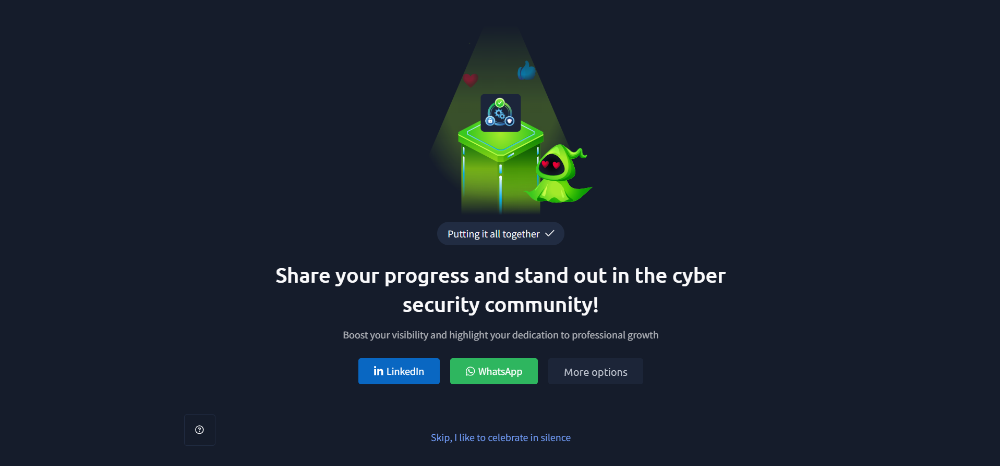

# TryHackMe – Putting It All Together

## Lab Completion Proof

*Screenshot showing completion of the Putting It All Together room on TryHackMe.*

## Overview

I completed the **Putting It All Together** room in the Pre Security learning path on TryHackMe.

This lab helped me understand how different components of a website work together to deliver content to users. I learned about the complete website request process, load balancers, Content Delivery Networks (CDNs), databases, Web Application Firewalls (WAFs), and web servers.

I also learned about virtual hosts, static and dynamic content, frontend and backend components, and the different scripting and backend languages used to build websites.

## What I Learned

### 1. Overview

- Learned how different components work together to make a website function.
- Understood how a user's request travels through different systems before the requested webpage is displayed.
- Learned about the role of load balancers, CDNs, databases, WAFs, and web servers.
- Understood how these components help websites handle requests, deliver content, and protect against potential attacks.

### 2. How Does a Website Request Work?

- Learned how a website request travels from a user's browser to the web server.
- Understood that when a user enters a website address, the browser sends a request to access the website.
- Learned that the request may pass through different components, such as a CDN, WAF, and load balancer, before reaching the web server.
- Understood that the server processes the request and sends the required response back to the browser.
- Learned how different components work together to deliver the requested webpage.

### 3. Complete Website Request Flow

- Learned about the complete process involved when a user accesses a website.
- Understood how different systems handle the request before it reaches the web server.
- Learned that the request may pass through the following components:

  1. **User's Browser:** Sends a request to access a website.
  2. **CDN:** Checks whether the requested content is available in its cache.
  3. **WAF:** Inspects incoming requests and checks for potentially malicious activity.
  4. **Load Balancer:** Distributes incoming requests across available web servers.
  5. **Web Server:** Receives the request and handles the requested content.
  6. **Backend:** Processes the request and performs the required operations.
  7. **Database:** Stores and provides the information requested by the backend.
  8. **Response:** The requested content is returned to the user's browser.

- Understood how these components work together to make a website accessible and functional.

### 4. What Is a Load Balancer?

- Learned that a load balancer distributes incoming network traffic across multiple servers.
- Understood that it prevents a single server from handling all incoming requests.
- Learned how load balancers help improve website performance and availability.
- Understood that distributing requests helps prevent individual servers from becoming overloaded.

### 5. How Does a Load Balancer Work?

- Learned how a load balancer receives incoming requests from users.
- Understood that it selects an available server to handle each request.
- Learned how the selected server processes the request and returns the response.
- Understood that the load balancer distributes requests across multiple servers to manage traffic efficiently.

### 6. Load Balancing Algorithms

- Learned that load balancers use different algorithms to decide which server should receive an incoming request.
- Understood that different algorithms distribute traffic in different ways.
- Learned about common load balancing algorithms.

| Algorithm | Purpose |
|---|---|
| Round Robin | Distributes requests between servers one after another in a repeating order. |
| Weighted Round Robin | Distributes requests based on the assigned weight of each server. |
| Least Connections | Sends new requests to the server with the fewest active connections. |
| IP Hash | Uses the client's IP address to determine which server receives the request. |

### 7. Health Checks

- Learned that health checks are used to monitor whether servers are working properly.
- Understood that a load balancer regularly checks the availability of its servers.
- Learned that if a server becomes unhealthy or stops responding, the load balancer can stop sending requests to it.
- Understood that health checks help maintain website availability.

### 8. What Is a CDN (Content Delivery Network)?

- Learned that CDN stands for Content Delivery Network.
- Understood that a CDN is a network of servers distributed across different geographical locations.
- Learned that CDNs help deliver website content to users from a server that is closer to their location.
- Understood that CDNs are commonly used to deliver static content such as images, CSS files, and JavaScript files.
- Learned how CDNs help reduce loading time and improve website performance.

### 9. How Does a CDN Work?

- Learned how a CDN stores copies of website content on multiple servers located in different regions.
- Understood that when a user requests content, the CDN checks whether the requested content is available in its cache.
- Learned that if the content is available, the CDN can deliver it directly to the user.
- Understood that if the content is not available in the cache, the CDN may request it from the original server and cache it for future requests.
- Learned how this process reduces the need to contact the original server for every request.

### 10. What Are Databases?

- Learned that databases are used to store and organise information.
- Understood that websites use databases to store information such as user accounts, passwords, product details, and other website data.
- Learned how backend applications communicate with databases to retrieve, insert, update, and delete information.
- Understood that databases are an important part of dynamic websites.

### 11. Common Databases

- Learned about commonly used database systems.
- Understood that different databases are used to store and manage website information.

| Database | Description |
|---|---|
| MySQL | A relational database management system that stores data in tables. |
| Microsoft SQL Server | A relational database system developed by Microsoft. |
| PostgreSQL | An open-source relational database management system. |
| MongoDB | A NoSQL database that stores data in document format. |
| SQLite | A lightweight database that stores information in a single file. |

### 12. What Is a WAF (Web Application Firewall)?

- Learned that WAF stands for Web Application Firewall.
- Understood that a WAF helps protect web applications by monitoring and filtering incoming HTTP and HTTPS traffic.
- Learned that it checks incoming requests for potentially malicious activity.
- Understood that a WAF can help protect websites against common web application attacks.

### 13. What Does a WAF Check?

- Learned that a WAF inspects incoming web requests before they reach the web application.
- Understood that it checks different parts of a request for suspicious or potentially harmful content.
- Learned that a WAF can inspect:
  - HTTP request methods.
  - Request headers.
  - Request body.
  - URL and query parameters.
  - Suspicious input patterns.
- Understood that these checks help identify potentially malicious requests.

### 14. What Is Rate Limiting?

- Learned that rate limiting controls how many requests a user or client can make within a specific period.
- Understood that websites use rate limiting to prevent excessive requests.
- Learned that it helps protect web applications from abuse and certain types of automated attacks.
- Understood that rate limiting can help reduce the impact of request flooding and brute-force attempts.

### 15. What Happens When a WAF Detects an Attack?

- Learned that a WAF checks incoming requests against its security rules.
- Understood that when a request is identified as potentially malicious, the WAF can take action based on its configuration.
- Learned that a WAF may block the request before it reaches the web application.
- Understood that some WAFs can also log suspicious requests for further investigation.
- Learned how WAFs help reduce the risk of malicious traffic reaching a website.

### 16. What Is a Web Server?

- Learned that a web server is software that listens for incoming connections and uses HTTP or HTTPS to deliver web content to clients.
- Understood that web servers receive requests from browsers and send the requested website resources back.
- Learned that web servers deliver files from a location known as the root directory.
- Understood that the root directory is defined in the web server's configuration.

### 17. Common Web Server Software

- Learned about commonly used web server software.
- Understood that different web servers are used to receive requests and deliver website content.

| Web Server | Description |
|---|---|
| Apache | A widely used open-source web server. |
| Nginx | A web server commonly used for handling web traffic and reverse proxy operations. |
| Microsoft IIS | A web server developed by Microsoft for Windows systems. |
| Node.js | A JavaScript runtime commonly used to build server-side web applications. |

### 18. Web Server Root Directory

- Learned that a web server root directory is the location where website files are stored.
- Understood that web servers use this directory to locate and deliver requested website content.
- Learned that the root directory is configured in the web server settings.
- Understood that the location of the root directory can differ depending on the web server software and operating system.

### 19. Web Server Operating System Default Root Directory

- Learned about the default root directory locations used by different web server software.
- Understood that different web servers may use different default locations to store website files.
- Learned that knowing these locations can help when working with web server configurations.

| Web Server | Default Root Directory |
|---|---|
| Apache (Ubuntu) | `/var/www/html` |
| Nginx (Ubuntu) | `/var/www/html` |
| IIS (Windows) | `C:\inetpub\wwwroot` |

### 20. What Are Virtual Hosts?

- Learned that virtual hosts allow multiple websites to run on a single web server.
- Understood that each website can have its own domain name and configuration.
- Learned that virtual hosting helps host multiple websites without requiring a separate physical server for each website.

### 21. How Do Virtual Hosts Work?

- Learned how a web server uses virtual hosts to identify which website a user wants to access.
- Understood that multiple websites can share the same server and IP address.
- Learned that the browser includes the requested hostname in the HTTP request.
- Understood that the web server checks the hostname and uses the matching virtual host configuration.
- Learned how the server delivers content from the correct website's document root.

### 22. Static vs Dynamic Content

- Learned the difference between static and dynamic website content.
- Understood that static content is delivered as stored, while dynamic content can change depending on user input or other conditions.

| Static Content | Dynamic Content |
|---|---|
| Content remains the same for users unless the stored file is changed. | Content can change depending on user input, data, or other conditions. |
| Usually served directly from the web server or CDN. | Usually generated or processed by backend applications. |
| Examples include HTML files, images, CSS, and JavaScript files. | Examples include personalised dashboards, search results, and user account information. |

### 23. Frontend vs Backend

- Learned about the two main parts involved in website development.
- Understood that the frontend handles the part of the website users interact with.
- Learned that the backend handles server-side operations and processes requests.
- Understood how both components communicate to provide website functionality.

| Frontend | Backend |
|---|---|
| The part of the website users can see and interact with. | The part that works behind the scenes. |
| Handles the layout and appearance of a website. | Handles application logic and data processing. |
| Commonly uses HTML, CSS, and JavaScript. | Uses server-side programming languages and databases. |
| Runs mainly in the user's browser. | Runs on the server. |

### 24. Scripting and Backend Languages

- Learned that scripting and backend languages are used to create the functionality of websites.
- Understood that these languages help process requests and perform operations on the server.
- Learned about commonly used backend languages.

| Language | Purpose |
|---|---|
| PHP | Used for server-side web development. |
| Python | Used for backend development and handling server-side operations. |
| JavaScript (Node.js) | Used to run JavaScript on the server side. |
| Ruby | Used for server-side web application development. |
| C# | Used for backend development, commonly with the .NET framework. |
| Java | Used to develop server-side applications and web services. |

### 25. What Can Backend Languages Do?

- Learned that backend languages handle operations that users cannot directly see.
- Understood that backend languages process requests received from the frontend.
- Learned that they can communicate with databases to retrieve and store information.
- Understood that backend languages can perform user authentication and manage user sessions.
- Learned that they can process user input and generate dynamic website content.
- Understood how backend languages help connect different parts of a website.

## Practical Experience

During this lab, I learned how the different components of a website work together to handle user requests and deliver content.

While exploring the different topics, I gained hands-on experience and understanding of:

- Understanding the complete website request flow.
- Learning how load balancers distribute incoming requests.
- Understanding load balancing algorithms and health checks.
- Learning how CDNs deliver website content.
- Understanding how databases store and manage information.
- Learning how WAFs inspect and filter incoming web traffic.
- Understanding rate limiting and how it helps control excessive requests.
- Learning how web servers deliver website files.
- Understanding web server root directories and virtual hosts.
- Differentiating between static and dynamic content.
- Understanding the difference between frontend and backend components.
- Learning about scripting and backend languages.

This lab helped me understand how different website components work together to handle requests, deliver content, and maintain website availability and security.

## SOC Analyst Relevance

Understanding how websites work is useful for a SOC Analyst because web applications involve multiple components that can be targeted during cyberattacks.

The concepts learned in this lab provide a foundation for:

- Understanding how web requests travel through different network and application components.
- Identifying suspicious traffic passing through web servers and load balancers.
- Understanding how CDNs handle and deliver website content.
- Analysing database-related activity during security investigations.
- Understanding how WAFs detect and block potentially malicious requests.
- Recognising excessive requests and possible brute-force or denial-of-service activity.
- Understanding web server configurations and virtual hosts.
- Identifying differences between frontend and backend operations.
- Understanding how backend applications process user requests and interact with databases.

As I continue preparing for a SOC Analyst Level 1 role, this knowledge will help me understand web application architecture and investigate suspicious activities involving websites and their supporting infrastructure.

## Key Takeaways

- A website uses multiple components that work together to deliver content.
- A load balancer distributes incoming requests across multiple servers.
- Load balancing algorithms decide how requests are distributed.
- Health checks help identify unavailable or unhealthy servers.
- A CDN delivers website content from geographically distributed servers.
- Databases store and manage website information.
- A WAF monitors and filters incoming web traffic.
- Rate limiting controls the number of requests made within a specific period.
- Web servers receive requests and deliver website content.
- The root directory stores the website files served by a web server.
- Virtual hosts allow multiple websites to run on a single server.
- Static content is delivered as stored, while dynamic content can change based on different conditions.
- The frontend handles user interaction, while the backend handles server-side operations.
- Backend languages process requests, communicate with databases, and generate dynamic content.
- Understanding website architecture is useful for cybersecurity and SOC investigations.

## Lab Details

- **Platform:** TryHackMe
- **Learning Path:** Pre Security
- **Room:** Putting It All Together
- **Status:** Completed

## Disclaimer

These notes document my learning from an authorized TryHackMe lab environment and are intended for educational purposes.