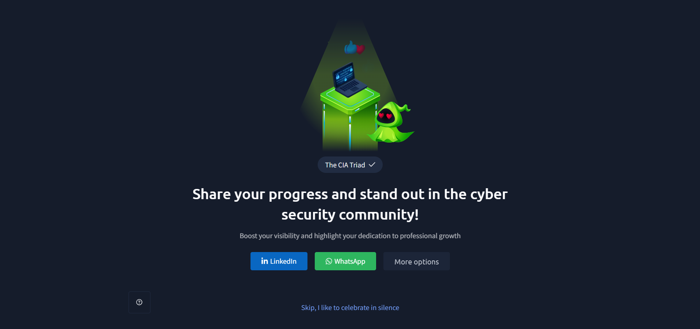

# TryHackMe – CIA Triad

## Lab Completion Proof

*Screenshot showing completion of the CIA Triad room on TryHackMe.*

## Overview

I completed the **CIA Triad** room in the Pre Security learning path on TryHackMe.

This lab introduced me to the CIA Triad, which is one of the basic concepts of cybersecurity. I learned about its three main principles: Confidentiality, Integrity, and Availability.

I also understood how security professionals use these three principles to identify the impact of security incidents and evaluate whether sensitive information, data, or systems have been affected.

## What I Learned

### 1. Introduction to the CIA Triad

- Learned about the CIA Triad and its importance in cybersecurity.
- Understood that it provides a basic framework for protecting information and systems.
- Learned that the CIA Triad consists of three main principles: Confidentiality, Integrity, and Availability.
- Understood how these three principles help security professionals think about different security risks and incidents.

### 2. What Is the CIA Triad?

- Learned that CIA stands for Confidentiality, Integrity, and Availability.
- Understood the purpose of each principle:
  - **Confidentiality:** Ensures that sensitive information is only accessible to authorised individuals.
  - **Integrity:** Ensures that data remains accurate and is not modified without permission.
  - **Availability:** Ensures that systems, services, and information remain accessible when needed.
- Learned that all three principles play an important role in protecting digital information.

### 3. How Do Security Professionals Use the CIA Triad?

- Learned that security professionals use the CIA Triad as a framework when investigating security incidents.
- Understood that they examine an incident to identify which part of the CIA Triad has been affected.
- Learned that they generally ask three important questions:
  - Was sensitive data exposed to unauthorised individuals?
  - Was data modified without permission?
  - Were systems or services unavailable?
- Understood how these questions help identify the impact of a security incident.

### 4. Confidentiality – Was Sensitive Data Exposed?

- Learned that Confidentiality focuses on protecting sensitive information from unauthorised access.
- Understood that only authorised users should be able to access private or sensitive data.
- Learned that unauthorised access or exposure of confidential information can affect confidentiality.
- Understood why protecting sensitive information is important for maintaining privacy and security.
- Learned that security professionals check whether sensitive data was exposed during a security incident.

### 5. Integrity – Was Data Modified Without Permission?

- Learned that Integrity focuses on maintaining the accuracy and consistency of data.
- Understood that information should not be modified without proper authorisation.
- Learned that unauthorised changes to files, databases, or other information can affect integrity.
- Understood why maintaining the correctness of information is important.
- Learned that security professionals investigate whether data was changed or modified without permission during an incident.

### 6. Availability – Were Systems or Services Unavailable?

- Learned that Availability ensures that systems, services, and information are accessible when required.
- Understood that users should be able to access systems and services when they need them.
- Learned that system failures, network problems, or attacks can affect availability.
- Understood that unavailable systems or services can interrupt normal operations.
- Learned that security professionals check whether an incident caused any system or service to become unavailable.

### 7. Why Is Understanding the CIA Triad Important?

- Learned that the CIA Triad provides a simple way to understand different aspects of information security.
- Understood how Confidentiality, Integrity, and Availability help identify the impact of security incidents.
- Learned that it helps security professionals understand what was affected during an attack.
- Understood why protecting sensitive information, maintaining data accuracy, and keeping systems available are all important.
- Learned how the CIA Triad helps develop a security mindset when analysing cybersecurity incidents.

## Practical Experience

During this lab, I learned how the CIA Triad is used to understand and evaluate the impact of security incidents.

While exploring the different topics, I gained a better understanding of:

- Understanding the three principles of the CIA Triad.
- Identifying situations where sensitive information is exposed.
- Understanding how unauthorised data modifications affect integrity.
- Identifying situations where systems or services become unavailable.
- Understanding how security professionals use the CIA Triad during incident investigations.
- Analysing security incidents by checking their impact on Confidentiality, Integrity, and Availability.

This lab helped me understand that cybersecurity is not only about preventing attacks but also about identifying what has been affected when a security incident occurs.

## SOC Analyst Relevance

Understanding the CIA Triad is important for a SOC Analyst because it helps identify and understand the impact of security incidents.

The concepts learned in this lab provide a foundation for:

- Identifying incidents involving unauthorised access or sensitive data exposure.
- Understanding data modification and possible integrity-related issues.
- Investigating situations where systems or services become unavailable.
- Evaluating the impact of security incidents on an organisation.
- Understanding which part of information security has been affected during an attack.
- Using Confidentiality, Integrity, and Availability as a basic framework during security investigations.

As I continue preparing for a SOC Analyst Level 1 role, the CIA Triad will help me understand the impact of different security incidents and analyse them from a security perspective.

## Key Takeaways

- CIA stands for Confidentiality, Integrity, and Availability.
- Confidentiality ensures that sensitive information is accessed only by authorised individuals.
- Integrity ensures that data remains accurate and is not modified without permission.
- Availability ensures that systems, services, and information remain accessible when needed.
- Security professionals use the CIA Triad to understand the impact of security incidents.
- Confidentiality focuses on whether sensitive data was exposed.
- Integrity focuses on whether data was modified without permission.
- Availability focuses on whether systems or services became unavailable.
- Understanding the CIA Triad helps develop a basic security mindset.
- The CIA Triad is an important foundation for cybersecurity and SOC investigations.

## Lab Details

- **Platform:** TryHackMe
- **Learning Path:** Pre Security
- **Room:** CIA Triad
- **Status:** Completed

## Disclaimer

These notes document my learning from an authorized TryHackMe lab environment and are intended for educational purposes.