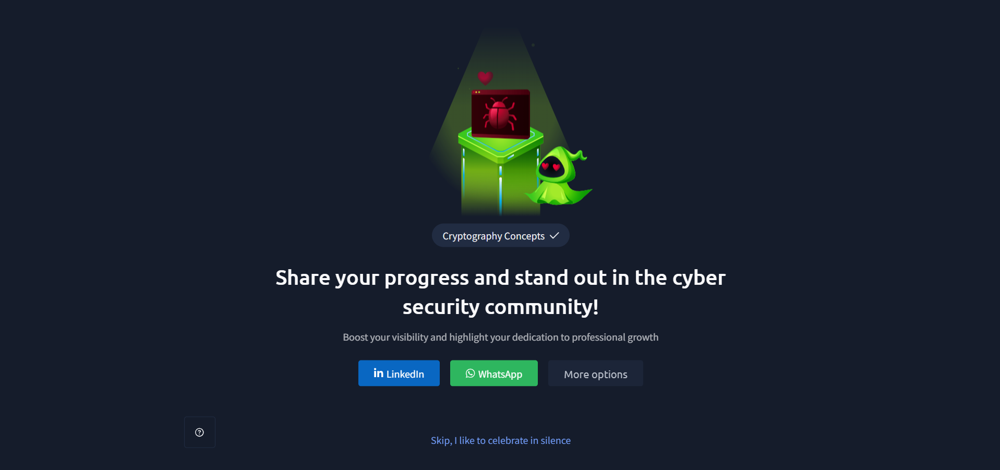

# TryHackMe – Cryptography Concepts

## Lab Completion Proof

*Screenshot showing the successful completion of the Cryptography Concepts room on TryHackMe.*

## Overview

In this room, I learned about the basic concepts of cryptography and why it is important in cybersecurity. Cryptography helps protect information by converting readable data into a format that cannot be easily understood by unauthorised people.

I also learned how cryptography works and explored two important types of encryption: symmetric encryption and asymmetric encryption.

## What I Learned

### 1. Why Does Cryptography Matter?

Cryptography is important because it helps protect sensitive information from unauthorised access. When data is transmitted or stored, it needs protection so that only authorised people can access and understand it.

It is commonly used to protect information during communication and to keep sensitive data secure.

### 2. What Is Cryptography?

Cryptography is the practice of securing information by converting readable data into an unreadable format.

The original readable information is called **plaintext**, while the converted unreadable information is called **ciphertext**.

Encryption converts plaintext into ciphertext, and decryption converts ciphertext back into plaintext.

### 3. How Does Cryptography Help?

Cryptography helps protect information in different ways:

- It prevents unauthorised people from reading sensitive information.
- It helps secure data during communication.
- It protects information from being easily understood if someone gains access to it.
- It helps maintain the security of digital information.

### 4. Symmetric Encryption

Symmetric encryption is a type of encryption that uses the **same key** for both encryption and decryption.

The sender uses a key to encrypt the original information, and the receiver uses the same key to decrypt it.

**How it works:**

1. The sender has the original readable data (plaintext).
2. The sender encrypts the data using a secret key.
3. The encrypted data (ciphertext) is sent to the receiver.
4. The receiver uses the same secret key to decrypt the data.

**Important point:** Both the sender and receiver must have access to the same secret key.

### 5. Asymmetric Encryption

Asymmetric encryption is a type of encryption that uses **two different keys**:

- **Public Key:** Can be shared with other people.
- **Private Key:** Must be kept secret by its owner.

These two keys work together to encrypt and decrypt information.

**How it works:**

1. The receiver shares their public key with the sender.
2. The sender uses the receiver's public key to encrypt the information.
3. The encrypted information is sent to the receiver.
4. The receiver uses their private key to decrypt the information.

**Important point:** The public key can be shared, but the private key must remain secret.

## Practical Experience

During this room, I explored the basic concepts of cryptography and learned how encryption protects information.

I also understood the difference between symmetric and asymmetric encryption, including how their keys are used during encryption and decryption.

## SOC Analyst Relevance

Understanding cryptography is useful for a SOC Analyst because it helps in understanding how sensitive information is protected during communication and storage.

It also provides basic knowledge of encryption methods that may be encountered while investigating security-related activities.

## Key Takeaways

- Cryptography helps protect sensitive information.
- Plaintext is the original readable data.
- Ciphertext is the encrypted, unreadable data.
- Encryption converts plaintext into ciphertext.
- Decryption converts ciphertext back into plaintext.
- Symmetric encryption uses the same key for encryption and decryption.
- Asymmetric encryption uses a public key and a private key.

## Lab Details

- **Platform:** TryHackMe
- **Learning Path:** Pre Security
- **Room:** Cryptography Concepts
- **Status:** Completed

## Disclaimer

These notes document my learning from an authorized TryHackMe lab environment and are intended for educational purposes.