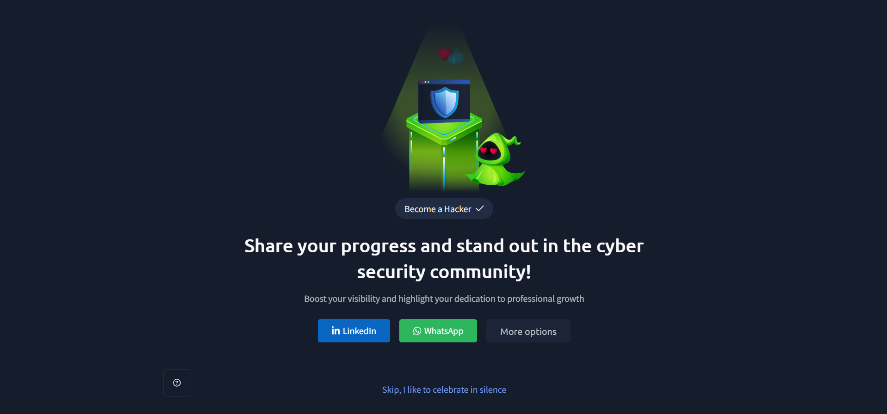

# TryHackMe – Become a Hacker

## Lab Completion Proof

*Screenshot showing the successful completion of the Become a Hacker room on TryHackMe.*

## Overview

In this room, I learned about the basics of offensive security and how to think like a hacker. I explored what hacking means, how offensive security works, and some important terms used in ethical hacking.

I also learned why permission is important when performing security testing and how attackers can combine multiple weaknesses to achieve a bigger impact.

In the practical section, I got an introduction to tools like **Gobuster** and **Hydra** and gained hands-on experience using them in the TryHackMe lab environment.

## What I Learned

### 1. What Is Offensive Security?

Offensive security is a cybersecurity approach where security professionals actively test systems, networks, and applications to find security weaknesses.

The main goal is to identify vulnerabilities before malicious attackers can exploit them.

### 2. Thinking Like a Hacker

Thinking like a hacker means looking at systems from an attacker's point of view.

Instead of only thinking about how a system is supposed to work, we try to understand:

- What weaknesses might exist?
- Which parts of the system could be vulnerable?
- How could an attacker take advantage of those weaknesses?
- Can multiple weaknesses be combined to cause more damage?

This way of thinking helps security professionals discover problems and improve security.

### 3. What Is Hacking?

Hacking is the process of finding and using weaknesses in computer systems, networks, or applications.

Hacking can be performed for different purposes. Ethical hackers use their skills to identify security weaknesses and help organisations fix them, while malicious attackers may exploit weaknesses for harmful purposes.

### 4. Offensive Security Introduction

Offensive security focuses on testing the security of systems by simulating techniques that real attackers might use.

It helps organisations understand how their systems could be attacked and what security improvements are needed.

### 5. Core Offensive Security Terms

During this room, I was introduced to some important terms related to offensive security and ethical hacking.

Understanding these terms helps when learning about security testing and the techniques used to identify vulnerabilities.

### 6. Importance of Permission in Ethical Hacking

Permission is one of the most important parts of ethical hacking.

Security testing should only be performed on systems for which we have proper authorisation.

Testing systems without permission can be illegal and may cause damage or disruption.

**Important point:** Always get proper permission and stay within the agreed scope before performing any security testing.

### 7. Introduction to Chain Weaknesses

Sometimes, a single security weakness may not cause serious damage on its own. However, attackers can combine multiple weaknesses to achieve a bigger impact.

This is known as chaining weaknesses.

For example, discovering a hidden login page may be one step in an attack. If another weakness is found and combined with it, the attacker may be able to gain access to something more sensitive.

This shows why security professionals should look at how different weaknesses can work together, rather than examining each weakness separately.

## Practical Experience

In the practical section, I was introduced to two tools used in offensive security:

### 1. Gobuster

Gobuster is a tool used for discovering hidden directories and files on websites.

It helps security testers find web resources that may not be directly visible through normal website navigation.

I got hands-on experience using Gobuster in the TryHackMe lab environment.

### 2. Hydra

Hydra is a tool used for testing login services by attempting different username and password combinations.

It can help security professionals identify weak login credentials during authorised security testing.

I also got hands-on experience with Hydra in the TryHackMe lab environment.

## SOC Analyst Relevance

Understanding offensive security is useful for a SOC Analyst because it helps in understanding how attackers think and how they may target systems.

Learning about tools like Gobuster and Hydra also provides basic awareness of activities that may appear during security monitoring.

This knowledge can help SOC Analysts recognise suspicious activities, investigate possible attacks, and understand how attackers may attempt to discover resources or access accounts.

## Key Takeaways

- Offensive security focuses on finding security weaknesses by testing systems.
- Thinking like a hacker helps identify possible attack paths.
- Hacking can be performed for ethical or malicious purposes.
- Ethical hacking requires proper permission and authorisation.
- Multiple weaknesses can be combined to create a bigger security impact.
- Gobuster is used to discover hidden web directories and files.
- Hydra is used to test login services with different username and password combinations.
- Practical experience with security tools helps understand offensive security techniques.

## Lab Details

- **Platform:** TryHackMe
- **Learning Path:** Pre Security
- **Room:** Become a Hacker
- **Status:** Completed

## Disclaimer

These notes document my learning from an authorized TryHackMe lab environment and are intended for educational purposes.