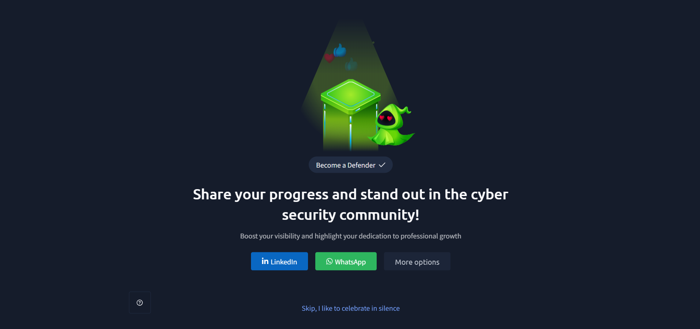

# TryHackMe – Become a Defender

## Lab Completion Proof

*Screenshot showing the successful completion of the Become a Defender room on TryHackMe.*

## Overview

In this room, I learned about the basics of defensive security and the role of a defender in protecting an organisation's systems and infrastructure.

I explored what defensive security means, how the Blue Team works, and why visibility is important for identifying suspicious activities.

I also learned about the different responsibilities of a defender, how to understand a client's infrastructure, how attacks move through an environment, and the key principles that help defenders protect systems.

## What I Learned

### 1. What Is Defensive Security?

Defensive security focuses on protecting systems, networks, and data from cyber threats.

The main goal is to prevent attacks, detect suspicious activities, reduce their impact, and respond to security incidents.

Defenders work to keep an organisation's infrastructure secure and ensure that its systems and services remain protected.

### 2. Understanding the Blue Team

The Blue Team is responsible for defending an organisation's systems and infrastructure against cyber threats.

Their work includes monitoring systems, identifying suspicious activities, investigating potential threats, and responding to security incidents.

The Blue Team focuses on protecting the organisation and reducing security risks.

### 3. Importance of Visibility in Defensive Security

Visibility means having enough information about the systems, devices, networks, and activities within an environment.

It is important because defenders cannot properly protect something they cannot see or monitor.

Having good visibility helps defenders:

- Understand what is happening in the environment.
- Identify suspicious activities.
- Detect possible security threats.
- Investigate security incidents.
- Understand how attacks affect different systems.

### 4. What You Can Do as a Defender

A defender has several responsibilities when protecting an organisation.

#### Prevention

Prevention means taking security measures to stop attacks from happening.

#### Detection

Detection means identifying suspicious activities or possible attacks within an environment.

#### Mitigation

Mitigation focuses on reducing the impact of an attack or security incident.

#### Analysis

Analysis means examining available information to understand what happened, how it happened, and which systems were affected.

#### Response

Response involves taking appropriate actions when a security incident occurs.

#### Improvement

Improvement means learning from previous incidents and making changes to strengthen security.

### 5. What Is Your Scope?

Scope defines the systems, networks, devices, and other resources that a defender is responsible for protecting.

Before defending an environment, it is important to understand what is included in your responsibility.

Knowing the scope helps defenders understand which assets they need to monitor, protect, and investigate.

### 6. Understanding Client Infrastructure

A defender needs to understand the client's infrastructure to identify the systems and resources that need protection.

The room introduced the following components:

#### Employee Device

Employee devices are the computers or other devices used by employees to perform their daily work.

These devices need protection because they may contain important information and provide access to the organisation's resources.

#### Web Server

A web server hosts websites and provides web content to users.

It needs to be monitored and protected because it can be targeted by attackers.

#### Mail Server

A mail server handles the sending and receiving of emails within an organisation.

It is an important part of the infrastructure and needs protection against email-based threats.

#### Firewall

A firewall helps control network traffic based on defined security rules.

It helps protect the organisation's network by controlling which traffic is allowed or blocked.

#### Internet

The internet connects the organisation's infrastructure to external networks and services.

Understanding this connection is important because external communication can introduce security risks.

### 7. The Defender Mindset

The defender mindset means thinking about security from the perspective of protecting an organisation.

A defender should understand the environment, identify possible threats, monitor activities, and consider how an attack could affect the organisation.

Instead of only reacting to attacks, defenders should also think ahead and prepare for possible threats.

### 8. How an Attack Moves Through an Environment

An attack does not always affect only one system. An attacker may move through different devices, servers, and network components within an environment.

Understanding how an attack can move helps defenders identify possible attack paths and recognise which systems may be affected.

This also highlights the importance of monitoring the entire environment instead of focusing on only one device or system.

### 9. Key Defender Principles

There are four important principles that help defenders protect an organisation.

#### Threat Anticipation

Threat anticipation means thinking ahead about possible threats and understanding how attackers might target the environment.

It helps defenders prepare before an attack happens.

#### Attack Awareness

Attack awareness means understanding the different ways attackers may attempt to compromise systems and recognising suspicious activities.

#### Risk Prioritization

Risk prioritization means identifying which security risks are more important and deciding which ones need attention first.

It helps defenders focus on the threats that could cause the greatest impact.

#### Continuous Adaptation

Continuous adaptation means regularly improving security practices based on new threats, changes in the environment, and lessons learned from previous incidents.

Security is not a one-time activity. Defenders need to keep adapting to stay protected.

## Practical Experience

During this room, I explored the responsibilities of a defender and learned how different components of an organisation's infrastructure work together.

I also learned how to think from a defender's perspective, understand the possible movement of attacks through an environment, and apply important defensive security principles.

## SOC Analyst Relevance

Understanding defensive security is directly useful for a SOC Analyst because SOC Analysts are part of the defensive security team.

This knowledge helps in understanding how to monitor an organisation's environment, identify suspicious activities, investigate potential threats, and support incident response.

Understanding client infrastructure and visibility is also important because SOC Analysts need to know which assets they are monitoring and how different systems are connected.

## Key Takeaways

- Defensive security focuses on protecting systems, networks, and data.
- The Blue Team is responsible for defending an organisation against cyber threats.
- Visibility is important because defenders need information about their environment to identify suspicious activities.
- A defender's responsibilities include prevention, detection, mitigation, analysis, response, and improvement.
- Understanding the scope helps identify which assets need protection.
- Client infrastructure can include employee devices, web servers, mail servers, firewalls, and internet connections.
- Understanding how attacks move through an environment helps defenders identify possible attack paths.
- Threat anticipation, attack awareness, risk prioritization, and continuous adaptation are key defender principles.

## Lab Details

- **Platform:** TryHackMe
- **Learning Path:** Pre Security
- **Room:** Become a Defender
- **Status:** Completed

## Disclaimer

These notes document my learning from an authorized TryHackMe lab environment and are intended for educational purposes.