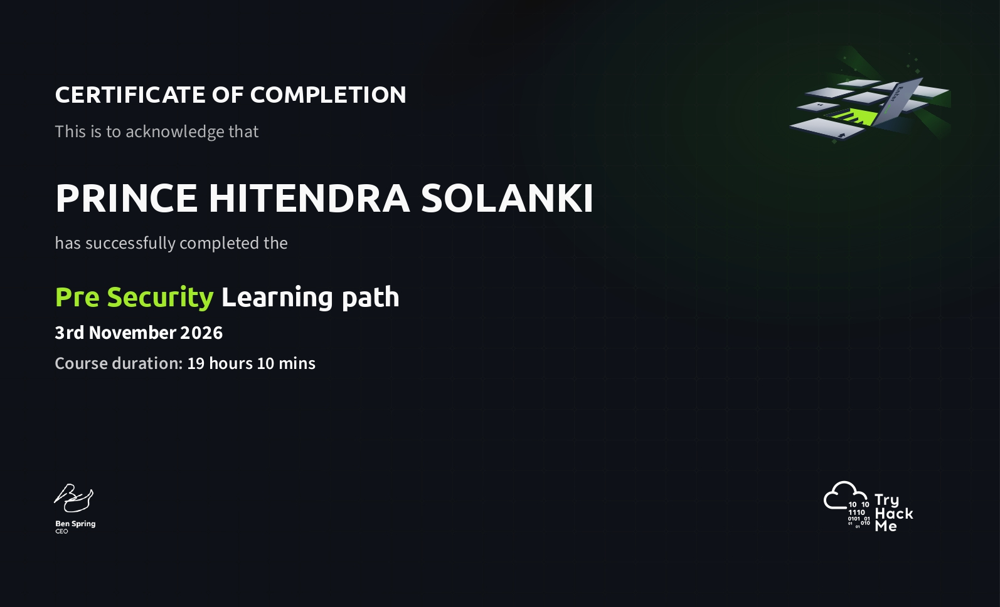

# TryHackMe – Pre Security

## Overview

I have successfully completed the **Pre Security** learning path on TryHackMe. This learning path helped me build a foundation in computer systems, operating systems, software, networking, web technologies, and cybersecurity.

I created this section to keep my lab documentation in one place. Each lab folder contains a README with the concepts I learned, simple notes, and a screenshot showing the room completion.

## Learning Path Completion Certificate

I have included a copy of my Pre Security completion certificate in this repository.

## What I Learned

During this learning path, I studied the following areas:

### 1. Introduction to Cyber Security

- Offensive security
- Defensive security
- Cybersecurity careers

### 2. Computer Fundamentals

- Types of computers
- Client-server basics
- Virtualisation
- Cloud computing

### 3. Operating Systems Basics

- Operating systems
- Windows basics
- Linux command-line basics
- Windows command-line basics
- Operating system security

### 4. Software Basics

- Data representation
- Data encoding
- Python fundamentals
- JavaScript fundamentals
- SQL and database basics

### 5. Network Fundamentals

- Introduction to networking
- Local Area Networks (LAN)
- OSI model
- Packets and frames
- Extending a network

### 6. How the Web Works

- DNS
- HTTP and HTTPS
- How websites work
- Bringing web concepts together

### 7. Attacks and Defenses

- CIA Triad
- Cryptography concepts
- Offensive security mindset
- Defensive security and the role of a defender

## Lab Documentation

I have documented the 30 rooms I completed. Select a lab below to read its README and view its completion screenshot.

### Introduction to Cyber Security

| Lab | Documentation |
|---|---|
| Offensive Security Intro | [View Lab 01](Lab_01/README.md) |
| Defensive Security Intro | [View Lab 02](Lab_02/README.md) |
| Careers in Cyber | [View Lab 03](Lab_03/README.md) |

### Computer Fundamentals

| Lab | Documentation |
|---|---|
| Computer Types | [View Lab 04](Lab_04/README.md) |
| Client-Server Basics | [View Lab 05](Lab_05/README.md) |
| Virtualization Basics | [View Lab 06](Lab_06/README.md) |
| Cloud Computing | [View Lab 07](Lab_07/README.md) |

### Operating Systems Basics

| Lab | Documentation |
|---|---|
| Operating Systems | [View Lab 08](Lab_08/README.md) |
| Windows Basics | [View Lab 09](Lab_09/README.md) |
| Linux CLI | [View Lab 10](Lab_10/README.md) |
| Windows CLI | [View Lab 11](Lab_11/README.md) |
| Operating System Security | [View Lab 12](Lab_12/README.md) |

### Software Basics

| Lab | Documentation |
|---|---|
| Data Representation | [View Lab 13](Lab_13/README.md) |
| Data Encoding | [View Lab 14](Lab_14/README.md) |
| Python: Simple Demo | [View Lab 15](Lab_15/README.md) |
| JavaScript: Simple Demo | [View Lab 16](Lab_16/README.md) |
| Database: SQL Basics | [View Lab 17](Lab_17/README.md) |

### Network Fundamentals

| Lab | Documentation |
|---|---|
| What Is Networking? | [View Lab 18](Lab_18/README.md) |
| Intro to LAN | [View Lab 19](Lab_19/README.md) |
| OSI Model | [View Lab 20](Lab_20/README.md) |
| Packets & Frames | [View Lab 21](Lab_21/README.md) |
| Extending Your Network | [View Lab 22](Lab_22/README.md) |

### How the Web Works

| Lab | Documentation |
|---|---|
| DNS in Detail | [View Lab 23](Lab_23/README.md) |
| HTTP in Detail | [View Lab 24](Lab_24/README.md) |
| How Websites Work | [View Lab 25](Lab_25/README.md) |
| Putting It All Together | [View Lab 26](Lab_26/README.md) |

### Attacks and Defenses

| Lab | Documentation |
|---|---|
| CIA Triad | [View Lab 27](Lab_27/README.md) |
| Cryptography Concepts | [View Lab 28](Lab_28/README.md) |
| Become a Hacker | [View Lab 29](Lab_29/README.md) |
| Become a Defender | [View Lab 30](Lab_30/README.md) |

## How I Documented My Labs

Each lab folder contains:

- `README.md` – an overview of the room, simplified notes, and the main things I learned.
- `screenshot/room-completed.png` – a screenshot showing that I completed the TryHackMe room.

## My Next Step

Completing Pre Security has given me a foundation to continue learning cybersecurity. I plan to build on these concepts through more hands-on labs and continue working towards my goal of becoming a SOC Analyst.

## Disclaimer

This repository contains my personal learning notes and completion evidence from TryHackMe rooms. The content is shared for learning and educational purposes.
